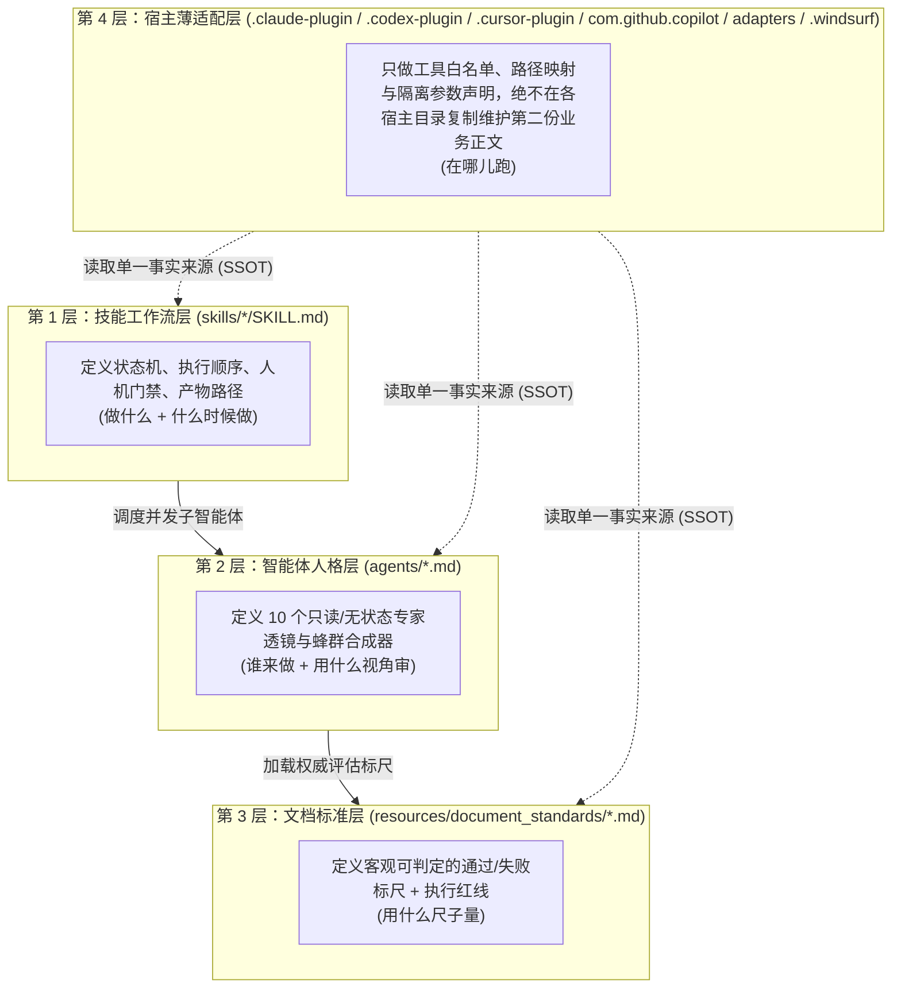

# 大象-金鱼模型（EGM）：从 0 到 1 第一性原理深度学习手册

> **写给想真正吃透这个“宝库”的你**
> 如果你英文不够熟练，但想把 `elephant-goldfish-model`（EGM）从底层思想、架构设计、Prompt 工程技巧，到多宿主适配与自动化测试全部吃透，最终能够**基于它二次创新，甚至从 0 到 1 亲手打造一套属于自己的 AI 工程框架**——这份手册就是为你写的。

---

## 一、第一性原理（First Principles）：EGM 到底在解决什么本质问题？

绝大多数人用 AI 写代码，使用的是**单线程对话式编程（Vibe Coding）**：打开一个聊天框，跟 AI 聊需求，让它出方案，顺手让它检查一下，然后直接改代码。

为什么这种方式在复杂工程中**必然崩塌**？从大语言模型（LLM）的自回归推理机制与信息论出发，有 **4 个结构性失效模式**：

### 1.1 认知冲突：构建者与审计员不能共享同一个大脑
- **自回归模型的确认偏误（Confirmation Bias）**：当同一个上下文窗口既负责提出方案、又负责评审方案时，模型之前吐出的 token 会强烈锚定它后续的概率分布。它天生倾向于为自己先前的假设“自圆其说”，而不是推翻它——这就是 **幻觉级联（Hallucination Cascade）** 与 **上下文污染（Context Pollution）**。
- **第一性原理解法 —— 记忆与角色的物理隔离**：
  - **大象（Elephant，高上下文构建者）**：像大象一样拥有长记忆，加载完整的项目历史、用户旅程、代码地图与前置讨论，负责探索、权衡、起草和辩护。
  - **金鱼（Goldfish，零上下文评审员）**：像金鱼一样“只有 7 秒记忆”——运行在完全隔离的新鲜子智能体上下文（Fresh Context Window）中，**物理剥夺它对父对话历史的访问权**。它只读三样东西：目标文档、被引用的真实代码、以及客观评估标准（Rubric）。如果一份文档连“零背景的新手金鱼”都读不懂，或者被“对抗视角金鱼”抓到漏洞，那它就不合格。
  - **人类（Human，唯一决策者与责任人）**：AI 永远不替人类拍板架构权衡。所有多解权衡、升级议题（`ESCALATE`）和最终落地，必须经过显式的人类审批门禁（Checkpoint Gate）。

### 1.2 海拔坍塌：Coding Agent 天生想钻进“杂草”里
- **痛点（Weeds Syndrome / 杂草综合征）**：AI 编程助手被训练得极其热衷于立刻写代码。你还没想清楚“该不该做、有没有现成代码可复用、系统边界怎么划”，它已经开始写函数和循环了。
- **第一性原理解法 —— 海拔控制（Altitude Control）与语义分割（Semantic Split）**：
  - 在设计阶段设立**硬性写边界**（Phase 1–4 严禁修改业务代码）。
  - 把同一份设计文档从语义分界线（Semantic Split）处一刀切为上下两段行号区间：上半段 **`FeatureRange`（高层特性规格，覆盖背景/架构/备选方案权衡）** 严禁出现具体代码细节（Anti-Weeds）；下半段 **`DetailedRange`（详细实现计划，自 `## Detailed Implementation Plan` 起）** 则强制执行 **零决策规则（Zero-Decision Rule）**——不许把任何架构或设计选择甩锅给后面的编码者，并给出精确的文件修改白名单（`Target Scope & File Boundary`）。

### 1.3 上下文带宽：聊天窗口不是文档编辑器
- **痛点（Chat Dump Fatigue / 聊天倾倒疲劳）**：在聊天框里刷几千字长方案，既撑爆上下文窗口导致注意力稀释，又没法逐行评审和版本化追踪。
- **第一性原理解法 —— 产物优先交互协议（Artifact-First UX）**：
  - 长文档、评审报告、构思简报一律写入持久化文件（`concepts_brief.md`、`design_draft.md`、`goldfish_review_report.md`）。
  - 聊天窗只保留“摘要 + 冲突点 + 人类需要做决定的选项”。

### 1.4 知识衰减：一次性文档必然腐烂
- **痛点（Documentation Drift / 文档漂移）**：代码每天在变，写完就扔的设计文档两周后就成了误导后来者的毒药。
- **第一性原理解法 —— 活体规格（Living Specifications）与低成本代码地图（Peanuts & Hay）**：
  - 用 `egm-bootstrap` 自底向上生成目录级 `README.md` 合约（叶子组件契约像“花生”，顶层架构总览像“干草”），让大象不用每次把几万行源码全塞进上下文。
  - 用 `egm-drift-report` 定期做文档与源码的双向漂移审计，让规格始终是“活的”。

### 1.5 Token 与延迟经济学：何时用全流程 vs `egm-lite`？
- **为什么在规格阶段多花 10 倍评审 Token 反而更省钱？** 在代码实现阶段才发现架构方向错误，返工成本是规格阶段的数十倍，且极易污染工作树。前置的多视角金鱼评审把架构缺陷消灭在写第一行代码之前。
- **按变更规模选型**：跨模块特性或新架构走完整五阶段（`egm-brainstorm` → `egm-draft` → `egm-review` → `egm-resolve`）；局部重构、Bug 修复或小迭代（`<= 100` 行非测试改动）直接走快车道 `egm-lite` 单回合五步状态机。

---

## 二、系统解剖：EGM 的四层正交解耦架构与上下文防火墙

把整个仓库剥开看，EGM 只有 **4 个极其干净、正交解耦的核心层次**。学会这种分层思想，你就能设计任何复杂的多智能体系统：



### 运行时上下文防火墙契约（从 0 到 1 复刻最核心的边界）

| 维度 | 大象（主会话编排者） | 物理隔离边界（派生金鱼时） | 金鱼（新鲜只读子智能体） |
| :--- | :--- | :--- | :--- |
| **可见上下文** | 完整聊天历史、用户偏好、前序草稿辩解、代码库地图 | **彻底切断父会话轮次与自动记忆**（如 `fork_turns: "none"`, `omitClaudeMd: true`） | 仅见：`[目标文档路径, 行号区间, 文档标准路径, 显式可读文件清单]` |
| **工具权限** | 读写工作区、派生子智能体、向人类发起门禁提问 | **强制只读工具投影**（禁用 `edit`/`write`/`bash`，OpenCode 甚至禁用 `grep` 防绕过 `.env`） | 仅允许 `read` / `glob`（若宿主不支持只读隔离则 Fail-Closed 报错停机） |
| **输出职责** | 起草规格、核实代码证据、将评审意见分四类呈交人类 | **结构化移交契约（`SubagentHandback`）** | 仅输出定级发现（`Blocker`/`Major`/`Nit`）或复述；工具失败诚实报 `not run` |

### 为什么“四层正交解耦”如此高明？
1. **改流程不动评审标准**：你想调整评审阶段顺序，只改 `skills/egm-review/SKILL.md`，不用碰 `agents/` 或 `resources/`。
2. **加一种新审查视角零侵入**：比如作者后来把前苏联 **TRIZ（发明问题解决理论）** 融进来做“消除伪妥协”的 `agents/inventive_catalyst.md`，几乎不需要重写主引擎。
3. **支持 6+ 种 AI 工具零漂移**：Claude Code、Codex、Cursor、Copilot、OpenCode、Windsurf 全部指向同一份 `skills/` + `agents/` + `resources/`（**单一事实来源 SSOT**），各宿主只维护几十行的**薄适配器（Thin Adapter）**。

---

## 三、核心工作流全景：8 个技能如何像齿轮一样咬合？

| 阶段 | 技能名称 | 角色 | 核心产出 | 设计精髓（必学点） |
| :--- | :--- | :--- | :--- | :--- |
| **Phase 0 建图** | `egm-bootstrap` | 编排器 + 只读工作子智能体 | 目录级 `README.md` 合约 | **自底向上递归**：先写叶子目录契约，再向上汇总，防止幻觉；严格并发上限 `<= 5` |
| **Phase 1 构思** | `egm-brainstorm` | 大象 + 7 只并发金鱼 | `concepts_brief.md` | **先对齐假设，再七视角压测**：用 7 种完全不同的专家透镜（设计批判/代码库落地/YAGNI 拉远/零背景理解/实现可行性/结构设计/TRIZ 发明催化）提前杀掉坏点子 |
| **Phase 2 起草** | `egm-draft` | 大象 | `design_draft.md` -> `docs/designs/<feat>.md` | **分节编译 + 语义分割**：逐节过人类共识门禁，反向核对是否与 `concepts_brief.md` 矛盾 |
| **Phase 3 评审** | `egm-review` | 5 阶段金鱼流水线 | 各阶段评审报告 | **强制拓扑顺序（5→6→7→8→9）**：编号延续自上游步骤 1–4；先拉远看方向(5)，再做新手理解测试(6)，再审架构(7)，再二次拉远剪除评审诱发的防御性臃肿(8)，最后才审实现细节(9) |
| **通用循环引擎** | `egm-review-loop` | 对抗式循环状态机 | 收敛状态与逐轮报告 | **对抗随机性**：必须连续 **2 轮净轮次（Clean Round）** 才算收敛；区分 `Settled`/`Fixed`/`Churn`，防死循环（最多 5 轮） |
| **Phase 4 裁决** | `egm-resolve` | 大象 + 人类门禁 | `goldfish_review_report.md` | **四分类裁决法**：`PROPOSE FIX`（修）、`CONTEST`（带证据反驳金鱼）、`ESCALATE`（交人类拍板）、`DECLINE`（婉拒） |
| **Phase 5 维护** | `egm-drift-report` | 只读巡检员 | `YYYY-MM-DD_DRIFT_REPORT.md` | **活体规格守护**：顺序比对设计文档与真实源码，抓出过时接口与隐性漂移 |
| **快车道** | `egm-lite` | 单回合状态机 | `egm_lite_checklist.md` | **小任务专用**：用 5 步轻量状态机（先质疑→列清单→审清单→执行→审 Diff）兼顾速度与安全 |

### 几个令人拍案叫绝的细节设计（宝库中的精华）

1. **为什么 Stage 6（`comprehension` 理解测试）严禁经过 `synthesizer` 汇总？**
   - 详见 [`zh-CN/agents/comprehension.md`](agents/comprehension.md) 与 [`zh-CN/skills/egm-review/SKILL.md`](skills/egm-review/SKILL.md)。
   - `comprehension` 金鱼的核心任务是**先复述（Paraphrase First）**：“用你自己的话复述这份文档要改什么、现有系统怎么工作”，然后再找茬。如果经过 `synthesizer` 去重汇总，复述正文会被砍掉——而作者恰恰需要亲眼看到新手的复述有没有理解偏差！
2. **TRIZ 发明催化金鱼（`inventive_catalyst`）如何破解“伪妥协”？**
   - 详见 [`zh-CN/agents/inventive_catalyst.md`](agents/inventive_catalyst.md) 与 [`zh-CN/docs/designs/triz_integration.md`](docs/designs/triz_integration.md)。
   - 工程设计里经常出现“为了安全只能牺牲速度”“为了解耦只能增加复杂度”之类的**伪妥协（False Compromise）**。EGM 把 TRIZ 浓缩为 10 个软件架构发明模式，强迫金鱼寻找**理想最终解（IFR）**，并且强制要求同时写出该方案引入的**次生运维代价**（拒绝纸上谈兵）。
3. **文风编辑（`style`）的声明校准（`DROP | CALIBRATE | RELOCATE | KEEP`）**：
   - 详见 [`zh-CN/agents/style.md`](agents/style.md)。
   - AI 写文档最爱堆砌空洞吹捧词（“革命性的”“无缝的”“极其优雅的”）以及漫天撒网的防御性免责声明。`style` 金鱼用四分类规则精准外科手术式清理水分。
4. **Fail-Closed（失效即阻断）工程哲学**：
   - 详见 [`zh-CN/tests/README.md`](tests/README.md) 与 [`zh-CN/docs/harnesses.md`](docs/harnesses.md)。
   - 如果某个宿主环境不支持真正的隔离只读子智能体，EGM **宁可报错停机，也绝不降级成主会话“角色扮演金鱼”**。
   - 甚至在测试里，连 OpenCode V1 的 `grep` 工具可能绕过 `read` 的 `.env` 权限过滤、以及 JSONL 日志里出现 Unicode 行分隔符 `\u2028`（避免按行切分或 JS 解析时静默破坏合法 Unicode 字符）这种极端边界，都有专门的防御与单元测试！

---

## 四、Prompt 工程与子智能体设计：从源码里偷师的 7 条黄金法则

读完 [`zh-CN/agents/`](agents/) 和 [`zh-CN/resources/execution_instructions.md`](resources/execution_instructions.md)，你会发现 EGM 的 Prompt 写法极其硬核，完全没有花哨辞藻，全是工程约束：

1. **铁律前置 + 明确禁止清单**：所有金鱼 Prompt 开头就锁死三大铁律——严格只读（`Strict Read-Only Protocol`）、无状态思维（`Stateless Mindset`）、禁止奉承与客套闲聊（`No Chitchat` / `No Glazing`）。
2. **一专多能的双模式设计**：同一个评审专家（如 `design_critic`），通过 `Mode: BRAINSTORM`（评估 QPS/成本/Token 经济学）与 `Mode: REVIEW`（按 `feature-spec-standard.md` 审计）复用于两个阶段。
3. **强制结构化返回契约**：规定输出必须包含固定字段（严重度、位置、证据、建议），以便 `synthesizer` 稳定解析与去重；若工具失败必须诚实报告 `not run` 或 `RESOURCE_UNREADABLE`，严禁编造通过。
4. **一次一问（One Question at a Time）**：在 [`zh-CN/resources/execution_instructions.md`](resources/execution_instructions.md) 中强制约束：向人类提问时一次只问一个核心决策点，绝不一次性甩出 10 个问题把人类问懵。
5. **标准外置（Rubric Externalization）**：把“好文档长什么样”从 Agent Prompt 里抽离到 `resources/document_standards/*.md`。这样人类也能直接阅读和评审这套标尺，且多个技能可以复用同一套标尺。
6. **正交的防回归状态机**：`egm-review-loop` 把上一轮的意见显式区分为 `Settled`（人类已接受风险，别再烦人）与 `Fixed`（已修改，必须复查有没有改出新 Bug），完美解决多轮 AI 评审“修复振荡（Churn）”的顽疾。
7. **把 Prompt 当代码一样测试**：EGM 为每个 Skill 都配了 `TEST.md` + `test_scenarios.yaml`，并用 `pytest` 自动守卫 `SKILL.md` 字节上限（`<= 24,000` 字节，防止超过 Antigravity 单文件加载上限被静默截断）、Frontmatter 合法性、全仓链接完整性、跨宿主清单零漂移与确定性 ZIP 打包！

---

## 五、从 0 到 1 实战蓝图：如何复刻、改造甚至超越 EGM？

你看完这个宝库后，可以按下面三个递进台阶，真正把知识变成自己的创造力：

### 台阶 A：在现有 EGM 上做二次加强（最快的上手实验）
1. **新增一个你专属领域的“金鱼专家”**：
   - 复制 [`zh-CN/agents/design_critic.md`](agents/design_critic.md) 的结构，在 `agents/` 下新建比如 `security_auditor.md`（安全审计金鱼）或 `database_critic.md`（数据库索引与事务评审金鱼）。
   - 在 `resources/document_standards/` 下配套写一份 `security-standard.md` 评估标尺。
   - 在 `skills/egm-review/SKILL.md` 或 `egm-brainstorm/SKILL.md` 的扇出列表里挂上它。
2. **新增一个自定义技能（Skill）**：
   - 参考 `skills/egm-drift-report/`（结构最精炼），新建 `skills/my-skill/`，包含 `SKILL.md`（注意正文 `<= 24,000` 字节）、`TEST.md`、`test_scenarios.yaml`、`agents/openai.yaml`。
3. **接入一个新的 AI 宿主（Harness）**：
   - 阅读 [`zh-CN/manifests/README.md`](manifests/README.md) 与 [`zh-CN/adapters/README.md`](adapters/README.md)，遵循“薄适配器 + 只读工具白名单 + 上下文隔离验证”三原则。

### 台阶 B：从 0 到 1 亲手打造你的最小可行“大象-金鱼”框架（MVP 蓝图）
如果你想完全脱离 EGM，自己为个人业务（比如做量化策略研发、内容创作、全栈 App 开发、学术论文写作）从零建一套类似系统，你只需要 **5 个核心零件**：

```text
my-egm-framework/
├── AGENTS.md                        # 零件 1：全局协作宪法（写边界、禁止奉承、人类审批红线）
├── resources/
│   ├── execution_rules.md           # 零件 2：大象起草规范（产物优先、一次一问、禁止幻觉）
│   └── standards/
│       └── spec_standard.md         # 零件 3：客观评估标尺（明确定义什么是“通过/失败”）
├── agents/
│   ├── critic.md                    # 零件 4：金鱼评审员（只读、零上下文、按标尺找茬）
│   └── naive_reader.md              #         新手读者（先复述后提问）
├── skills/
│   ├── draft/SKILL.md               # 零件 5：工作流状态机（起草 -> 人类确认）
│   └── review/SKILL.md              #         隔离评审状态机（扇出金鱼 -> 裁决 -> 修复 -> 收敛）
└── tests/
    └── test_invariants.py           # 工程护城河：校验 frontmatter、链接、字数上限、模板完整
```

**从 0 到 1 搭建的 5 个关键步骤**：
1. **先写标尺，再写 Agent**：先想清楚你所在领域的“烂产出”长什么样（例如：缺少量化指标、隐含假设未写明、没有回滚方案），把它写成 1 页纸的 `spec_standard.md`。
2. **设计“大象”的起草状态机**：强制“先访谈对齐 -> 分节起草 -> 写入文件 -> 人类门禁”，禁止一口气吐出整篇长文。
3. **引入物理隔离的“金鱼”（4 条最小隔离清单）**：
   - ① 工具白名单仅限只读（禁写/禁编辑/禁 Shell）；
   - ② 派生时严禁传入 `session_id` / `task_id` 防止复用历史会话；
   - ③ 显式屏蔽项目级自动记忆注入（如 `omitClaudeMd: true`）；
   - ④ 若宿主不支持独立子智能体则直接报错停机（Fail-Closed），绝不退化为同上下文自审。
4. **建立“大象裁决 + 人类拍板”收敛闭环**：让大象把金鱼意见分成 `修(PROPOSE FIX) / 反驳(CONTEST) / 交人定夺(ESCALATE) / 忽略(DECLINE)`，区分已结案不重开（`Settled`）与已修改需复检（`Fixed`），连续 2 轮零重大问题（`Clean Round`）即收敛（最多 3–5 轮）。
5. **加上自动化不变量测试（`test_invariants.py` 必写 4 条断言）**：① 所有 Skill/Agent 的 YAML Frontmatter 非空且合法；② 所有 Markdown 相对路径链接在磁盘上真实存在；③ 所有 Skill 正文字节数不超过宿主加载上限；④ 所有评审 Agent 配置的工具列表均为纯只读。

### 台阶 C：超越 EGM 的创新方向（留给你的想象空间）
- **持久化知识图谱 / 记忆层**：EGM 目前用 `README.md` + `docs/designs/` 作为静态文本记忆，你可以结合向量检索或结构化 ADR（架构决策记录）数据库增强“大象”的跨项目记忆。
- **跨模型异构蜂群**：让不同模型家族分别担任大象与金鱼（减少同源模型的盲区相关性）。
- **领域专用化**：把这套“高上下文构建 + 零上下文多棱镜审计 + 人类裁决”范式迁移到**产品 PRD、商业计划书、法律合同评审、科研实验设计**等领域——本质完全相通！

---

## 六、推荐学习路线图（从入门到创造者）

建议按以下 4 个阶段，直接在 [`zh-CN/`](README.md) 目录中由浅入深阅读：

### 第 1 阶段：建立直觉（1–2 小时）
1. [`zh-CN/GLOSSARY.md`](GLOSSARY.md) —— 先扫一遍 40 个核心术语，消除阅读障碍。
2. [`zh-CN/README_ORIG.md`](README_ORIG.md) —— 了解项目全貌与 8 个技能入口。
3. [`zh-CN/docs/index.md`](docs/index.md) & [`zh-CN/docs/getting_started.md`](docs/getting_started.md) —— 理解理念与日常用法。
4. [`zh-CN/docs/designs/architecture.md`](docs/designs/architecture.md) —— 吃透端到端 5 阶段架构图。

### 第 2 阶段：精读“灵魂”—— 规则与金鱼 Prompt（半天）
1. [`zh-CN/resources/execution_instructions.md`](resources/execution_instructions.md) —— 学会如何驯服“大象”。
2. [`zh-CN/resources/document_standards/`](resources/document_standards/zoom-out-standard.md) 下全部 5 份文档标准 —— 学会如何制定高水平评估标尺。
3. [`zh-CN/agents/`](agents/synthesizer.md) 下全部 10 个子智能体人格 —— 重点精读 `synthesizer.md`、`zoom_out.md`、`comprehension.md`、`inventive_catalyst.md`、`style.md`。

### 第 3 阶段：吃透“骨架”—— 技能状态机与设计文档（1 天）
1. 精读核心技能链：`egm-brainstorm` -> `egm-draft` -> `egm-review` -> `egm-review-loop` -> `egm-resolve` -> `egm-lite`（均在 [`zh-CN/skills/`](skills/) 下）。
2. 对照阅读 [`zh-CN/docs/designs/`](docs/designs/README.md) 中对应的设计文档，学习**“作者当初为什么这么设计、否决了哪些备选方案”**。

### 第 4 阶段：掌握“护城河”—— 多宿主工程、打包与测试体系（1 天）
1. [`zh-CN/manifests/README.md`](manifests/README.md) —— 学会“单一事实来源 + 薄适配器”如何统治 6+ AI 客户端。
2. [`zh-CN/adapters/README.md`](adapters/README.md) & [`zh-CN/scripts/README.md`](scripts/README.md) —— 学习安全边界、防逃逸、确定性构建。
3. [`zh-CN/tests/README.md`](tests/README.md) & [`zh-CN/TESTING.md`](TESTING.md) —— 学习如何给非确定性的 AI 系统写出坚如磐石的自动化不变量测试与 Fail-Closed Trace 校验器。
4. [`zh-CN/site/README.md`](site/README.md) —— 了解如何用 Astro + Starlight 把仓库文档直接变成带 `llms.txt` 的现代化文档站。
