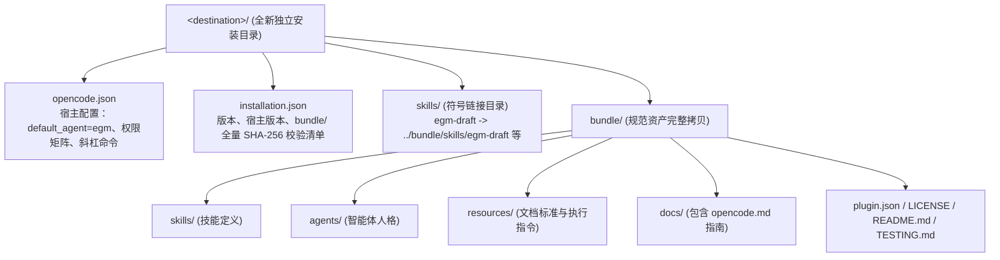

# OpenCode 适配器（`adapters/opencode/`）架构导读与源码精解

> **原文路径**：`adapters/opencode/install.py` | 本文档为中文架构导读与代码精解，保留英文原文件以便对照。
>
> 💡 **第一性原理提示**：EGM 的核心挑战之一是在不同 AI 编程宿主环境（Harness）中，**严格落位金鱼（零上下文评审员）的隔离与只读边界**。`adapters/opencode/install.py` 展示了如何用不到 150 行无第三方依赖的纯标准库 Python 代码，在不污染用户全局配置的前提下，通过最小权限白名单、符号链接技能挂载、以及基于 SHA-256 的安装清单元数据，构建一个安全可审计的实验性 V1 宿主适配器。

---

## 1. 设计哲学与核心定位（V1 适配器）

`adapters/opencode/install.py` 是 EGM 为 **OpenCode** 宿主环境（目标宿主版本 `HOST_VERSION = "1.18.29"`）提供的实验性 V1 安装与适配脚本。它的设计遵循四条第一性原理：

1. **零侵入用户配置（Non-Intrusive Isolation）**：脚本明确拒绝修改用户现有的 OpenCode 全局配置，也拒绝覆盖任何已存在的目标路径（包括悬空符号链接）。每次安装都在全新的独立目录 `destination` 中生成自包含的 `opencode.json`、`bundle/`、`skills/` 与 `installation.json`。
2. **零外部运行时依赖（Zero Runtime Dependency）**：甚至不依赖 `PyYAML`。为了提取各技能与智能体人格（Persona）的规范名称，脚本直接用正则解析 Markdown YAML Frontmatter，确保用户在任何标准 Python 3 环境下开箱即用。
3. **纵深防御的安全边界（Defense-in-Depth Security Boundaries）**：从安装路径注入防护，到子智能体最小权限模型，再到封堵 `grep` 工具绕过 `.env` 读取规则的漏洞，层层设防。
4. **单一事实来源 + 薄适配器（Single Source of Truth + Thin Adapter）**：将仓库中的规范文件（`skills/`、`agents/`、`resources/`、`docs/`）完整拷贝为只读 `bundle/`，再由薄配置层 `opencode.json` 负责把 OpenCode 的工具权限、斜杠命令与子智能体派发机制映射到 EGM 工作流。

---

## 2. 安装产物的目录结构与架构全景

运行 `python3 adapters/opencode/install.py <destination>` 后，生成的独立安装目录拓扑如下：



---

## 3. 核心安全边界详解

### 3.1 路径安全与模板/通配符注入防护（Lines 32–46）

安装路径 `destination` 不仅用于文件落盘，还会被**直接拼接到 `opencode.json` 的 glob 权限规则**（如 `f"{bundle}/**": "allow"`）以及**系统提示词模板**中。因此脚本在创建目录前执行四道防线：

| 防线 | 源码位置 | 检查逻辑 | 防范风险 |
| :--- | :--- | :--- | :--- |
| **拒绝覆盖** | L33–34 | `destination.exists() or destination.is_symlink()` | 防止覆盖已有目录或利用悬空符号链接劫持写入目标 |
| **禁止通配符与模板字符** | L37–40 | 拒绝反斜杠 `\` 及 ``*?[]{}!@`$\n\r``（对 `resolve()` 后的真实父路径一并检查） | 防止路径中的 glob 元字符扩大 `external_directory` 放行范围，或破坏 Prompt / Shell 模板 |
| **禁止路径含 `.env.`** | L43–44 | `".env." in str(destination).lower()` | OpenCode 的 `read` 规则匹配工作树相对路径且 glob 中的 `*` 会跨目录层级匹配（跨越 `/`），若安装路径本身包含 `.env.`，`"*.env.*": "deny"` 会误杀整个 `bundle/` 的读取 |
| **禁止装入源码树内部** | L45–46 | `destination.is_relative_to(ROOT)` | 防止 `shutil.copytree` 递归复制导致死循环，或污染 Git 源码工作区 |

### 3.2 权限模型对比：大象编排者 (`egm`) vs. 金鱼评审员 (`egm-*`)

EGM 在 OpenCode 中通过 `opencode.json` 的 `agent` 字段将两类角色彻底隔离：

| 维度 | 金鱼（零上下文评审员：`REVIEWERS` 中 8 个角色） | 大象（高上下文编排者：`egm`） |
| :--- | :--- | :--- |
| **`mode` 与配色** | `subagent`（`#E86E00` 橙色） | `primary`（`#1B6EF3` 蓝色，设为 `default_agent`） |
| **默认兜底策略 (`*`)** | `"deny"`（默认拒绝一切未显式放行的工具，包括写入、Shell、派发） | `"ask"`（高危操作须经人类确认） |
| **`read` 规则** | `"*": "allow"`, `"*.env": "deny"`, `"*.env.*": "deny"`, `"*.env.example": "allow"`, `"mcp:*": "deny"` | `"*": "allow"`, `"*.env": "ask"`, `"*.env.*": "ask"`, `"*.env.example": "allow"` |
| **`glob` / `grep`** | `glob: "allow"`, **`grep: "deny"`** | `glob: "allow"`, `grep: "allow"` |
| **`skill` / `task`** | 均被默认 `"*": "deny"` 禁止（禁止嵌套委派） | `skill` 仅允许 `egm-*`；`task` 仅允许派发已注册的 8 个评审员 |
| **`external_directory`** | `{"*": "deny", f"{bundle}/**": "allow"}`（仅能读取安装 bundle） | `{"*": "ask", f"{bundle}/**": "allow"}` |

### 3.3 深度解析：为什么要封堵 `.env` 的 `grep` 绕过与规则覆盖陷阱？

源码中两条极具工程价值的注释揭示了 OpenCode 权限系统的两个微妙行为：

1. **后置规则胜出陷阱（L71–75）**：
   - 在 OpenCode 中，权限字典里**后出现的规则会覆盖先前的默认规则**。如果只写 `"read": {"*": "allow"}`，它会覆盖 OpenCode 内置的默认 `.env` 保护规则，导致金鱼可以读取密钥文件！
   - 因此，适配器必须**显式重申** `"*.env": "deny"` 与 `"*.env.*": "deny"`，同时为示例模板开绿灯（`"*.env.example": "allow"`），并封堵 MCP 读取通道（`"mcp:*": "deny"`）。
2. **`grep` 绕过 `.env` 读取规则（L76–77）**：
   - OpenCode 的 `grep` 工具底层**不强制执行 `read` 的 deny 规则**。如果对只读子智能体放行 `grep`，模型完全可以通过搜索 `API_KEY` 或 `SECRET` 把 `.env` 文件内容“读”出来。
   - 因此，所有金鱼评审员被硬性配置为 `"grep": "deny"`，仅保留 `glob` 用于发现文件列表，再通过受 `read` 规则严格管控的文件读取工具查看代码。

### 3.4 拷贝（Copy） vs. 符号链接（Symlink）的分层策略

脚本对不同层级采用了截然不同的文件系统策略，背后的考量非常清晰：

- **`bundle/` 使用完整拷贝（`shutil.copytree` / `shutil.copy2`，L50–53）**：
  - 将源仓库的 `skills/`、`agents/`、`resources/`、`docs/` 以及 `plugin.json`、`LICENSE`、`README.md`、`TESTING.md` 静态快照到 `destination/bundle/`。
  - **原因**：保证安装实例与源码仓库彻底解耦。即使后续源码仓库被切换分支、编辑或删除，已安装的 OpenCode 实例仍然保持原子性、不可变性与可复现性，并且能与 `installation.json` 中的 SHA-256 清单精确对应。
- **`skills/` 目录内使用符号链接（`symlink_to`，L111–116）**：
  - OpenCode 通过 `skills.paths` 加载技能目录，要求子目录名与规范技能名一致。
  - 脚本在 `destination/skills/<skill_name>` 创建指向 `bundle/skills/<dir>` 的目录符号链接（`target_is_directory=True` 以兼容 Windows）。
  - **原因**：避免在同一个安装目录内二次冗余拷贝技能文件，同时保证 `skills/` 下的入口永远与 `bundle/skills/` 指向同一份受 SHA-256 校验的规范资产。

### 3.5 SHA-256 安装清单（`installation.json`，L131–139）

安装结束前，脚本会遍历 `bundle/` 下的每一个文件（按路径字典序排序 `sorted(bundle.rglob("*"))`），计算其 SHA-256 摘要，并连同 `plugin.json` 的 `name`、`version`、适配的 `host_version` 与 `status: "experimental"` 写入 `installation.json`。这为后续的完整性审计、篡改检测和版本排障提供了确定性基准。

---

## 4. 逐函数与逐段源码精解

### 常量定义（Lines 13–18）

- `ROOT = Path(__file__).resolve().parents[2]`：通过当前脚本路径向上回溯两级定位 EGM 仓库根目录。
- `HOST_VERSION = "1.18.29"`：记录该适配器经过验证的 OpenCode 宿主基线版本。
- `REVIEWERS`：包含 8 个只读金鱼评审员的元组：
  `codebase_details`、`comprehension`、`design_critic`、`implementation_readiness`、`inventive_catalyst`、`structural`、`style`、`zoom_out`。
  > 注意：这里刻意不包含 `synthesizer` 与 `bootstrap_orchestrator`，因为在 OpenCode V1 中，主智能体 `egm` 直接通过 `task` 工具逐一派发这 8 位独立评审员并自行汇总报告。

### `name(path: Path) -> str`（Lines 21–27）

```python
def name(path: Path) -> str:
    """Read the canonical name without a runtime YAML dependency."""
    header = path.read_text(encoding="utf-8").split("---", 2)[1]
    match = re.search(r"^name: (egm-[a-z-]+)$", header, re.MULTILINE)
    if not match:
        raise ValueError(f"Missing canonical name: {path}")
    return match[1]
```

- **职责**：在零外部依赖的前提下，从 Markdown 文件的 YAML Frontmatter 中提取规范的 `egm-*` 标识符。
- **Fail-Closed 设计**：使用 `split("---", 2)[1]` 截取 Frontmatter 区块，并用严格锚定行首行尾的正则 `^name: (egm-[a-z-]+)$` 校验。一旦缺失或格式不合规，立即抛出 `ValueError` 中止安装。

### `install(destination: Path) -> Path`（Lines 30–140）

按执行流分为 6 个清晰阶段：

1. **阶段一：路径归一化与安全校验（L32–46）**
   先 `expanduser().absolute()` 检查是否已存在或为符号链接，再 `resolve()` 校验通配符/模板字符、`.env.` 冲突以及源码树嵌套。
2. **阶段二：规范资产快照拷贝（L47–53）**
   创建 `destination/bundle/`，拷贝 4 个核心目录与 4 个根目录关键文件。
3. **阶段三：构造共享路径上下文 `context`（L55–61）**
   生成一段统一的路径解析指令，明确告诉大象与金鱼：先读 `docs/opencode.md`，`agents/`、`resources/`、`docs/` 相对 `bundle` 解析，`references/` 相对规范技能目录解析，用户文件与输出产物相对项目工作目录解析。
4. **阶段四：注册 8 个金鱼子智能体与 1 个大象主智能体（L62–110）**
   - 每个金鱼的 Prompt 均注入了零上下文纪律：`Return findings to the caller. Do not write reports or delegate.`、禁止主动检索未提供的历史/记忆/前序评审结果、遇到无法访问的必需文件须明确报告为不完整评审。
   - 主智能体 `egm` 的 Prompt 则注入了编排纪律：派发时**必须省略 `task_id`**（严禁复用/恢复评审员会话，保证新鲜上下文）、等待前台完成、只传任务/绝对资源路径/目标/标准/选定阅读清单而不传对话历史、在 `egm-brainstorm` 转 `egm-draft` 前必须完成全部 7 个头脑风暴评审并合成 `concepts_brief.md`、在 `egm-review` 的 Step 8 前必须核验 `zoom_out_report.md` 存在并传入绝对路径、保留每一个人类检查点门禁（Checkpoint Gate）。
5. **阶段五：挂载技能符号链接与生成斜杠命令（L111–121）**
   遍历 `bundle/skills/*/SKILL.md`，为每个技能在 `destination/skills/` 创建符号链接，并在 `opencode.json` 的 `command` 字段注册对应斜杠命令（指定 `agent: "egm"`，模板把 `$ARGUMENTS` 透传给规范 `SKILL.md`）。
6. **阶段六：落盘 `opencode.json` 与 `installation.json`（L122–140）**
   写入 JSON 配置（显式关闭 `"autoupdate": False` 防止宿主自动更新破坏已验证行为）与全量 SHA-256 校验清单，返回 `opencode.json` 路径。

### CLI 入口（Lines 143–146）

使用 `argparse` 接收单个位置参数 `destination`（类型为 `Path`），调用 `install(...)` 并打印生成的 `opencode.json` 路径，方便在 Shell 脚本或 CI 流水线中直接捕获。
