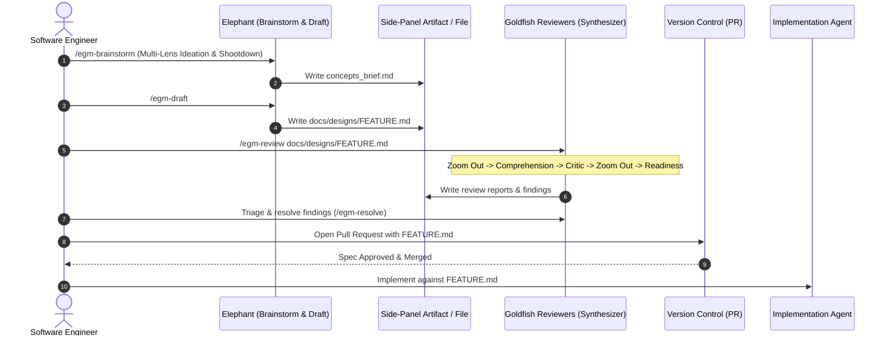

> **原文路径**：`docs/designs/architecture.md` | 本文档为中文学习翻译版，保留英文原文件以便对照。

> 💡 **第一性原理提示**：EGM 的本质是用**上下文隔离**对抗 LLM 的确认偏误（幻觉级联）。单一长对话既当运动员又当裁判员必然自我强化错误，因此 EGM 将“高上下文起草（大象）”与“零上下文只读审计（金鱼）”彻底解耦，并把所有长文本状态固化为可追踪的活体规格文件（产物优先交互协议），从而把人类的判断力牢牢锚定在关键决策门禁上。

# EGM 架构与系统生命周期

*   **作者：** Jim Quinn ([@quinnjim](https://github.com/quinnjim))、Elise Ewing ([@eewing314](https://github.com/eewing314))、Dave Rensin ([@drensin](https://github.com/drensin))
*   **状态：** Current（现行）
*   **日期：** 2026-06-06

--------------------------------------------------------------------------------

## 概述

**大象-金鱼模型 (EGM)** 是基于 [Elephants, Goldfish, and the New Golden Age of Software Engineering](https://medium.com/@drensin/elephants-goldfish-and-the-new-golden-age-of-software-engineering-c33641a48874) 一文实现的规格驱动开发 (SDD) 框架。它强调协作式使用 AI 进行设计与评审，并维护直接签入代码库的经验证技术规格文档。

本文档规定了 EGM 的总体系统架构：其组件模型、端到端数据流，以及在各类编程智能体运行时（宿主环境）中的生命周期。

## 问题背景

非结构化、纯对话式的 AI 代码生成存在四种系统性失效模式：

1.  **幻觉级联与上下文污染**：当单一 LLM 会话线程既访谈开发者、又创建设计、还编写代码时，会话上下文会不断累积推测性假设与对话偏见。模型会不断印证自身的错误假设，而非检出错误。
2.  **过早实现（“杂草综合征”）**：编程智能体默认会立刻在附近的文件中写代码，跳过高层架构选址、极简性检查（YAGNI）以及现有基础设施复用。
3.  **聊天倾倒疲劳**：将长达数页的设计规格或冗长的评审反馈直接输出到聊天窗口中，会使对话历史杂乱无章、降低 LLM 上下文推理性能，并带来糟糕的用户体验。
4.  **文档漂移**：项目启动时编写的设计文档通常会随着代码演进而腐烂失效，破坏未来 AI 智能体的代码库上手体验。

## 设计原则

*   **大象与金鱼**：

    *   **大象（高上下文构建者）**：加载了系统历史、关键用户旅程 (CUJ) 和代码库地图的深上下文智能体，用于探索需求并起草设计。
    *   **金鱼（零上下文评审员）**：运行在隔离、零上下文环境中的子智能体评审员，依据评估准则对草稿进行评判，不受上下文偏见影响。

*   **人类所有权**：AI 是用于探索与评审的工具；人类工程师对架构决策、技术权衡负责，并对最终结果承担所有权。

*   **产物优先交互协议 (Artifact-First)**：所有长篇交付物（草稿、摘要、评审报告）都渲染到专用的侧边栏 Markdown 产物或工作区文件中，并配以交互式反馈检查点。

*   **活体规格**：设计文档是签入源码树（`docs/designs/`）中的受控产物，持续接受针对代码库漂移的监控。

## 系统架构与组件模型

开源的 EGM 框架被组织为四个解耦的子系统：

### 1. 技能层（`skills/`）
可通过斜杠命令或直接调用执行的模块化智能体能力：
*   `egm-brainstorm`：用于早期概念探索的 7 视角批驳蜂群。
*   `egm-draft`：逐节推进的规格编译器。
*   `egm-review`：多阶段评审流水线的编排器。
*   `egm-review-loop`：并发子智能体评审分发器。
*   `egm-resolve`：交互式裁决与补丁应用工具。
*   `egm-drift-report`：通过宿主搜索与文件读取工具对比规格文档、README 与代码的智能体工作流。
*   `egm-bootstrap`：递归自底向上的代码库文档生成器。

### 2. 智能体人格层（`agents/`）
用于隔离金鱼评审子智能体的无状态系统提示词指令（理解力评审员 Comprehension、设计批评家 Design Critic、实现就绪评审员 Implementation Readiness、代码库细节审计员 Codebase Auditor、结构校验员 Structural Validator、风格编辑 Style Editor、发明催化剂 Inventive Catalyst，以及合成器 Synthesizer）。

### 3. 文档标准层（`resources/document_standards/`）
金鱼评审员会加载[共享运行时资源](../../resources/README.md)中列出的版本化评估准则。这些文件本身定义了具体的评估要求；本设计文档阐述各层级如何使用它们。

### 4. 活体文档层（`docs/`）
用户指南（`getting_started.md`、`faq.md`）以及技术设计规格文档（`docs/designs/`）。

## 端到端生命周期与数据流

EGM 开发流水线使产物依次流经五个严谨的阶段：

### 阶段 1：上游构思与多视角批驳（大象）

*   **命令**：`/egm-brainstorm`
*   **机制**：大象通过访谈工程师锚定核心假设，随后派生 7 视角金鱼蜂群，对有缺陷的假设发起批驳。
*   **输出**：写入 `concepts_brief.md` 的结构化概念简报。

### 阶段 2：规格编写与语义边界

*   **命令**：`/egm-draft`
*   **机制**：将概念简报（或讨论笔记）转化为符合 EGM 规范的技术设计文档，写入 `docs/designs/<feature>.md`。
*   **语义边界发现**：在高层架构（`FeatureRange`）与详细实现计划（`DetailedRange`）之间建立清晰边界，以便下游子智能体进行有针对性的评审。

### 阶段 3：隔离验证（金鱼）

*   **命令**：`/egm-review`
*   **执行**：运行五阶段评估流水线：
    1.  **步骤 5：拉远视角评审（Zoom Out Review）**：依据 `zoom-out-standard.md` 评估简洁性、YAGNI 与代码库复用。
    2.  **步骤 6：理解力测试（Comprehension Test）**：隔离的“零背景读者”审计文档的自洽性与缺失的背景知识。
    3.  **步骤 7：批评家评审（Critic Review）**：依据 `feature-spec-standard.md` 评估系统设计、规模瓶颈与故障模式。
    4.  **步骤 8：中间拉远视角（Intermediate Zoom Out）**：依据 `zoom-out-standard.md` 重新审计理解力与批评家阶段中新增的内容。
    5.  **步骤 9：实现就绪测试（Implementation Readiness Test）**：依据 `implementation-readiness-standard.md` 验证文件路径、函数签名与测试用例。
*   **子智能体扇出/扇入**：`synthesizer` 智能体人格并行派生隔离评审员，聚合原始发现、去重重叠项，并编写整合后的 Markdown 报告。

### 阶段 4：人类评审与提交

*   人类工程师使用 `/egm-resolve` 裁决或驳回金鱼的评审发现，更新设计文档，并通过 Pull Request 提交规格文档进行人类同行评审。

### 阶段 5：实现与漂移监控

*   **执行**：编程智能体严格遵循经批准的设计文档编写代码。（此处不需要额外的 `Skill.md`，因为设计文档本身已经足够完备和详尽。）
*   **阶段写入边界**：阶段 1–4（`/egm-brainstorm`、`/egm-draft`、`/egm-review` 和 `/egm-resolve`）应只写入规格与评审产物：`concepts_brief.md`、`design_draft.md`、评审报告、设计文档，以及 `SITEMAP.md`（若存在）。它们不应修改生产源码或依赖项。这是一项约定，尚无强制拦截机制。一旦步骤 9（实现就绪测试）通过，计划中的 `Target Scope & File Boundary`（目标范围与文件边界）列表即构成阶段 5 实现允许写入的文件集合。
*   **维护**：定期（如每周）运行 `/egm-drift-report`，以检测代码库实现与已签入设计文档之间的偏离（漂移）。

## 产物优先交互协议 (Artifact-First)

为维持对话健康度并防止上下文退化，所有 EGM 技能都遵循以下交互协议：

1.  **禁止聊天倾倒**：工具和技能严禁将冗长的提案、草稿或评审日志直接倾倒到主聊天流中。
2.  **产物输出**：所有内容必须直接写入专用的侧边栏产物（在 Antigravity 中设置 `RequestFeedback: true`）或持久化的工作区文件。
3.  **交出回合的检查点**：当需要用户反馈或分诊裁决时，调用方技能用简明消息通知用户并指向产物文件，随后交出执行回合。
4.  **清空队列**：一旦用户完成检查点评审，调用方技能清除待处理的反馈标记。

## 参考资料

*   Dave Rensin, [Elephants, Goldfish, and the New Golden Age of Software Engineering](https://medium.com/@drensin/elephants-goldfish-and-the-new-golden-age-of-software-engineering-c33641a48874) (Medium, 2026).

## 曾考虑的替代方案

*   **单线程整体评审 vs. 多子智能体流水线**：
    *   *替代方案*：在同一聊天会话内按顺序运行评审提示词。
    *   *驳回理由*：会导致严重的上下文退化与确认偏误；模型会不断印证自身的错误。
*   **直接写代码 vs. 规格驱动开发 (SDD)**：
    *   *替代方案*：直接提示智能体根据功能需求生成代码。
    *   *驳回理由*：会导致每千行代码的评审评论密度更高、工具函数重复实现，且代码库中没有任何签入的架构记忆。
