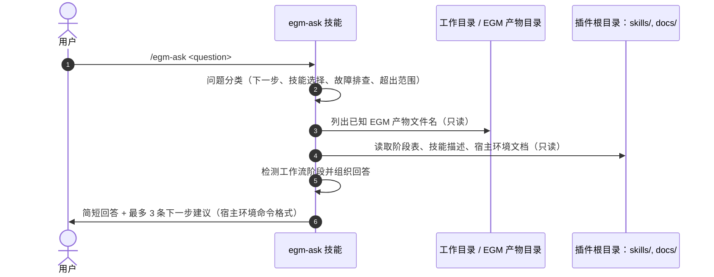

> **原文路径**：`docs/designs/ask.md` | 本文档为中文学习翻译版，保留英文原文件以便对照。

# EGM Ask：只读上下文帮助与下一步指引

*   **作者：** Smit Parmar ([@smituparmar01](https://github.com/smituparmar01))
*   **状态：** 草案（Draft）
*   **日期：** 2026-10-28
*   **关联 Issue：** [#175](https://github.com/google/elephant-goldfish-model/issues/175)

--------------------------------------------------------------------------------

## 概述

**EGM Ask 技能**（`/egm-ask <question>`）用于回答用户关于大象-金鱼模型 (EGM) 以及当前所处 EGM 工作流阶段的问题。它会检查磁盘上存在哪些 EGM 产物（例如 `concepts_brief.md`、`design_draft.md` 与评审报告），读取 EGM 技能描述与 EGM 宿主环境文档，并在聊天窗中给出简短回答以及最多三条建议的下一步操作。

该技能仅为只读建议性质。它不会写入文件、不会运行其他技能，也不会更改正在进行的技能状态。

Issue [#175](https://github.com/google/elephant-goldfish-model/issues/175) 最初提议命名为 `/ask-egm`。维护者在该 Issue 中最终选定了 `/egm-ask`，以便命令与其他所有 EGM 技能一样遵循 `egm-` 前缀约定。

## 问题背景

1.  **空白画布（Blank Canvas）**：新用户看过 `/egm-brainstorm` 或 `/egm-review` 的演示，但不知道应该输入什么来开始、哪个技能适合自己的任务，或者某个技能期望什么输入。

2.  **中断后迷失方向（Lost After a Break）**：各技能可以按任意顺序使用（参见 [getting_started.md](../getting_started.md)）。在单次会话中，每个技能在结束时都会指明下一步：`egm-brainstorm` 的交接会提供 `/egm-draft`，`egm-draft` 会推荐 `egm-review`，而 `egm-review` 的阶段门禁会指明下一阶段。但在新会话中，或当用户稍后回到项目时，这些交接信息已不复存在。用户看到磁盘上的产物文件，却不知道是哪个技能生成的，也不知道接下来该运行哪个技能。

3.  **无锚点的故障排查（Unanchored Troubleshooting）**：当出现故障时（例如评审员无法读取其智能体人格文件、自动补全中缺少某个技能、子智能体工具不可用），文档化的修复方法位于 [harnesses.md](../harnesses.md) 或宿主环境指南（[claude.md](../claude.md) 或 [codex.md](../codex.md)）中。由于 EGM 技能设置了 `disable-model-invocation: true`，它们不会出现在自动技能发现中（见 `claude.md`）。因此，在普通聊天中，模型看不到 EGM 技能描述，也不知道哪份文档记录了修复方法。

## 目标与非目标

### 范围内目标（In-Scope Goals）

*   新增一个由用户主动调用的 `/egm-ask <question>` 技能。
*   根据磁盘上的产物检测当前所处的工作流阶段，并以用户宿主环境期望的命令形式建议下一个要运行的技能。
*   基于用户声明的意图推荐技能，直接读取每个已安装 `skills/*/SKILL.md` 的实时 `description` 字段，从而使新技能无需修改 `egm-ask` 即可出现在推荐结果中。
*   通过引用包含修复方案的 EGM 文档来回答故障排查问题。

### 范围外非目标（Out-of-Scope Non-Goals）

*   运行技能、派生子智能体、加载技能或编辑文件。该技能只读取文件并在聊天窗中回复。
*   替代正常的任务工作提示词。`/egm-ask` 仅回答关于 EGM 的问题；它不会起草、评审或修复。
*   代答、恢复或操作另一个技能中挂起的审批步骤。
*   与 EGM 无关的通用编程帮助。对于此类问题，该技能会说明其仅覆盖 EGM 并停止。
*   在多次调用之间维护自身的状态或记忆。
*   运行诸如 `git status` 之类的 Shell 命令。阶段检测仅依赖产物文件。

## 系统架构与工作流



### 技能的读取来源

`skills/egm-ask/SKILL.md` 的开头采用与其他 EGM 技能相同的两行宿主环境前导语（preamble）：在 Claude Code 或 Cowork 中读取 `docs/claude.md`，在 Codex 或 ChatGPT Work 中读取 `docs/codex.md`。该前导语明确了两件事：

*   **路径解析。** 本设计中的 `docs/` 和 `skills/` 路径均相对于已安装的插件根目录解析，绝不相对于用户项目解析（用户项目可能存在同名目录）。产物文件和 `docs/designs/` 则相对于用户工作区解析。
*   **宿主环境指南。** 前导语所指明的指南即下文所称的“宿主环境指南”。没有独立指南的宿主环境（例如 Antigravity 或 omp）仅使用 [harnesses.md](../harnesses.md)。

### 步骤 1：对问题进行分类

技能将问题归类为以下四种类型之一。类型决定了需要读取哪些文件，避免每次提问都读取全部文档。

| 类型 | 示例 | 读取的文件 |
| :--- | :------ | :--------- |
| **下一步（Next step）** | “我现在该做什么？” | 工作区中的产物文件名以及阶段表（步骤 2） |
| **技能选择（Skill choice）** | “哪个技能用来检查我的 README 与代码是否一致？”也包括 EGM 任务请求，例如“帮我修一下草案”：指出负责该工作的技能，不做任何编辑。 | 仅读取 `skills/*/SKILL.md` 的 frontmatter |
| **故障排查（Troubleshooting）** | “评审员说它无法读取自己的智能体人格文件。” | `docs/harnesses.md` 与宿主环境指南 |
| **超出范围（Out of scope）** | “这个 TypeScript 报错怎么修？” | 无。回复说明 `/egm-ask` 仅覆盖 EGM。 |

如果用户未提供问题，技能会将其视为**下一步（Next step）**问题处理。

### 步骤 2：检测工作流阶段

技能按与 `egm-draft` 输入采集（`egm-draft` 步骤 1）相同的位置和顺序查找 EGM 产物：先查工作目录，再查宿主环境的产物目录（见 [harnesses.md](../harnesses.md) 的“Artifact Directory”一节），最后查 `scratch/`。用户提示词或智能体指令文件中的 `EGM artifact directory: <path>` 行会替代工作目录，具体规则见 `claude.md`。

技能按文件名检查文件是否存在。它从工作区读取的唯一文件内容是 `goldfish_review_report.md` 的前几行：即 `Status: resolved` 行和 `**Target:**` 行。仅当该目标与用户所指的设计文档一致时，它才建议解决（resolution）之后的下一步。

文件的存在仅作为阶段线索，不能作为工作流已完成的证据。评审报告可能是不完整的，或是之前某次运行遗留下来的。如果文件不足以确定当前目标所处的阶段，技能会将阶段报告为未知，列出它看到的所有产物，并询问用户指的是哪一次运行或哪一个目标。

下方的阶段表列出了每个产物由哪个技能写入。其权威版本（canonical copy）位于 [getting_started.md](../getting_started.md) 中由实现 PR 新增的“What to run next”一节，`/egm-ask` 在运行时从该处读取。阅读文档的人看到的也是同一张表，重命名产物时只需在一处更新。

| 发现的产物（写入方） | 检测到的阶段 | 建议的下一步 |
| :--------------------------- | :------------- | :------------------ |
| 无，且没有 `docs/designs/*.md` | 尚未开始 | 新构想使用 `egm-brainstorm`，为现有代码库补全文档使用 `egm-bootstrap` |
| `concepts_brief.md`（`egm-brainstorm`） | 构思已完成 | `egm-draft`，它会以 `concepts_brief.md` 作为首要输入 |
| `design_draft.md`（`egm-draft`），且无对应的 `docs/designs/<feature>.md` | 起草进行中 | 继续 `egm-draft`，直到写入 `docs/designs/<feature>.md` |
| `docs/designs/<feature>.md`，且无评审报告 | 评审就绪 | `egm-review docs/designs/<feature>.md` |
| `zoom_out_report.md`、`comprehension_report.md`、`critic_report.md`、`intermediate_zoom_out_report.md`、`implementation_readiness_report.md` 或 `consolidated_review_report.md`（`egm-review`） | 评审已开始；完成状态未知 | 询问该目标的评审是否已完成。若已完成，对其发现项运行 `egm-resolve`；若未完成，继续挂起的评审 |
| `goldfish_review_report.md`（`egm-resolve`）且不含 `Status: resolved` | 裁决解决进行中 | 返回正在等待回答的解决步骤，或重新运行 `egm-resolve` |
| `goldfish_review_report.md` 且包含 `Status: resolved` | 发现项已解决 | 对设计文档进行人工评审（`getting_started.md` 第 4 步）；仅在下方所有检查通过后才建议进入实现 |

**建议进入实现之前的检查。** 仅凭已签入的设计文档或已解决的报告，不足以作为开始实现的依据。技能仅在以下所有条件同时满足时才建议进入实现：

1.  **目标明确。** 用户明确指定了设计文档，或者已解决报告中的 `**Target:**` 行精确指向唯一一个 `docs/designs/<feature>.md` 且经用户确认。如果有多个设计文档可能匹配，技能应询问用户指的是哪一个。
2.  **该目标没有挂起的评审。** 如果存在评审报告，用户需确认该评审已完成，且近期对话中没有任何评审或解决步骤正在等待回复。
3.  **没有挂起的审批。** 技能无法看到人类对设计文档的审批，因此它会询问该设计是否已获批准。在用户确认之前，它建议执行人工评审步骤而非直接实现。

若任一检查未通过，技能改为建议执行该挂起的步骤。它不会自行代答或恢复该步骤（参见“规则”一节）。

表格按工作流顺序排列。当有多行匹配时，技能会指明最新的匹配阶段并列出它看到的全部产物，以便用户纠正。如果用户的提问明确指向其他目标，则以该目标覆盖阶段表。

### 步骤 3：组织回答

回复采用简明自然语言，遵循如下结构：

```markdown
**Where you are:** <one sentence, naming the artifacts seen>
**Answer:** <2-6 sentences>
**Next steps:**
1. `<command>`: <why>
2. ...
**Source:** <relative path of each doc or SKILL.md used>
```

*   最多三条下一步建议，总计不超过 20 行。EGM 的产物优先交互协议（参见 [architecture.md](architecture.md)）避免在聊天窗中输出长文本；需要更多篇幅的帮助回答应指向已包含详细内容的文档。
*   命令采用宿主环境指南给出的形式，例如在 Claude Code 中使用 `/egm:egm-draft`。若没有宿主环境指南，技能显示裸命令并复述 README 中关于前缀的说明。
*   展示的每条 EGM 命令都必须属于已安装的技能。宿主命令与设置（例如 `claude plugin enable egm@egm`）仅可在引用自所引文档时出现。技能不得凭空捏造命令或参数标志。
*   如果文档未涵盖某个故障排查问题，技能应如实说明并建议提交 Issue，而不是猜测。

### 规则：挂起门禁与只读约束

**挂起门禁（Pending gates）。** 用户可能在另一个技能等待回答时运行 `/egm-ask`，例如停在 `egm-resolve` 的解决门禁处。该门禁接受自由文本输入（包括自定义指令）。`/egm-ask` 不会代答、恢复或操作挂起的门禁。其只读规则在发出回复后即结束，由用户直接回复挂起的门禁。

**只读约束（Read-only）。** 该技能运行在主对话中，因为下一步指引和故障排查的回答依赖于用户最近的对话轮次以及他们刚刚看到的报错文本。运行在新鲜上下文中的金鱼评审员（参见 [architecture.md](architecture.md)）既看不到前者也看不到后者。在 Claude Code 中，EGM 技能运行在主上下文中，只有子智能体适配器才拥有受限的工具列表（见 `claude.md`）。因此，只读规则由技能指令和行为测试场景（参见“测试”一节）共同强制执行。与其他 EGM 技能一样，该技能设置 `disable-model-invocation: true`，确保仅在用户主动调用时运行。

## 备选方案考量

| 备选方案 | 拒绝原因 |
| :---------- | :-------------- |
| **在普通聊天中直接提问（不新增技能）** | 目前可行，但由于 EGM 技能不在自动技能发现范围内，除非对话中已经出现过，否则模型看不到它们的描述、产物名称或阶段顺序。 |
| **改进现有技能的交接提示** | 值得作为后续改进：`egm-brainstorm` 和 `egm-draft` 打印的下一步命令缺少宿主环境前缀。但这无法解决新会话迷失、技能选择或故障排查等本设计针对的核心场景。 |
| **由只读子智能体回答问题** | 虽可通过工具列表强制只读，但下一步指引与故障排查需要用户近期的对话上下文和报错文本。仅将部分问题路由到子智能体会增加第二条执行路径并在每个宿主环境中新增适配器，为了一个 20 行的回复付出过高代价。 |
| **仅在文档中增加“What to run next”一节** | 已采纳为数据源（步骤 2），但静态文档无法看到用户磁盘上实际拥有哪些产物。 |
| **将回答写入产物文件** | 帮助回答非常简短。每次提问生成一个文件会造成杂乱，而且还需要用户额外打开文件。 |
| **允许模型自动调用（Model-invocable）** | 模型会在任何“我该怎么做”的消息上误触发该技能，与正常任务提示词冲突（这是明确的非目标）。 |
| **沿用 Issue 中的 `/ask-egm` 命名** | 维护者在 #175 中选定了 `/egm-ask`，以与现有所有技能的 `egm-` 前缀保持一致。 |

## 风险与缓解措施

*   **检测到错误的工作流阶段。** 文件的存在可能产生误导，例如之前运行遗留的报告。缓解措施：技能将文件视为线索，列出看到的全部产物，并在无法确定时报告未知阶段而非猜测（步骤 2）。
*   **阶段表与技能发生漂移。** 缓解措施：在 `getting_started.md` 中维护唯一权威表，并在每一行注明写入方技能。
*   **只读约束仅靠指令强制执行。** 缓解措施：行为测试场景 6、7 和 8 专门验证技能不做任何编辑且不替用户选择门禁选项。
*   **工作区文件中植入恶意指令（提示词注入）。** 在具备写工具的主对话中，评审报告内的文本可能被当作指令读取。缓解措施：技能从工作区仅读取文件名以及单个报告中的 `Status:` 和 `**Target:**` 行。它读取的所有正文均来自插件自有文档与 frontmatter。
*   **主线程上下文开销。** 缓解措施：每种问题类型仅读取其列出的文件，且回答上限为 20 行。

## 实现文件与引用组件

### 实现 PR 变更的文件

| 路径 | 新建/修改 | 变更内容 |
| :--- | :------------ | :----- |
| `skills/egm-ask/SKILL.md` | 新建 | 宿主环境前导语、四种问题类型、阶段检测、回答格式以及挂起门禁与只读规则。正文须保持在 `tests/unit/test_skill_load_limits.py` 检查的 24,000 字节上限以内。 |
| `skills/egm-ask/TEST.md` | 新建 | 针对每种问题类型与阶段的手动验证步骤。 |
| `skills/egm-ask/test_scenarios.yaml` | 新建 | 下文“测试”一节定义的行为测试场景。 |
| `skills/egm-ask/agents/openai.yaml` | 新建 | 与其他技能一致的显示名称与图标元数据。 |
| `skills/egm-ask/assets/icon.svg` | 新建 | 遵循 [skill_icons.md](skill_icons.md) 的技能图标。 |
| `docs/getting_started.md` | 修改 | 新增“What to run next”阶段表以及 `/egm-ask` 条目。 |
| `scripts/pack_plugin.py` | 修改 | 将 `egm-ask` 加入技能列表。 |
| `tests/unit/test_harnesses.py` | 修改 | 将 `egm-ask` 加入 `EXPECTED_SKILLS`。 |
| `tests/unit/test_packaging.py` | 修改 | 将 `skills/egm-ask/SKILL.md` 加入预期打包文件列表。 |
| `README.md` | 修改 | 将 `/egm-ask` 与其他命令一同列出。 |
| `docs/designs/architecture.md` | 修改 | 将 `egm-ask` 加入技能层（Skills Layer）列表。 |
| `docs/designs/skill_icons.md` | 修改 | 更新技能数量。 |
| `site/src/components/Skills.astro`、`site/src/components/SkillIcon.astro` | 修改 | 新增技能卡片与图标。 |

### 引用文档（运行时读取）

*   [getting_started.md](../getting_started.md)：“What to run next”阶段表。
*   [harnesses.md](../harnesses.md)、[claude.md](../claude.md)、[codex.md](../codex.md)：故障排查与命令格式。
*   `skills/*/SKILL.md` frontmatter：用于推荐的技能名称与描述。

## 测试

`skills/egm-ask/test_scenarios.yaml` 采用与其他技能测试套件相同的场景格式，至少覆盖以下用例：

1.  空工作区、无提问：建议 `egm-brainstorm` 或 `egm-bootstrap`。
2.  仅存在 `concepts_brief.md`：建议 `egm-draft`。
3.  当前目标存在评审报告：在建议 `egm-resolve` 之前先询问评审是否已完成，且不绕过挂起的门禁。
4.  存在 `critic_report.md` 且用户表示评审尚未完成：建议继续 `egm-review`，而非重新开始。
5.  同时存在 `concepts_brief.md` 和 `docs/designs/x.md`：指明最新阶段并列出两个文件。
6.  “请帮我修改草案”：不做任何编辑，并指明负责该工作的技能。
7.  无关的编程问题：回复说明其仅覆盖 EGM。
8.  在 `egm-resolve` 门禁挂起时调用：回答问题、不做任何编辑，且不选择任何门禁选项。
9.  “哪个技能用来对比我的设计文档和代码？”：推荐 `egm-drift-report` 并引用其 `SKILL.md`。
10. 智能体人格读取失败：引用 `docs/claude.md`。
11. 存在已解决报告与两份已签入的设计文档，且用户未指定其中任何一份：请用户确认目标设计文档（报告中的 `**Target:**`，若不明确则询问是哪一份）以及是否已获批准；不建议直接进入实现。

静态检查：`pytest tests/unit`（frontmatter、场景覆盖率、技能正文大小限制、打包完整性与链接有效性）。

## 参考资料

*   Issue [#175](https://github.com/google/elephant-goldfish-model/issues/175)：Add /ask-egm command for contextual help and guidance。
*   Dave Rensin，[Elephants, Goldfish, and the New Golden Age of Software Engineering](https://medium.com/@drensin/elephants-goldfish-and-the-new-golden-age-of-software-engineering-c33641a48874)（Medium，2026）。
