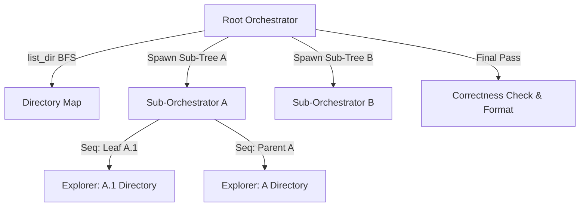
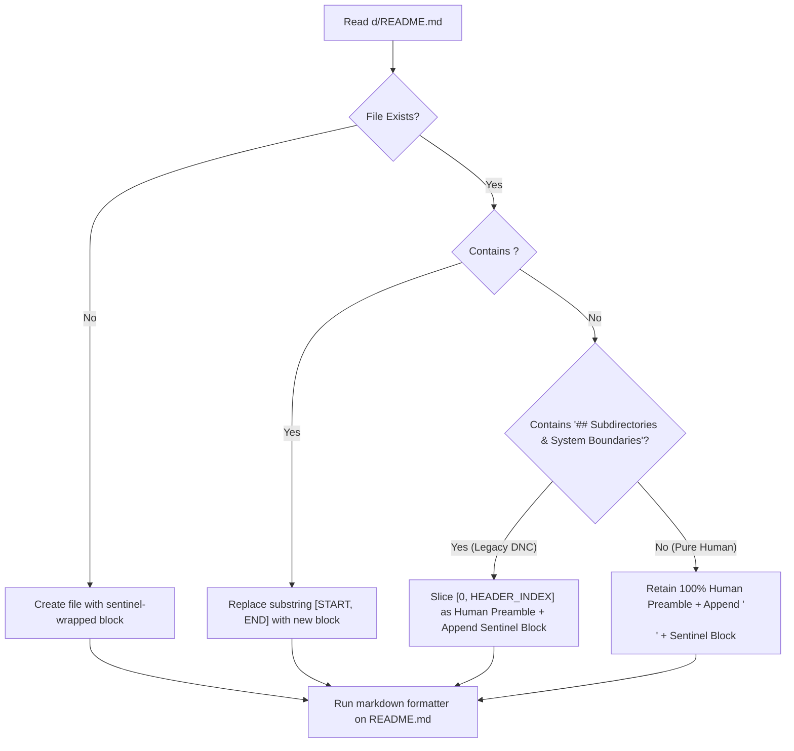

> **原文路径**：`docs/designs/bootstrap.md` | 本文档为中文学习翻译版，保留英文原文件以便对照。

# 设计文档：EGM 仓库与代码包引导（`egm-bootstrap`）

*   **作者：** Brian Suchy ([@briansuchy](https://github.com/briansuchy))
*   **状态：** Current（现行）
*   **日期：** 2026-06-29

--------------------------------------------------------------------------------

## 1. 概述与问题陈述

### 1.1 问题背景

在大型代码库（单体仓库 Monolith）中，建立并维护清晰的架构心智模型对人类开发者和 AI 助手而言都是一项首要挑战。

*   **上下文缺失**：如果没有结构化的目录级文档，AI 智能体就缺乏关于局部不变量、公共接口和副作用的上下文。这会导致上下文窗口膨胀、重复的文件读取循环以及引入回归缺陷的风险。
*   **单体规模**：为大型仓库手工编写目录级 README 是一项繁重且枯燥的任务，开发者往往会将其排在低优先级。

### 1.2 概述与“花生与干草”模型（Peanuts and Hay）

我们提出用于 EGM 插件的 **`egm-bootstrap`** 技能。该技能可自动化完成目录树中符合[设计即新代码（Design is the New Code，DNC）](../../README.md)规范的 `README.md` 文件的创建、修正、格式化与正确性验证。

*   **DNC 合规性**：设计即新代码（DNC）是 EGM 的工程哲学，它将人类可读的架构契约（目录 README 中的不变量、接口与副作用）视为系统的核心资产。这些文档文件为人类评审员与 AI 智能体提供了结构化护栏。
*   **隐喻映射**：在此语境下，“花生（Peanuts）”和“干草（Hay）”均指生成的目录级 `README.md` 文件：
    *   **花生（Peanuts）**：细粒度的叶子级**组件包 README**，包含具体的文件级契约。
    *   **干草（Hay）**：父级的**仓库蓝图（Repository Blueprints）**，汇总子级接口契约以提供高海拔索引。

为确保性能、效率与健壮性，该技能会根据目标代码库的规模动态调整其执行模型：

1.  **增量范围探查**：根编排器（Root Orchestrator）使用原生文件系统 API（`list_dir`）逐层映射目录树。如果探查过程中目录数量超过规模上限，它会立即暂停并警告用户，防止在超大型仓库中挂起。
2.  **顺序执行（小型目录树）**：如果目标目录包含 5 个或更少的子目录，根编排器会按后序（post-order）依次遍历并编写文档，避免多智能体协调与启动开销。
3.  **上限并发蜂群（中/大型目录树）**：如果目标目录包含超过 5 个子目录，根编排器会切分目录树，并派生编排器智能体自身的并发实例（使用框架的 `self` 子智能体类型）作为子编排器（Sub-Orchestrator，每棵子树一个）。
    *   **自适应深度切分**：为防止单一深层嵌套源码树（如 `src/` 或 `java/`）仓库出现并发瓶颈，根编排器采用自适应深度切分，在探查地图中逐层下探，直到将目录拆分为均衡的子树分支。
    *   **经批准的上限派生**：根编排器最多派生 5 个子编排器，每个子编排器每次最多运行 5 个侦察员（scout）。如果目录数量较大（> 5），它会请求用户批准派生所需数量的子编排器，随后将它们全部并发启动。
    *   **蜂群直接写入与格式化**：子编排器并发处理各自的子树，直接在分配的文件夹中写入或修改 `README.md` 文件，并使用 `mdformat` 进行格式化。
4.  **自底向上顺序处理**：在每棵子树内部，子编排器按后序（最深的叶子优先）顺序为子目录编写文档，并派生 `goldfish-explorer` 智能体来总结文件。这保证了父目录仅在其所有子目录完成后才编写文档，避免竞态条件。
5.  **最终正确性验证**：在结束工作前，根编排器会对所有创建和修改过的 README 执行最终检查，验证 DNC 合规性、正确的 Markdown 格式、有效的相对链接以及有效的验证目标。
6.  **可选漂移评审**：根编排器可选择性地提示用户对生成的 README 更新运行 EGM 漂移报告，以确保文档与代码库保持一致。

### 1.3 目标

*   **自动化引导与修正**：递归生成或修正任意目标源码目录树的 DNC 合规 README（`Interface`、`Invariants`、`Side Effects`）。已有 README 会被修正和更新，而非完全覆盖。
*   **幂等哨兵块更新插入（Idempotent Sentinel-Block Upserting）**：将自动生成的 DNC 契约封装在显式 HTML 哨兵标记（`<!-- EGM_BLUEPRINT_START ... -->` / `<!-- EGM_BLUEPRINT_END -->`）内，确保既有 `README.md` 中的人工运维文档零丢失，在多次运行间逐字节保留哨兵之上的人工运维手册（runbook）内容。
*   **Markdown 格式化**：确保每个修改或创建的 README 都经过 Markdown 格式化工具正确排版。
*   **最终正确性检查**：在结束工作前对所有修改过的 README 执行最终验证检查。
*   **安全扩展**：通过动态用户警告、增量 BFS 范围探查、子树切分以及经用户批准的上限并发执行，安全处理深层/宽广的目录树。

### 1.4 非目标

*   **代码生成**：该技能不会编写或重构任何功能性源代码；其职责严格限定于文档。
*   **非源码目录**：不会为隐藏系统目录（如 `.git`、`.jj`、`.gemini`）、构建输出路径或第三方依赖目录（如 `third_party`）编写文档。

### 1.5 关键用户旅程 (CUJ)

#### CUJ 1：为目录树引导、修正、格式化并验证 README

*   **给定（Given）**：一个源码目录树（例如 `src/` 或 `pkg/`），其中的子目录缺少 `README.md` 文件或包含不完整的遗留 README。
*   **当（When）**：用户通过斜杠命令 `/egm-bootstrap <path>`（或宿主环境等效命令/提示词）指定目标根目录来运行 `egm-bootstrap` 技能。
*   **那么（Then）**：
    1.  根编排器增量映射目录树。
    2.  若目录数 <= 5，则按顺序处理。
    3.  若目录数 > 5，则自适应切分目录树，请求用户批准，并派生最多 5 个并发的编排器工作实例（`self` 子编排器）。
    4.  子编排器自底向上处理各自子树，为每个目录节点派生一个 `goldfish-explorer` 智能体。
    5.  创建或修正符合 DNC 规范的 `README.md` 文件，并使用 `mdformat` 格式化。
    6.  根编排器对所有修改过的 README 执行最终正确性检查。
    7.  可选择性地提示用户对更新内容运行漂移报告。

--------------------------------------------------------------------------------

## 2. 技术方案

### 2.1 蜂群架构与角色

`egm-bootstrap` 技能恰好使用两种智能体配置：



*   **节点编排器（`bootstrap-orchestrator`）**：
    *   实现为单一智能体配置。
    *   **根实例（Root Instance）**负责协调流水线：增量映射目录树、计算数量与深度、管理安全门禁、在用户批准后管理上限并发工作节点派生、为剩余的中间目录编写文档、编译最终根 README，并执行最终正确性检查。
    *   **工作实例（子编排器 Sub-Orchestrators）**由根实例派生，负责处理特定的顶层子目录树。它们自底向上顺序遍历子树、派生侦察员、直接在文件系统中写入或修改 README 文件，并使用 `mdformat` 格式化。
*   **`goldfish-explorer`**：

    *   只读、动态侦察智能体。
    *   **系统提示词**：> "You are a read-only codebase explorer. Your task is to analyze the source files in the target directory and return a concise, factual summary. Do not write or modify any files. Return a JSON object containing the directory's public symbols (interface), invariants, and side effects."（你是一名只读代码库探索员。你的任务是分析目标目录中的源文件，并返回简洁、基于事实的摘要。不要写入或修改任何文件。返回一个包含该目录公共符号（interface）、不变量（invariants）和副作用（side_effects）的 JSON 对象。）
    *   **侦察员文件约束**：侦察员将每个目录的总读取数据量上限控制在 **50,000 字节**，以防止上下文窗口膨胀。实现与 Schema 文件（如 `.cc`、`.py`、`.java`、`.go`、`.rs`、`.ts`）每个文件最多读取 **300 行**。若目录总大小超过 50KB 限制，则按以下优先级列表选择文件进行读取：
        1.  完整读取接口、Schema、IDL 与头文件（如 `.h`、`.hh`、`.hpp`、`.proto`、`.graphql`、`.gql`、`.thrift`、`.prisma`、`.sql` Schema/DDL 定义、接口类）。
        2.  读取模块入口文件（如 `main.*`、`index.*`、`lib.*`、`mod.*`、`__init__.py` 或与目录同名的文件），最多 300 行。
        3.  按字母顺序读取生产源码与配置文件，每个最多 300 行，直至达到字节上限。
        4.  上下文加载阶段完全忽略测试文件。
    *   **输出 Schema**：

        ```json
        {
          "type": "object",
          "properties": {
            "interface": {
              "type": "array",
              "items": { "type": "string" }
            },
            "invariants": {
              "type": "array",
              "items": { "type": "string" }
            },
            "side_effects": {
              "type": "array",
              "items": { "type": "string" }
            }
          },
          "required": ["interface", "invariants", "side_effects"]
        }
        ```

### 2.2 智能体汇报与上下文契约

通信遵循层级汇报模式：

1.  **侦察员汇报给子编排器**：`goldfish-explorer` 分析目录中的所有文件，并向其父级 `bootstrap-orchestrator` 返回结构化 JSON 摘要（`interface`、`invariants`、`side_effects`）。
2.  **父级上下文传播**：当子编排器处理父目录 `P` 时，它会在调用父目录的 `goldfish-explorer` 侦察员时，将子目录已编译的接口摘要作为提示词上下文传入。这使得父级侦察员能够准确总结子级接口边界。
    *   *传播启发式规则*：
        1.  如果子目录是在本次执行运行中生成文档的，子编排器直接从内存执行缓存（或工作节点返回的 JSON 载荷）中读取其公共接口，直接消费结构化数据。
        2.  如果子目录 README 是经过修正/修改的，子编排器直接从侦察员扫描结果与遗留提取结果中获取更新后的符号。
3.  **子级汇报给父级编排器**：子目录向父级 `bootstrap-orchestrator` 返回其编译后的 README 摘要，父级使用该摘要来编写自身的“Subdirectories”接口章节。
4.  **工作节点汇报给根编排器**：子编排器使用下方定义的结构化 JSON Schema 向根编排器返回其编译后的子树契约元数据。

#### 2.2.1 工作节点返回接口 Schema

子编排器工作子智能体使用以下 Schema 汇报已完成的子树结构：

```json
{
  "type": "object",
  "properties": {
    "subtree_index": {
      "type": "array",
      "items": {
        "type": "object",
        "properties": {
          "path": { "type": "string" },
          "summary": { "type": "string" },
          "interface": { "type": "array", "items": { "type": "string" } },
          "invariants": { "type": "array", "items": { "type": "string" } },
          "side_effects": { "type": "array", "items": { "type": "string" } }
        },
        "required": ["path", "summary"]
      }
    }
  },
  "required": ["subtree_index"]
}
```

### 2.3 目录过滤与分类规则

为避免为空目录编写文档并确保选择正确的模板，我们在目录探查阶段强制执行以下规则：

*   **非代码过滤**：为避免为空目录编写文档，任何既不包含源代码文件、也不包含任何含代码子目录的目录都将被排除。由于自顶向下遍历无法预知更深层子目录是否包含代码，剪枝操作作为阶段 A 完成整棵树映射后的**自底向上后处理流程**执行。
    *   *源代码文件*：定义为包含可执行代码、Schema 与契约的文件（例如 `.c`、`.cc`、`.cpp`、`.cxx`、`.h`、`.hh`、`.hpp`、`.rs`、`.go`、`.zig`、`.lean`、`.f`、`.f90`、`.f95`、`.f03`、`.f08`、`.hs`、`.java`、`.kt`、`.scala`、`.cs`、`.fs`、`.vb`、`.py`、`.rb`、`.php`、`.lua`、`.sh`、`.bash`、`.ps1`、`.psm1`、`.psd1`、`.r`、`.R`、`.ex`、`.exs`、`.ts`、`.tsx`、`.js`、`.jsx`、`.mjs`、`.cjs`、`.swift`、`.m`、`.dart`、`.sql`、`.proto`、`.graphql`、`.gql`、`.thrift`、`.prisma`、`.tf`、`.hcl`、`.cue`）。排除构建清单、锁文件、测试夹具、文档以及通用数据转储文件。
*   **测试目录排除**：任何仅包含测试代码的目录（例如名为 `tests`、`testing`、`testdata` 的文件夹，或仅包含匹配 `*_test.*` / `*Test.*` 文件的目录）在剪枝阶段会被排除出文档范围。
*   **测试文件过滤**：在同时包含生产代码与测试文件的混合包目录中，侦察员在上下文扫描时会过滤掉测试文件并忽略其公共符号，以防止测试夹具污染文档化的公共接口。
*   **自定义排除项**：探查循环支持自定义忽略模式。默认忽略隐藏/系统目录（`.git`、`.jj`、`.gemini`、`node_modules`）。此外，它会读取本地 `.egmignore` 文件（若存在），按其中的 glob 模式排除自定义文件夹（如 `*testdata*`、`*mocks*`、`third_party`）。
*   **目录分类**：
    *   **仓库根目录（Blueprint / 干草）**：引导执行的目标根目录*始终*被分类为仓库根目录，即使其中包含直接源文件。它使用“Repository Root README Template”编写（对根目录下的直接文件使用可选的 Local Interface 章节）。
    *   **组件包（Peanut / 花生）**：任何包含直接源代码文件的非根目录。如果它还包含带有代码契约的子目录，其 README 的 `Interface` 章节会包含指向子目录契约的相对链接。
    *   **仓库蓝图（Hay / 干草）**：任何*不含*直接源代码文件、但包含带有代码契约的子目录的非根目录（无论是否存在 `BUILD` 文件）。

### 2.4 文档模板

#### 📄 组件包（花生 Peanuts）README 模板

用于包含直接源文件的文件夹，聚焦于局部模块契约。

```markdown
# [Component Name]

## Overview
[Prose overview of the component's architectural role and goals]

## Interface
- [Public classes, functions, and symbols]
- [Subdirectories list and links to their contracts]

## Invariants
- [State and call invariants that must be preserved by developers/agents]

## Side Effects
- [State mutations, network calls, disk access, locks, or external side effects]

## Verification
- Build: `build //[package_path]...`
- Test: `test //[package_path]...`
```

#### 📄 仓库根目录（蓝图 / 干草 Hay）README 模板

用于协调子树的根目录节点。

```markdown
# [Repository Name] Blueprint

## System Overview
[High-altitude architectural overview of this subsystem]

[Optional section if the root directory contains direct source files]
## Local Interface & Invariants
- [Direct symbols, invariants, and side effects of files in the root folder]

## Subdirectories & System Boundaries
- [Subdirectory Name]: [Link to child README.md] - [Summary of child contract/role]

## Global Invariants
- [System-wide constraints that cross component boundaries]

## Global Side Effects
- [Shared resources, databases, or external integrations affected by this subsystem]

## System Verification
- Run: `test //[system_path]...`
```

#### 📄 中间蓝图（Intermediate Blueprint）README 模板

用于位于根目录与叶子包之间的中间非代码目录（适用于被分类为仓库蓝图但并非执行根目录的目录）。

```markdown
# [Directory Name]

## Overview
[Factual overview of the subdirectories and systems grouped under this directory path]

## Subdirectories & Boundaries
- [Subdirectory Name]: [Link to child README.md] - [Summary of child contract/role]
```

*注：干草（Hay）模板中的所有子目录索引必须使用相对路径（例如 `./subdir/README.md`），以保持本地渲染兼容性。*

### 2.5 执行流水线

#### 阶段 A：增量目录探查与计划定义

1.  **增量 BFS 探查**：根编排器使用目录队列与原生 `list_dir` 工具调用逐层（BFS）映射目标树，并保留中间文件夹节点。遍历期间**忽略符号链接（Symbolic links）**以防止无限递归与重复映射。
2.  **安全门禁**：在 BFS 循环中，如果已探查目录的累计总数超过 **15**，根编排器立即暂停探查遍历，并调用 `ask_question` 工具警告用户执行范围过大、估算所需的工作节点与侦察员数量，并要求确认后才能继续映射或派生工作节点。
3.  **自底向上后剪枝**：一旦映射遍历完成（并获批准），根编排器自底向上（从叶子到根）遍历已映射的树，依据过滤规则剔除隐藏、系统、构建输出、纯测试及非代码目录。
4.  剪枝树确定后，根编排器计算最大深度。
5.  **执行策略**：
    *   **顺序执行（规模 <= 5）**：根编排器在单线程内顺序执行自底向上的文档编写。
    *   **并发执行（规模 > 5）**：根编排器将探查地图切分为独立的子树分支。
        *   **自适应深度切分算法**：
            1.  设 `depth = 1`。
            2.  从探查地图中提取位于当前 `depth` 的目录节点。
            3.  如果该 `depth` 的节点数在 3 到 5 之间：返回这些节点作为子树切分根。
            4.  如果该 `depth` 的节点数 < 3：递增 `depth`，重复步骤 2。
            5.  如果该 `depth` 的节点数 > 5：将最大的分支（按嵌套文件夹总数衡量）划分为 3–4 个独立分区，将剩余小分支合并为一个兜底分区子树，并返回这些分区根边界。
            6.  回退策略：若达到深度上限 3 时节点数仍 < 3，则返回根目录的直接子节点（或回退到顺序执行）。
        *   为每个分区子树派生一个并发工作节点（子编排器），向 `self` 子智能体调用传入参数 `is_worker: true` 与 `sub_tree_root: <path>`。
    *   **经批准的上限派生**：根编排器最多派生 5 个子编排器，每个子编排器每次最多运行 5 个侦察员。若目录数较大（> 5），它请求用户批准派生所需数量的子编排器，随后并发启动所有子编排器。
6.  **条件分支控制**：`egm-bootstrap` 技能配置（`SKILL.md`）在启动时检查这些参数：
    *   若 `is_worker` 为 false/未设置：执行根编排器角色（运行 BFS 映射、安全门禁、派生工作节点、编译最终蓝图 README，并执行最终正确性检查）。
    *   若 `is_worker` 为 true：跳过阶段 A，执行子编排器角色（自底向上处理分配的 `sub_tree_root` 子树，派生侦察员，直接写入/修改文件，并用 `mdformat` 格式化）。

#### 阶段 B：自底向上引导

1.  在并发策略下，根编排器派生多个并发 `bootstrap-orchestrator` 实例作为子编排器，向每个实例传入其目标子树。
2.  每个子编排器按后序（最深叶子优先）处理其子树：
    *   **修正与修改策略**：生成文档前，子编排器检查当前文件夹是否已存在 `README.md`。若已存在，不会完全覆盖它，而是读取现有内容，派生 `goldfish-explorer` 侦察员编译真实的代码契约，并使用 `replace_file_content`（或 `write_to_file`）修正并更新现有 README 使其符合 DNC 规范，同时保留开发者笔记与描述。
        *   *侦察员扫描要求*：无论 README 是否已存在，子编排器**始终派生** `goldfish-explorer` 侦察员扫描目录中的源码，以编译真实的代码符号边界。
        *   *遗留符号提取提示词*：为解析既有手工编写的 README 文件，子编排器使用以下提取提示词调用推理 LLM：> "Analyze the following unstructured README.md content. Extract all public symbol names, classes, interfaces, invariants, and side effects. Format your response strictly as a JSON object matching the following schema: { \"interface\": string[], \"invariants\": string[], \"side_effects\": string[] }."（分析以下非结构化 README.md 内容。提取所有公共符号名称、类、接口、不变量和副作用。将你的响应严格格式化为符合以下 Schema 的 JSON 对象：`{ "interface": string[], "invariants": string[], "side_effects": string[] }`。）
    *   **验证命令目标查找**：生成 `## Verification` 章节时，子编排器检查当前文件夹是否存在 `BUILD` 文件。若存在：
        *   检查是否存在测试文件（匹配 `*_test.*` 或 `*Test.*`）。若存在测试文件，则写入 `Test:` 命令；否则省略测试命令。
        *   如果 `BUILD` 文件中的目标名称存在歧义或与文件夹名称不匹配，则回退为构建整个包的通配符目标：`build //[package_path]:all`。
        *   如果不存在本地 `BUILD` 文件：扫描最近的祖先 `BUILD` 文件，定位其 `srcs` 属性引用了当前子目录文件的目标（例如通过直接路径列表或 glob）。若找到匹配目标，则引用该目标（例如 `build //[ancestor_path]:my_target`）。若匹配多个目标或未找到匹配项，则回退至祖先包的通配符目标：`build //[ancestor_path]:all`。若找不到祖先包，则省略验证命令。
        *   *Starlark 解析回退*：如果祖先 `BUILD` 文件包含无法通过文件读取解析的复杂 Starlark 宏或依赖，子编排器回退为引用祖先包的通配符 `:all` 目标，或省略该目标。
    *   **侦察员定义与派生**：若当前会话中尚未定义只读 `goldfish-explorer` 子智能体类型，子编排器会使用 `define_subagent` 动态声明它。
        *   *子智能体定义参数*：
            *   `TypeName`: `goldfish-explorer`
            *   `Role`: `goldfish-explorer`
            *   `enable_write_tools`: `false`
            *   `enable_subagent_tools`: `false`
            *   `SystemPrompt`: 如第 2.1 节所定义。
        *   随后为当前目录顺序派生侦察员。
    *   **子级容错**：若某个子目录文档化失败（如侦察员超时或工具报错），子编排器记录一条警告，在父目录索引中插入占位链接（例如 `- [Subdirectory Name]: [Link to child README.md] - (Details pending/documentation failed)`），然后继续文档化工作而不中止。
    *   根据其分类使用对应模板生成或修正 `README.md`（组件花生或蓝图干草；非执行根目录的蓝图干草节点使用“Intermediate Blueprint template”）。
    *   **Markdown 格式化**：写入或修正 `README.md` 后，子编排器立即通过 `run_command` 执行 `markdown formatter (e.g. prettier or markdownlint)`，确保 Markdown 格式正确。
3.  所有并发工作实例完成后：
    *   **根级容错**：若某个并发工作节点失败或超时，根编排器记录一条警告，在根蓝图的子目录索引中插入占位警告链接（例如 `[Subtree Root] (Documentation failed / Subagent execution timeout)`），并完成其余编译工作。
    *   **中间目录文档化**：根编排器识别位于根目录与已切分子树根之间的所有中间目录，利用工作节点返回的已编译摘要自底向上顺序处理这些中间目录，生成中间蓝图 README，并用 `mdformat` 格式化。
    *   根编排器检查根目录本身是否包含直接源文件。若包含，则为根目录派生一个 `goldfish-explorer` 侦察员提取局部符号与不变量，追加至根 README 的 `## Local Interface & Invariants` 章节下。
    *   编译最终根 `README.md`（蓝图），写入磁盘并用 `mdformat` 格式化。
    *   **最终正确性验证**：根编排器对 `subtree_index` 中所有创建和修改的 README 执行最终验证，核查 EGM 合规性（`Interface`、`Invariants`、`Side Effects`）、正确的 Markdown 格式、有效的相对链接（显式验证所引用的子 README 或 SKILL 文件物理存在）以及有效的验证目标，之后再结束工作。
    *   **可选漂移评审**：根编排器调用 `ask_question`，提供对生成更新运行 `egm-drift-report` 技能的选项，以验证与代码库的一致性。
    *   成功终止。

### 2.6 处理工具

*   **目录探查**：在 BFS 循环中使用原生 `list_dir` 调用（过滤 `.git`、`.jj`、`.gemini`、`third_party`、`node_modules`）。探查期间保留 `BUILD` 文件，以便提取 Verification 模板章节所需的构建/测试目标。
*   **Markdown 格式化**：使用 `run_command` 对每个修改或创建的 README 执行 `markdown formatter (e.g. prettier or markdownlint)`。

### 2.7 增量哨兵块更新插入（Upsert）架构

为了在已包含人工编写运维文档（如仓库运维手册或值班元数据）的目录上安全运行 `egm-bootstrap`，该技能强制执行**幂等哨兵块引导**：

1.  **哨兵边界标记**：由子编排器或叶子工作节点生成的每个 DNC 块都包裹在显式 HTML 哨兵标记内：

    *   **起始哨兵**：`<!-- EGM_BLUEPRINT_START: AUTO-GENERATED BY egm-bootstrap. PUT HUMAN NOTES ABOVE THIS LINE -->`
    *   **结束哨兵**：`<!-- EGM_BLUEPRINT_END -->`

2.  **三态更新插入状态机**：在写入或更新 `d/README.md` 时，工作节点执行如下逻辑：



--------------------------------------------------------------------------------

## 3. 曾考虑的替代方案

### 3.1 单智能体扁平爬虫

相比递归蜂群，我们曾考虑使用单个智能体顺序遍历目录树，边读文件边更新 README。

*   **驳回理由**：
    *   **上下文窗口限制**：顺序遍历大型目录树会累积过多 Token 历史，导致上下文截断与精度下降。
    *   **执行时间**：对于深层或宽广的目录树，顺序执行速度较慢。
    *   **并发能力**：无法利用并发执行。蜂群模型允许子智能体并行运行，大幅缩短执行时间。

### 3.2 直接复用 `growing-peanuts-and-hay` 技能

我们曾调研直接复用现有的 `growing-peanuts-and-hay` 技能（一个内部原型前身）。

*   **驳回理由**：
    *   该技能面向特定团队、采用顺序执行且硬编码了特定语言约定。
    *   EGM 需要一个通用的、语言无关的工具（支持 C++、Python、Java 等），并能以并发方式扩展至大型仓库。
    *   我们选择编写 `egm-bootstrap`，将其 DNC 模板与自底向上逻辑整合进一个支持通过 `self` 工作节点并发扩展的通用技能中。

--------------------------------------------------------------------------------

## 4. 详细实现

所有变更均位于开源仓库结构之内：

### 4.1 实现文件

1.  **`skills/egm-bootstrap/SKILL.md`**

    *   **理由**：定义引导流程的 EGM 工作流步骤。
    *   **YAML Frontmatter 输入 Schema**：

        ```yaml
        name: egm-bootstrap
        description: Bootstrap directory README.md files across a repository subtree.
        inputs:
          path:
            type: string
            description: The target root directory path to bootstrap.
            required: true
          is_worker:
            type: boolean
            description: Internal parameter. True if executing as a worker Sub-Orchestrator.
            default: false
          sub_tree_root:
            type: string
            description: Internal parameter. The root path of the assigned subtree partition.
            required: false
        ```

    *   **`SKILL.md` 算法流程**：

        1.  **启动检查**：读取 `is_worker` 参数。若为 true，跳转至步骤 6（工作节点流程）。
        2.  **BFS 范围探查**：在队列循环中运行 `list_dir` 映射目录树，忽略符号链接与 `.egmignore` glob 规则。
        3.  **警告门禁**：若探查数量 > 15，调用 `ask_question` 并等待用户批准。
        4.  **切分**：若数量 <= 5，顺序编写文档。否则运行自适应深度切分，将树划分为均衡子树。
        5.  **派生**：经用户批准后并发调用 `self` 子智能体，传入 `is_worker: true` 与 `sub_tree_root`。跳转至步骤 9。
        6.  **工作节点流程**：启动时动态声明只读 `goldfish-explorer` 子智能体类型。自底向上（后序）遍历分配的子树。
        7.  **侦察员扫描与格式化**：对每个文件夹检查修正与修改策略。读取现有 README，派生侦察员，使用 `replace_file_content` 或 `write_to_file` 修正/更新文件使其符合 DNC 规范，并用 Markdown 格式化工具排版。
        8.  **汇报**：编译子树索引并返回 JSON（工作节点接口 Schema）给根编排器。
        9.  **编译与最终验证**：根编排器编译子级元数据（从工作节点超时中恢复）、对根文件夹直接文件运行侦察员（若存在）、写入蓝图 README、用 Markdown 格式化工具排版、对所有修改的 README 执行最终正确性检查、可选提示运行漂移报告，然后退出。

2.  **`skills/egm-bootstrap/TEST.md`**

    *   **理由**：列出引导技能的验证与测试场景。

3.  **`skills/egm-bootstrap/test_scenarios.yaml`**

    *   **理由**：自动化集成测试，评估引导场景（小型树顺序执行、并发子树切分及安全门禁）。

4.  **`agents/bootstrap_orchestrator.md`**

    *   **理由**：定义 `bootstrap-orchestrator` 智能体人格的系统提示词与指令。

--------------------------------------------------------------------------------

## 5. 非功能性需求

### 5.1 安全与隐私

*   **以源码为中心**：范围探查仅读取源文件，必须忽略包含敏感数据的隐藏目录（如本地凭据、`.git/` 历史）。

### 5.2 性能与 Token 开销

*   **蜂群并发**：调用子智能体时应使用 `Workspace=inherit` 以实现并发运行。
    *   **`Workspace=inherit`**：在 Antigravity 框架中，以 `Workspace=inherit` 启动子智能体会指示系统直接将父级工作区目录共享给子智能体，而非检出新的隔离分支。这是并发读取操作所必需的，可避免克隆开销并确保所有子智能体看到相同的本地文件系统状态。
*   **VCS 隔离**：子编排器工作节点和侦察员严禁执行任何版本控制命令（例如 `git add`、`git commit`）。所有文件系统变更均在本地写入。对生成 `README.md` 文件的跟踪与提交将推迟至技能完成后的父级 EGM 会话框架或由用户处理，避免并发 VCS 数据库锁冲突。
*   **临时文件隔离**：共享工作区的并发工作节点必须在独立且专属工作节点的目录中执行所有状态追踪、检查点保存和日志写入——使用应用数据目录下各自的唯一 `conversationId`（例如 `<appDataDir>/brain/<conversation_id>/scratch/`），或在其他宿主环境中使用私有 `mktemp -d` 目录。严禁在源码仓库工作区内写入任何临时文件，保持源码树洁净，且绝不使用固定的共享路径。如果上述目录均不可用，则跳过写入这些文件。
*   **Antigravity 框架**：Antigravity 是面向自主编程助手的智能体 SDK 生态与运行时框架。
*   **Token 优化**：金鱼侦察员是只读、临时的，且只读取单个目录，防止编排器的上下文窗口耗尽。
    *   *子智能体隔离 vs. 直接读取文件*：将文件级读取卸载给专用的 `goldfish-explorer` 侦察员，可使子编排器的上下文窗口保持紧凑，因为它仅接收结构化 JSON 摘要而非原始代码文件。这以子智能体启动延迟为代价降低了 Token 开销。
*   **警告门禁**：若目录数量 > 15，通过 `ask_question` 提示用户，以防止在大型仓库上发生无界执行与 Token 浪费。

### 5.3 风险与缓解措施

*   **LLM 速率限制**：切分宽广的仓库树可能触发过多并发 API 调用。缓解措施：将工作节点上限设为 5、每个工作节点的并发侦察员上限设为 5，且在大型树上要求用户明确批准。
*   **VCS 数据库锁**：通过禁止工作节点和侦察员执行任何 VCS 追踪/提交命令（`jj`/`g4`），并将相关操作推迟至 EGM 会话完成后执行来缓解。
*   **共享工作区上的状态冲突**：通过将执行检查点存储在 `<appDataDir>` 下的工作节点专属草稿目录（或其他宿主上的私有 `mktemp -d` 目录）来缓解，避免污染工作区。若两者均不可用，工作节点将跳过这些文件。
*   **工作节点失败遗留部分文件**：将其作为增量进度特性处理。修正与修改策略会在后续运行中保留已完成的部分进度并修正已有文件，使开发者能够无数据丢失地恢复执行。
*   **文档漂移**：引导生成的 README 可能会随时间与代码库产生漂移。这超出引导工具的范围，应由未来的 EGM 插件通过定期运行 EGM 漂移检查工具（例如 `egm-drift-report`）来解决。
*   **幻觉风险**：自动生成的不变量与副作用文档可能受到 LLM 幻觉影响。生成的 README 文件包含标准验证命令（构建/测试目标），以便用户构建并执行包代码以验证功能。

--------------------------------------------------------------------------------

## 6. 验证与测试计划

### 6.1 静态分析与技能校验

验证过程确保技能定义、frontmatter、标题层级与哨兵块符合 EGM 标准。

### 6.2 集成测试与场景

`skills/egm-bootstrap/test_scenarios.yaml` 中的自动化集成测试套件评估以下场景：

*   `bootstrap_small_tree`：验证目录数 <= 5 的树采用顺序执行，确保生成符合规范的花生与干草 README、完成格式化并执行最终正确性检查。
*   `bootstrap_parallel_tree`：验证经用户批准后的上限并发工作节点派生、子级上下文传播、直接文件系统写入/修改、格式化及最终正确性验证。
*   `bootstrap_safety_gate`：验证当映射目录数超过 15 时触发警告门禁，暂停遍历并提示用户。
*   `bootstrap_incremental_sentinel_upsert`：验证对已包含人工运维笔记的 `README.md` 运行 `egm-bootstrap` 时，能够完整保留哨兵块之上的人工文本，同时更新下方的 DNC 契约。
