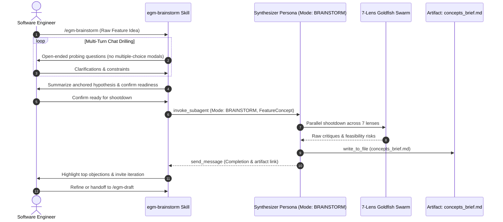

> **原文路径**：`docs/designs/brainstorm.md` | 本文档为中文学习翻译版，保留英文原文件以便对照。

# EGM 头脑风暴：零文档上游构思与多视角批驳

*   **作者：** Brian Suchy ([@briansuchy](https://github.com/briansuchy))
*   **状态：** Current（现行）
*   **日期：** 2026-07-31

--------------------------------------------------------------------------------

## 概述

**EGM 头脑风暴技能**（`/egm-brainstorm`）是一种快速验证想法的工具。它旨在用于人类尚未明确自己想要何种解决方案的早期阶段，使“尚不成熟”的概念能够尽早接受金鱼蜂群的审视，并可在任何正式设计讨论开始之前使用。

## 问题背景

在构思周期中过早起草正式的技术设计文档会导致两种主要失效模式：

1.  **过早承诺于有缺陷的假设**：当开发者为早期想法撰写完整设计文档时，他们会投入大量精力为一个可能根本不需要的前提编写细节规范。

2.  缺乏对抗性评审的标准 AI 聊天头脑风暴存在谄媚（sycophancy）的风险。

## 系统架构与工作流

### 1. 步骤 1：开放式问题深挖

*   该技能在早期构思阶段刻意避免使用结构化多选提问弹窗（`ask_question`），强制在聊天中通过多轮对话进行开放式探索。
*   深挖根本瓶颈、调用方消费系统、不可妥协的硬不变量，以及明确的非目标（Non-Goals）。
*   构建一段 2–3 句的锚定假设，并在派生子智能体蜂群之前要求人类明确批准。

### 2. 步骤 2：7 个金鱼头脑风暴视角

`synthesizer` 智能体人格会并发派生七个金鱼子智能体，从截然不同甚至相互冲突的视角审计该概念：

| 视角 / 智能体人格 | 核心目标 | 重点质疑的核心问题 |
| :------------- | :------------- | :---------------------- |
| **1. 反对派 / YAGNI（Contrarian / YAGNI）** | 复杂度最小化 | *现有库、API 或服务能否在不编写新代码的情况下解决此问题？* |
| **2. 成本与资源经济学（Cost & Resource Economics）** | 预算与基础设施扩展性 | *在规模化场景下，峰值 QPS、内存占用、存储负载或 Token 成本是多少？* |
| **3. UX 与开发者人体工程学（UX & Developer Ergonomics）** | 可用性与认知负担 | *CLI/API 是否直观？错误信息是否具备可操作性，还是会增加开发者摩擦？* |
| **4. 迁移与兼容性（Migration & Compatibility）** | 发布安全性与版本偏移 | *现有客户端/数据如何迁移？是否会破坏序列化格式或持久化存储？* |
| **5. 可观测性与 SRE（Observability & SRE）** | 遥测与可调试性 | *操作是否可通过分布式链路追踪进行追踪？监控指标与告警对值班人员（Oncall）是否具备可操作性？* |
| **6. 技术债与维护性（Tech Debt & Maintenance）** | 长期可维护性 | *这是否引入了紧耦合的状态机，从而在两年后演变为技术债？* |
| **7. 发明催化剂（Inventive Catalyst）** | 矛盾消除与发明变换 | *该设计把哪种根本权衡当成了不可避免的前提？我们如何利用经过验证的软件架构变换解决此冲突，从而在不做妥协的情况下达成理想最终解 (IFR)？* |

### 3. 步骤 3：合成输出至 `concepts_brief.md`

合成器将多视角反馈整合至侧边栏产物目录或本地工作区中的 `concepts_brief.md`：

*   执行摘要与问题界定
*   多视角分析与风险矩阵
*   范围边界（目标 Goals vs. 非目标 Non-Goals）
*   关键架构决策

### 4. 步骤 4：迭代精炼与交接

工程师审阅简报、回应关键反对意见，并决定下一步走向：

*   彻底放弃该想法。
*   通过追加更多轮金鱼批驳来继续精炼假设。
*   转入 **`/egm-draft`**（当概念已经具体、准备好撰写正式设计文档时）。

## 实现文件与引用组件

头脑风暴能力通过其核心技能定义实现，并直接委托给共享的 EGM 子智能体蜂群与文档标准：

### 核心技能文件

| 文件路径 | 类型 | 用途与存在理由 |
| :-------- | :--- | :----------------------------- |
| `skills/egm-brainstorm/SKILL.md` | 技能定义 | 实现 `/egm-brainstorm` 工作流、多轮开放式深挖、批驳委托与简报定稿。 |
| `skills/egm-brainstorm/TEST.md` | 单元测试 | 验证头脑风暴构思与多视角批评流程的测试场景。 |
| `skills/egm-brainstorm/test_scenarios.yaml` | 评估基准 | 用于评估头脑风暴构思与多视角批评流程的基准测试套件。 |

### 引用的智能体人格与基础设施组件

构思批驳蜂群依赖定义在 `agents/` 中的中间编排器、专用金鱼智能体人格以及文档标准：

*   **中间编排器**：
    [`agents/synthesizer.md`](../../agents/synthesizer.md)（`Mode: BRAINSTORM`）负责协调并发扇出并编译生成 `concepts_brief.md`。
*   **7 视角金鱼智能体人格**：
    *   [`agents/zoom_out.md`](../../agents/zoom_out.md)：反对派 / YAGNI 视角。
    *   [`agents/design_critic.md`](../../agents/design_critic.md)：成本、配额与资源经济学视角。
    *   [`agents/comprehension.md`](../../agents/comprehension.md)：UX 与开发者人体工程学视角。
    *   [`agents/implementation_readiness.md`](../../agents/implementation_readiness.md)：迁移与兼容性视角。
    *   [`agents/codebase_details.md`](../../agents/codebase_details.md)：可观测性与 SRE 可调试性视角。
    *   [`agents/structural.md`](../../agents/structural.md)：可维护性与技术债视角。
    *   [`agents/inventive_catalyst.md`](../../agents/inventive_catalyst.md)：矛盾消除与发明变换视角。
*   **引用标准**：依据 [`zoom-out-standard.md`](../../resources/document_standards/zoom-out-standard.md) 与 [`heilmeier-standard.md`](../../resources/document_standards/heilmeier-standard.md) 对概念进行评估。

## 参考资料

*   Dave Rensin, [Elephants, Goldfish, and the New Golden Age of Software Engineering](https://medium.com/@drensin/elephants-goldfish-and-the-new-golden-age-of-software-engineering-c33641a48874) (Medium, 2026).
*   DARPA, [The Heilmeier Catechism](https://www.darpa.mil/about/heilmeier-catechism).
