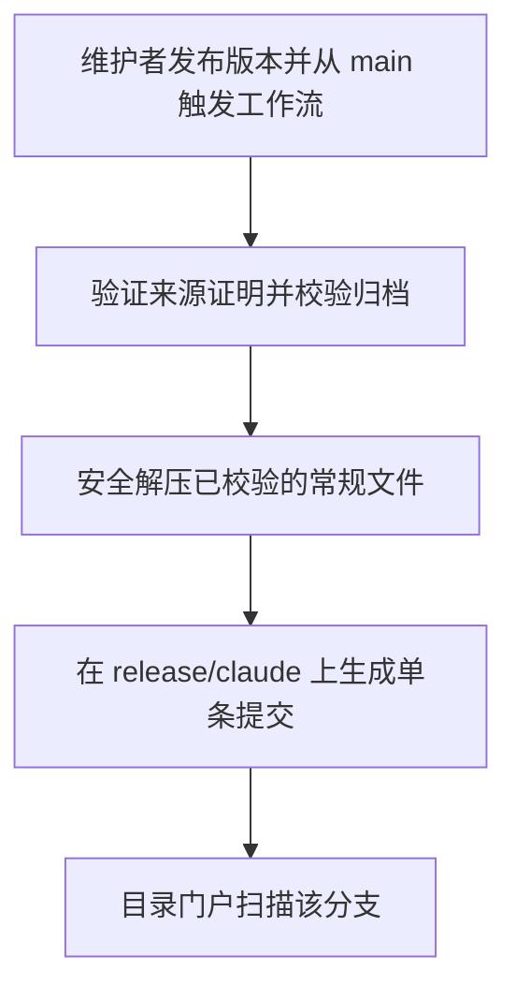

> **原文路径**：`docs/designs/claude_release_branch_distribution.md` | 本文档为中文学习翻译版，保留英文原文件以便对照。

# Claude 发布分支分发

*   **作者：** [@n3wth](https://github.com/n3wth)
*   **状态：** 草案（Draft）
*   **日期：** 2026-10-29。2026-11-09 修订：拆分第 6 阶段，允许第 6a 阶段先行执行。

## 概述

Claude 目录（Claude directory）是 Anthropic 的插件目录。其提交门户（submission portal）会扫描 GitHub 仓库中的一个插件目录。目前该目录 `distributions/claude` 存放着 Claude 运行时（即用户安装的插件包），由 `scripts/pack_plugin.py` 生成并提交到仓库的 `main` 分支。本设计将停止将其提交到 `main`。在维护者发布一个版本并从 `main` 触发发布工作流后，工作流会验证经过来源证明（attested）的 `egm-claude-<version>.zip`，并将其内容作为单个提交添加到生成的 `release/claude` 分支中。Claude 目录则跟踪该分支。

## 问题陈述

将生成的目录提交到仓库中需要手动与源码保持同步。新鲜度测试（freshness test）只能检测漂移，而不会自动重新生成。该目录是在 `f91dccb` 提交中引入的。从 `f91dccb` 到 `f0ba151`，`git log --oneline f91dccb..f0ba151 -- README.md .claude-plugin agents skills docs` 列出了 48 次源码提交；而 `git log --oneline f91dccb^..f0ba151 -- distributions/claude` 列出了 38 次目录提交（含 `f91dccb`）。

`test_published_claude_runtime_is_current` 会将该目录的每个字节与全新构建的结果进行比对。它在 Pull Request 上运行，因此只能在 `main` 已经过时的情况下才捕获漂移。PR #208（“docs: note Antigravity (agy CLI) also requires /egm: prefix”）修改了 `README.md` 并在未重新生成该目录的情况下合并。这导致该测试在 `main` 以及所有未合并的 Pull Request（包括 Dependabot 的 PR）上全部失败。这是来自 `f0ba151` 的历史证据，而非当前 `main` 的状态：打包的 README 随后已同步且 #209 已关闭，当前离线测试套件均通过。但一次性的同步无法防止下一次漂移。

### 目录门户约束

来源：Anthropic，[Submit your plugin](https://claude.com/docs/plugins/submit)，查阅于 2026-10-29。

*   门户读取一个 GitHub 仓库、一个可选的插件路径（包含 `.claude-plugin/plugin.json` 的目录）以及一个可选的跟踪分支或标签。它会扫描所跟踪分支或标签上的每一次新提交。它不接受直接上传 ZIP 用于目录上架。
*   每个组织针对同一个仓库和插件路径只能有一次提交。提交后，组织无法更改仓库和插件路径，但可以在插件设置中更改所跟踪的分支或标签。
*   如果 `plugin.json` 设置了 `version`，每次发布时必须递增该版本号。
*   2026-10-29 针对 `google/elephant-goldfish-model`、插件路径 `distributions/claude`、分支 `main`（位于 `f0ba151`）运行门户的 Validate 步骤，结果为通过，带有 6 条警告和 9 条策略拦截（policy holds）。策略拦截会将该版本转交人工审核员。作者并未提交任何内容。

## 目标

1.  `main` 分支不包含任何生成的 Claude 运行时副本。
2.  仅当维护者正式发布一个版本时，目录才会看到新版本。
3.  `release/claude` 上的插件子树精确包含该版本经过来源证明的 `egm-claude-<version>.zip` 中的文件。工作流不重新构建它们。该子树位于分支根目录或既有提交所固定的路径下。
4.  Pull Request 不会再因生成目录过时而失败。
5.  如果运行时构建器损坏，Pull Request 仍然会失败。

目标 1 和目标 4 在第 6a 阶段之后成立（参见“发布与回滚”）。在此之前，已提交的副本及其测试将保留。目标 2 所依赖的“发布到上架延迟”尚未量化（参见“待决问题”）。

## 非目标

*   更改运行时或 OpenAI 产物包的内容。
*   更改发布来源证明、`SHA256SUMS` 或草稿发布流程。
*   向目录提交插件。该操作由维护者在门户中手动完成。
*   解决门户的名称、发布者和图标策略拦截问题。
*   在该分支上支持除 Claude 以外的其他宿主环境。

## 待决问题（Open Questions）

1.  **既有提交与目录布局**（负责人：@n3wth；作为第 4 阶段和第 6a 阶段的门禁）：是否有人曾从任何组织或通过早期的 Console 表单（`platform.claude.com/plugins/submissions`）将本仓库提交到目录？门户会拒绝另一个组织针对相同仓库和插件路径发起的第二次提交。首次提交会锁定插件路径。本设计默认使用 `release/claude` 的根目录（插件路径为空）。如果已存在插件路径为 `distributions/claude` 的提交，则在发布前必须选择该前缀并在整个上线过程中保持不变。任何其他既有路径都需要在第 4 阶段之前更新设计。作者的账号下没有本仓库的提交，但这不能回答其他组织的情况。在第 6a 阶段合并前，拥有 Google 组织 Directory 权限的维护者需检查开发者门户与早期 Console 表单，并将结果记录在 [#387](https://github.com/google/elephant-goldfish-model/issues/387) 中。
    **针对第 6a 阶段的答复（2026-11-09，@n3wth）：** 该插件尚未提交到目录。用户可能已从市场目录（marketplace catalog）安装过它；在版本号变更前，这些安装会保留各自的缓存副本（参见“风险”）。该答复基于负责人的认知；在第 4 阶段之前仍需执行门户核查。
2.  **门户扫描时机**：推送后目录需要多久才会扫描新提交？门户文档提到了定时检查和可选的推送 Webhook，但未给出具体时间间隔，因此发布到上架的延迟尚未量化。
3.  **组织策略**（将在第 4 阶段得到验证）：组织级别的 Actions 策略是否限制了 `GITHUB_TOKEN` 的写权限？作者无法查看该设置。个人账号下的临时 Fork 使用相同工作流成功推送了分支，但 Fork 不会继承组织的策略。

## 关键用户旅程 (CUJs)

### CUJ 1：维护者发布新版本

*   **前置条件（Given）**：一个发布 PR 已在 `docs/releases.md` 列出的插件清单中提升了 `version`。`main` 上存在对应的 `vMAJOR.MINOR.PATCH` 标签。**Prepare draft release**（`release.yml`）已生成带有来源证明 ZIP 的草稿发布。
*   **操作（When）**：维护者审查并发布该草稿，随后从 `main` 触发 **Publish Claude runtime branch** 工作流并传入已发布的标签。
*   **预期结果（Then）**：工作流验证来源证明，在解压前校验归档，并向 `release/claude` 添加一条提交。目录将该提交扫描为一个新版本。

### CUJ 2：贡献者修改源码文件

*   **前置条件（Given）**：一个未合并的 Pull Request 编辑了 `README.md` 或某个技能。
*   **操作（When）**：该 Pull Request 通过测试并合并。
*   **预期结果（Then）**：无需更新任何生成目录。在下一次正式发布之前，`release/claude` 保持不变。

### CUJ 3：验证失败

*   **前置条件（Given）**：满足以下任一条件：该版本的 Claude ZIP 缺少来自 `main` 上 `release.yml` 的有效来源证明；其清单版本号与标签不一致；该发布仍为草稿或预发布（prerelease）。
*   **操作（When）**：工作流运行。
*   **预期结果（Then）**：工作流在推送前失败。`release/claude` 保留先前版本，维护者看到一次失败的运行记录。

### CUJ 4：手动发布既有版本

*   **前置条件（Given）**：某个版本已发布，但 `release/claude` 尚未包含它。原因可能是该分支首次发布、遗漏了触发，或先前推送失败。
*   **操作（When）**：维护者从 `main` 传入该标签手动运行工作流。
*   **预期结果（Then）**：该分支获得对应版本的提交。如果该分支已包含完全相同的内容，运行会报告该状态且不做任何修改。

## 提议架构

### 触发器

`.github/workflows/publish-claude-branch.yml` 仅通过带 `tag` 输入的 `workflow_dispatch` 触发。工作流与发布器代码必须来自 `main`，绝不来自发布标签。在检出代码之前，要求 `github.ref` 等于 `refs/heads/main`，并显式检出同一个已解析的 `main` 提交。工作流检查标签是否符合 `vMAJOR.MINOR.PATCH` 格式，且对应 Release 既非草稿也非预发布。同时检查标签指向的提交是否为 `origin/main` 的祖先提交（这需要 `fetch-depth: 0`）。将受信任的 `main` 工作流提交与发布标签以及经证明的构建源码分开记录。

使用 `release` 事件触发会选中标签上的工作流与代码，而那可能是旧版本。因此在本设计中不将其作为带写权限的触发器。文档化的发布流程将包含在发布完成后从 `main` 分支显式触发的步骤。

### 验证与解压

`release.yml` 在 `main` 上构建运行时 ZIP 并通过 GitHub 产物来源证明（artifact attestations）进行签署。来源证明是一份签名声明，证明某次特定的工作流运行产出了某个特定文件。发布说明会指导用户使用 `gh attestation verify` 进行验证。

新工作流下载唯一的 `egm-claude-*.zip` 发布资产，并使用 `--signer-workflow <repo>/.github/workflows/release.yml` 和 `--source-ref refs/heads/main` 运行相同校验。保留经验证的证明摘要、实际源码 SHA 以及构建运行身份。拒绝缺失或存在歧义的来源信息。同时记录标签提交与实际经证明的源码；不要将前者包装成来源声明。随后在创建任何解压文件之前校验整个 ZIP。它不运行 `pack_plugin.py`。发布的字节即经过证明的字节，因此设计无需假设构建器在不同的 Runner 上产出完全相同的字节。

归档校验会拒绝绝对路径、`..` 路径段、盘符或 UNC 路径、反斜杠、NUL 字符、重复或大小写冲突的路径以及文件/目录冲突。拒绝符号链接与特殊文件类型。在读取条目数据之前，拒绝超过 4,096 个条目或声明未压缩总大小超过 64 MiB 的归档，并在读取过程中强制执行该字节上限。校验每个条目的 CRC。这些上限高于当前运行时体积，如需调高必须通过设计变更。对不受支持的元数据采取默认拒绝（fail closed）。仅在所有条目全部通过校验后，才使用已校验的相对路径在新建的私有暂存目录（staging directory）下写入常规文件。绝不调用无限制的 ZIP 解压器。在构造提交前再次验证暂存路径与字节。任何失败都会清除暂存目录并保持远程分支不变。

### 分支提交

`scripts/publish_runtime_branch.py` 接收 ZIP 路径、新建的暂存目录、标签、标签提交、已验证的来源证明、配置的插件路径、远程仓库以及分支名。其契约如下：

| 规则 | 行为 |
|---|---|
| 输入校验 | 标签必须匹配不含前导零的 `vMAJOR.MINOR.PATCH`。每个提交标识必须是 40 位小写十六进制字符。来源证明必须包含已验证的 SHA-256 摘要和构建运行标识。插件前缀必须为空或 `distributions/claude`。违规抛出 `ValueError`。 |
| 归档校验 | 在任何解压写入前使用上述防护规则校验完整归档。暂存目录必须包含与 ZIP 完全一致的路径与字节。 |
| 清单校验 | 目录中必须存在 `.claude-plugin/plugin.json`，且其 `version` 必须等于去掉 `v` 后的标签名。 |
| 分支查询 | `git ls-remote --exit-code` 退出码为 0 时以 `--depth=1` 拉取分支顶端；退出码为 2 时创建孤儿分支（orphan branch）；其他退出码抛出 `RuntimeError`。 |
| 幂等重复 | 如果所配置前缀下的 ZIP 路径与字节与分支树完全一致，脚本直接返回且不产生提交。该检查在顺序规则之前运行，因此重复发布最新版本会成功。 |
| 版本顺序 | 脚本拒绝低于分支当前版本的版本号，也拒绝相同版本号但内容不同的情况。版本号按整数三元组比较。 |
| 提交格式 | 以 `github-actions[bot]` 身份生成单条提交，主题为 `Release <tag>`。正文根据已验证的工作流输出分别记录 `Tagged-commit`、`Attested-source`、`Artifact-digest`、`Build-run` 和 `Publisher-commit`。标签祖先关系不等于产物来源证明。 |
| 推送方式 | 执行 `git push origin HEAD:refs/heads/<branch>`，禁止强制推送。Git 失败时抛出附带 Git 报错信息的 `RuntimeError`。 |
| 字节保真 | 每次 Git 调用均携带 `core.autocrlf=false` 和 `core.safecrlf=false`，确保在任何平台上提交的字节都与 ZIP 字节完全一致。 |

目录树仅包含所选插件前缀下的 ZIP 文件。默认清单路径为 `.claude-plugin/plugin.json`；对于既有的 `distributions/claude` 提交则为 `distributions/claude/.claude-plugin/plugin.json`。分支首次发布后拒绝更改前缀。每次提交存储一份约 250 kB 的完整副本，因此每次发布使历史增长约 250 kB。

### 失败处理与排序

*   验证失败、版本不匹配、旧版本号、草稿或预发布，或推送被拒都会导致作业失败。分支保持不变。维护者修复原因后重新运行作业或手动触发工作流即可。
*   单一并发组（concurrency group）保证发布按串行方式逐一执行，且不取消正在运行的发布。GitHub 为每个并发组最多保留一个运行中任务和一个等待中任务，较新的等待任务会替换较旧的等待任务。如果两个版本紧挨着发布，GitHub 可能会跳过较旧的那个；随后旧版本规则会拒绝重新运行旧标签，这正是预期结果。
*   不支持强制推送，也不支持删除分支。如需纠正错误发布，请发布一个更高的版本号。

### 安全性

*   工作流顶层设置 `permissions: {}`。验证与解压在只读作业中执行。独立的推送作业才获得 `contents: write` 权限，仅消费经验证的暂存文件与来源证明，并重复执行路径与字节检查。两个作业均不执行来自标签或解压归档中的任何代码，且均使用同一个受保护的 `main` 分支工作流提交。
*   工作流与其他工作流一样按提交 SHA 固定所使用的 Actions。标签通过环境变量传递，并在使用前进行正则匹配校验。工作流除作业令牌（job token）外不使用任何其他密钥。令牌通过环境变量以脱敏的 `http.extraheader` 形式仅在单个推送步骤中传递给 Git，且检出步骤不持久化凭证。
*   来源证明将 `release/claude` 绑定到 `release.yml` 在 `main` 上构建的 ZIP。它并不将 ZIP 绑定到标签指向的提交，`docs/releases.md` 允许经证明的源码与标签不同。任何能够创建标签的人本就拥有写权限。本设计接受这一差异并明确分别记录两个身份，而不把标签提交错误地标示为经证明源码。该保障依赖于本节列出的 `v*` 标签规则集（ruleset）。
*   本设计不强制要求只有该工作流才能推送。GitHub 规则集按操作者（actor）而非按工作流进行限制。拥有写权限的维护者仍可向 `release/claude` 推送普通提交，且门户会将其扫描为一个版本。
*   维护者在第 3 阶段应用以下设置（须在第 4 阶段开始前完成）：第一条是在 `release/claude` 上配置规则集，阻止删除和非快进（non-fast-forward）更新；第二条是在 `v*` 标签上配置规则集，限制谁可以创建版本标签。目前仅有默认分支配置了规则集，尚无标签规则。

### 保留在 `main` 上的内容

`scripts/pack_plugin.py`、`scripts/prepare_release.py` 及其测试继续保留在 `main` 上。如果构建器损坏，Pull Request 仍会通过 `tests/unit/test_packaging.py` 中的 `test_runtime_bundle_is_complete_and_reproducible`（会构建两个运行时）以及 `tests/integration/test_claude.py` 失败。这两者均不与已提交副本做比对。

## 备选方案考量

### 备选方案 A：保留已提交副本并由机器人自动重新生成

*   **优点**：插件路径在 `main` 上仍保持为 `distributions/claude`。
*   **缺点**：机器人需要向 `main` 推送的权限，而默认分支规则集若不设绕过例外则禁止此操作。如果门户跟踪 `main`，机器人的每次提交都会变成一次目录扫描版本。修改相同输入的并行 Pull Request 会在生成文件上频繁冲突。
*   **拒绝原因**：为了解决一个在停止提交副本后自然消失的问题，反而引入了 `main` 的写权限与多余的目录扫描。

### 备选方案 B：在 pre-commit 钩子中重新生成

*   **优点**：本地提交即可包含最新目录，无需服务端改动。
*   **缺点**：为每位贡献者增加安装步骤，且部分人会跳过。目前测试失败是提示重新生成目录的唯一手段，但这并未防止漂移。
*   **拒绝原因**：CI 仍需兜底捕获钩子漏掉的情况，因此过时目录依然会导致 Pull Request 失败。

### 备选方案 C：直接提交仓库根目录

*   **优点**：无需生成任何内容。
*   **缺点**：目录会扫描整个文件夹，包括运行时包刻意排除的官网、测试、工作流和贡献者文档。每次合并到 `main` 都会成为一次被扫描的版本。
*   **拒绝原因**：改变了目录审核与上架的内容边界。

### 备选方案 D：上传发布 ZIP，或跟踪某个标签

*   **优点**：ZIP 已经存在且带有来源证明。
*   **缺点**：目录不接受 ZIP 上传。跟踪标签会停留在其对应提交上直到修改设置，而 `docs/releases.md` 禁止移动标签。因此每次发布都需要手动编辑门户设置。
*   **拒绝原因**：ZIP 上传不可行，而跟踪标签为每次发布增加了手动操作。

### 备选方案 E：从标签重新构建并与 ZIP 比对

*   **优点**：为经过证明的 ZIP 增加第二道独立校验。
*   **缺点**：引入第二条构建路径，并假设构建器在不同 Runner 镜像上产出完全相同的字节，而本仓库仅在单一环境下测试过可复现性。误报的不匹配会阻塞发布。
*   **拒绝原因**：来源证明已将 ZIP 绑定到 `release.yml` 执行的那次构建。额外校验增加了故障模式，却未带来新保障。

### 备选方案 F：将 Git 步骤直接写在工作流中，省去 Python 脚本

*   **优点**：文件更少，工作流与 Git 之间没有 Python 胶水层。
*   **缺点**：YAML 中的 Shell 步骤无法在单元测试套件中运行。针对旧版本、同版本异内容、换行符以及推送被拒的防护逻辑在 Ubuntu 和 Windows 上都将缺乏测试。
*   **拒绝原因**：Python 脚本在两大操作系统上都有单元测试并在 Fork 上完成演练，而 YAML Shell 两者都不具备。

### 备选方案 G：保留已提交副本直到第 2 至第 5 阶段全部完成

*   **优点**：市场安装可继续使用白名单运行时，上线流程保持单一顺序。
*   **缺点**：每次修改打包源文件仍需手动重新生成，漏掉时新鲜度测试仍会让 Pull Request 失败（见“问题陈述”）。第 2 至第 5 阶段尚无排期，且依赖待决问题 1 与维护者的仓库设置变更。
*   **拒绝原因**：维护成本会持续未知时长。在尚无目录提交的情况下，删除操作并不依赖发布器。

备选方案 C 拒绝为官方目录使用仓库根目录，因为官方目录会审核并上架它所扫描的一切。而市场目录（marketplace catalog）是另一条渠道：它仅将文件复制到用户的插件缓存中，不进行公开上架。在 [#347](https://github.com/google/elephant-goldfish-model/pull/347) 之前，市场目录使用的正是仓库根目录。

## 风险与缓解措施

| 风险 | 缓解措施或风险接受说明 |
|---|---|
| 9 条策略拦截会阻止版本上架，直到审核员放行。 | 接受。本设计不改变这些策略。 |
| 既有提交使用了不同的插件路径。 | 待决问题 1（既有提交与布局）作为第 4 阶段与第 6a 阶段的门禁。 |
| 门户扫描间隔未文档化，因此延迟未知（待决问题 2）。 | 接受。在第 5 阶段实测并记录于此。 |
| 版本公开后发布分支推送失败或被拒，导致目录停留在旧版本。 | 接受。失败的运行记录即为信号（CUJ 3），不额外增加告警。 |
| 错误的发布版本进入目录。 | 参见“失败处理与排序”。 |
| 拥有写权限的人向 `release/claude` 推送错误提交。 | 参见“安全性”。本设计接受写权限持有者的普通推送。 |
| 新测试尚未在针对 `main` 的 Windows Runner 上运行。 | 已在 Fork 的 `windows-2025` 上通过（参见“验证计划”）。在真实仓库上的首次运行即为验证。 |
| 在第 4 阶段与第 6a 阶段之间，`release/claude` 携带的打包 `docs/releases.md` 仍描述已提交目录。 | 接受。第 6a 阶段后的下一次发布会自动修正。此行仅在第 6a 阶段晚于第 4 阶段执行时适用。 |
| 第 6a 阶段之后，市场安装会复制整个仓库（包括官网与测试），而非白名单运行时。 | 接受。在 [#347](https://github.com/google/elephant-goldfish-model/pull/347) 之前目录本就使用 `"source": "./"`。两种来源安装的均是 `main` 的内容，不会暴露未发布内容。运行时 ZIP 仍保持白名单。 |
| 在第 6a 阶段之后、第 4 阶段之前，没有任何分支保存可供目录门户扫描的运行时。 | 接受。该情形下不存在既有提交，第 4 阶段会在任何提交前创建该分支。 |
| [#322](https://github.com/google/elephant-goldfish-model/issues/322) 中 Cowork 同步失败的根因尚未完全验证。 | 第 6a 阶段门禁要求在合并前完成一次 Cowork 同步验证。 |
| 此前从 `./distributions/claude` 安装的客户端在 `version` 未变时会保留缓存副本。 | 接受。下一次版本号变更时会从仓库根目录刷新。 |

## 发布与回滚

| 阶段 | 变更内容 | 进入下一阶段的门禁 |
|---|---|---|
| 1 | 确认当前 `main` 通过离线测试套件；历史 README 漂移已修复且 #209 已关闭。 | 单元测试在所记录的 `main` SHA 上通过。 |
| 2 | 合并新增脚本、对应测试与工作流的 Pull Request。 | 测试与仓库工作流安全扫描通过。其文件均不进入运行时包，因此不影响新鲜度测试。 |
| 3 | 维护者添加上述两条规则集。 | 规则集在仓库设置中可见。 |
| 4 | 待决问题 1 明确后，配置固定的插件前缀并从 `main` 传入最新正式发布标签触发工作流。 | 选定子树与发布 ZIP 完全一致，来源身份已记录，且门户 Validate 在该精确仓库、分支与插件路径下通过。 |
| 5 | 若为新提交，使用第 4 阶段验证通过的路径。若为既有提交，保留其仓库与插件路径，仅将跟踪分支改为 `release/claude`。 | 门户接受在选定路径下扫描，且负责人确认目录条目现已跟踪生成分支。 |
| 6a | 单个 Pull Request 删除 `distributions/claude` 与新鲜度测试、恢复市场目录来源，并执行详细实现计划中的第 6a 阶段修改。 | 单元测试通过；将该 PR 分支副本作为市场添加并执行 `claude plugin install egm@egm` 成功；维护者在 Claude Cowork 中添加以该变更为默认分支的 Fork 市场且同步成功。 |
| 6b | 单个 Pull Request 执行第 6b 阶段文档修改，描述发布器流程。 | 下一次发布后，`release/claude` 获得该版本的提交。 |

第 4 阶段选定目录布局；第 5 阶段保持该选择不变。

### 第 6a 阶段的执行顺序

第 6b 阶段始终紧随第 5 阶段之后。第 6a 阶段有两种允许的执行位置：

*   **存在跟踪 `main` 上 `distributions/claude` 的目录提交。** 第 6a 阶段在第 5 阶段于生成分支上验证该提交之前不得启动。在 `release/claude` 上保留相同的 `distributions/claude` 前缀，即可安全从 `main` 删除生成副本而不改变提交的插件路径。
*   **不存在任何目录提交。** 第 6a 阶段可在第 1 阶段之后、第 2 至第 5 阶段之前运行。但必须先记录待决问题 1 的答复。

允许第 6a 阶段先行，是因为已提交的副本在每次变更时都会带来维护成本。[#347](https://github.com/google/elephant-goldfish-model/pull/347) 曾将市场目录指向 `distributions/claude`，并将 [#322](https://github.com/google/elephant-goldfish-model/issues/322) 中的 Cowork 同步失败归因于目录根下存在两份 Claude 清单：根目录清单与已提交目录中的清单。第 6a 阶段移除了第二份清单并恢复 `"source": "./"`。备选方案见“备选方案考量”（备选方案 G）。

第 1 至第 4 阶段的回滚方式是：禁用工作流、由维护者解除 `release/claude` 规则集并删除该分支。该分支是自动生成的，不包含发布版本之外的任何内容。第 5 阶段之后仅支持向前修复（参见“失败处理与排序”）。错误的插件路径需要发起新提交。当存在既有提交时，第 6a 阶段之后恢复已提交目录并不能恢复旧上架条目，因为提交已不再指向它。当不存在既有提交时，第 6a 阶段的回滚方式是回退（revert）其 Pull Request，恢复目录、新鲜度测试与 [#347](https://github.com/google/elephant-goldfish-model/pull/347) 的市场目录来源。如果合并后 Cowork 检查失败，直接回退该 Pull Request。

## 补充参考资料

*   Anthropic，[Submit your plugin](https://claude.com/docs/plugins/submit) 与 [Publish to the directory](https://claude.com/docs/directory/publish)。
*   Anthropic，[Plugin pre-submission checklist](https://claude.com/docs/plugins/pre-submission-checklist)。
*   [运行时打包](runtime_packaging.md)、[版本发布](../releases.md)、[目录包](../directory.md)。

## 详细实现计划

### 拟新建/修改的目标文件

#### 1. `scripts/publish_runtime_branch.py`（新建，第 2 阶段）

*   **类型 / 范围**：Python 脚本，仅使用标准库。
*   **拟议变更**：`validate_and_extract(archive, staging)` 在写入任何文件前校验所有条目；`verify_archive(folder, archive)` 复核暂存目录树；`publish` 强制执行上述分支契约。命令行参数接收归档与暂存路径、标签、标签提交、已验证的来源证明记录、远程仓库、分支名（默认 `release/claude`）以及配置的插件前缀。脚本依次执行校验、解压、复核与发布，输出 `Published <tag> on <branch>` 或 `Already current: <tag> on <branch>`。

#### 2. `.github/workflows/publish-claude-branch.yml`（新建，第 2 阶段）

*   **类型 / 范围**：名为 **Publish Claude runtime branch** 的 GitHub Actions 工作流，仅从 `main` 手动触发，在 `ubuntu-24.04` 上拆分为只读验证作业与独立的带写权限推送作业。
*   **拟议变更**：以下各步骤跨两个作业按顺序执行。

| 步骤 | 行为 |
|---|---|
| 守卫（Guard） | 在两个作业中，于任何检出或使用不可信输入之前，要求 `workflow_dispatch` 且 `github.ref == refs/heads/main`。 |
| 检出（Checkout） | 按 SHA 固定 `actions/checkout`。显式检出受保护的 `main` 工作流 SHA，设置 `fetch-depth: 0` 与 `persist-credentials: false`。绝不检出标签来执行发布器代码。 |
| 解析标签（Resolve tag） | 通过 `env` 接收 `inputs.tag`。校验语义化版本语法，解析其提交并要求是 `main` 的祖先。分别记录标签提交与发布器提交。 |
| 下载与验证（Download and verify） | 要求为已发布的非预发布版本。下载唯一匹配的 Claude ZIP。使用受批准的签署工作流与 `main` 源引用验证来源证明；保留经验证的摘要、实际源码 SHA 与构建运行身份。拒绝不完整或有歧义的验证输出。 |
| 校验与暂存（Validate and stage） | 在只读作业中，于解压前校验整个归档，再仅将已校验的常规文件写入私有暂存目录。对照归档复核暂存路径与字节。通过经摘要校验的作业产物传递归档、暂存目录与来源证明。 |
| 发布（Publish） | 在带写权限的作业中，复核产物摘要、暂存字节、来源证明、清单版本与固定前缀。仅在推送步骤中通过 `GIT_CONFIG_*` 构造脱敏令牌请求头。仅执行受保护的 `main` 发布器代码。 |

工作流顶层设置 `permissions: {}`，验证作业仅获读权限，仅推送作业获 `contents: write`。单一并发组 `publish-claude-branch` 设置 `cancel-in-progress: false`。

#### 3. `tests/unit/test_publish_runtime_branch.py`（新建，第 2 阶段）

*   **类型 / 范围**：针对本地裸仓库（bare repository）的单元测试。工作流除 Lint 工具与手动试运行外无额外测试。
*   **拟议变更**：每个预期失败的用例均断言远程仓库保持不变。
    *   首次发布创建分支，使用机器人作者、正确主题以及分离的 tagged/source/digest/run/publisher 来源证明字段，且不含 co-author 行。
    *   CRLF 与 LF 字节原样保留。
    *   后续发布以快进方式更新、保留父提交并移除已删除的文件。
    *   完全相同的内容不产生新提交。
    *   分支上原有的无关历史得以保留。
    *   `verify_archive` 拒绝修改、多余、缺失的文件以及损坏的条目。
    *   在任何解压写入之前，拒绝路径遍历、绝对路径与盘符路径、反斜杠、重复/大小写冲突条目、符号链接、特殊文件、文件/目录冲突、超限条目数或体积以及 CRC 校验失败，并断言暂存目录与远程仓库均未变化。
    *   `publish` 拒绝 `1.2.3`、`v01.2.3`、`v1.2.3;echo` 等标签、短提交 `abc`、与标签不一致的清单版本、缺少清单的目录；同时拒绝低于分支当前版本的版本号、同版本但内容不同的情况以及分支上已存在的畸形版本号。
    *   不可达的远程仓库抛出 `RuntimeError("git ls-remote failed")`。
    *   拒绝推送的 `pre-receive` 钩子抛出 `RuntimeError("git push failed")`（在缺乏 POSIX Shell 的 Windows 上跳过）。
    *   真实构建在独立仓库中分别支持发布到根目录与 `distributions/claude`；后续更改前缀会被拒绝。
    *   工作流守卫在检出前拒绝来自标签或非 `main` 分支的触发；验证失败阻止写作业运行；标签代码绝不被执行；不同的标签 SHA 与经证明源码 SHA 在最终提交元数据中保持区分。
    *   命令行接口可正常发布、重复执行为空操作，并在目录被篡改时以非零退出码退出。

#### 4. 第 6a 阶段与第 6b 阶段变更（修改或删除）

*   **类型 / 范围**：第 6a 阶段一个 Pull Request，第 6b 阶段一个 Pull Request。
*   **第 6b 阶段**：下述 `docs/directory.md` 与 `docs/releases.md` 的修改，以及 `docs/designs/runtime_packaging.md` 的第一处修改，用于描述发布器流程。当第 6a 阶段早于第 4 阶段运行时，先在这三处写入过渡文案：声明 `main` 不保存生成的运行时，目录发布遵循本设计。随后由第 6b 阶段应用下述正式文案。
*   **第 6a 阶段**执行此列表中的其余全部变更。
*   **拟议变更**：
    *   删除 `distributions/claude/`。
    *   `.claude-plugin/marketplace.json`：恢复 `"source": "./"`。仓库根目录存有 `.claude-plugin/plugin.json`。
    *   `tests/unit/test_harnesses.py`：在 `test_marketplace_resolves_shared_package` 中，期望 Claude 目录来源解析到仓库根目录；检查根目录仅包含唯一一份 Claude 清单；搜索时跳过 `.git`、`.claude`、虚拟环境与 `node_modules` 等可能包含其他检出的目录。
    *   `.gemini/styleguide.md`：移除 Runtime Bundle Parity 不变量与 Checked-In `distributions/claude/` Runtime Tree 条目。
    *   `docs/designs/ask.md` 与 `docs/designs/triz_integration.md`：移除重新生成 `distributions/claude` 的步骤。
    *   在 `tests/unit/test_packaging.py` 中删除 `test_published_claude_runtime_is_current`。`build` 与 `ROOT` 仍在使用，不会产生未使用的导入。
    *   `docs/directory.md`：将以“For Anthropic, the generated runtime is checked in”开头（至“Do not commit ZIPs.”）的前五句替换为：“For Anthropic, dispatching the publisher from `main` after a release adds the runtime to `release/claude`. In the directory portal, use repository `google/elephant-goldfish-model` with tracked branch `release/claude` and the fixed plugin path validated in rollout. Preserve an existing submission's path. Do not commit the runtime or ZIPs to `main`.”保留 OpenAI 相关句子。
    *   `docs/releases.md`：将第 2 步改为“Run `pytest tests/unit`. Include any migration notes in the PR.”；将第 6 步改为：“Publish the draft manually only after review. Then dispatch **Publish Claude runtime branch** from `main` with the released tag to add it to `release/claude`. If it fails, fix the cause and run it again from `main` with the tag. Directory publication is separate.”编号保持不变。该文件属于运行时包内容；如果在删除目录前编辑了它，新鲜度测试会失败。它是列表中唯一被打包的文件。
    *   `docs/designs/runtime_packaging.md`：将以“Generate `distributions/claude` from the same builder”开头的段落替换为“Publish the Claude runtime to `release/claude` from the attested release archive. See [Claude release-branch distribution](claude_release_branch_distribution.md).”
    *   `docs/designs/runtime_packaging.md`：同时将“overwrite refusal, reproducibility, and generated freshness”改为“overwrite refusal, and reproducibility”。`docs/designs/releases.md` 保持不变。
    *   `docs/designs/skill_icons.md`：将“Regenerate `distributions/claude`; do not edit its copies independently.”替换为“Do not edit generated copies independently.”
    *   在变更前后运行 `grep -rn "distributions/claude" . --exclude-dir=.git --exclude=claude_release_branch_distribution.md --exclude=plugin_listing_presentation.md`。第二个排除文件是已完成变更的历史记录。变更前预期命中 `.claude-plugin/marketplace.json`、`.gemini/styleguide.md`、`docs/directory.md`、`docs/releases.md`、`docs/designs/ask.md`、`docs/designs/runtime_packaging.md`、`docs/designs/skill_icons.md`、`docs/designs/triz_integration.md`、`tests/unit/test_harnesses.py`、`tests/unit/test_packaging.py` 以及 `distributions/claude/` 下的文件；变更后应无任何命中。

### 验证计划

*   **编译/构建**：不适用，脚本为解释执行。
*   **单元测试**：在 Ubuntu 与 Windows 上针对当前 `main` 集成运行 `pytest tests/unit`。下文记录的 `f0ba151` 历史失败与 Fork 演练不能代表修订后实现的状态。#209 已关闭，不再作为上线依赖。
*   **静态分析与 Lint**：`actionlint` 与 `zizmor`（含 `zizmor --persona=auditor`）对工作流无任何告警。仓库的 Actions 安全扫描在 Pull Request 上运行。
*   **测试覆盖率要求**：每一条实现的防护逻辑都必须有对应测试，移除防护时测试须失败。作者于 2026-10-29 执行的变异测试覆盖的是早期原型，未覆盖修订后的解压与工作流信任边界。
*   **端到端/集成验证**：作者于 2026-10-29 运行了以下历史原型检查并删除了 Fork。它们不验证修订后的仅限 `main`、双作业工作流、安全解压器、可选前缀或来源证明字段。第 2 阶段必须在上线前针对修订后的契约重新运行这些检查。
    *   本地针对真实仓库的 v0.1.0 发布：来源证明验证通过，包含 63 个条目的 ZIP 作为单条提交发布到了临时裸仓库；重复运行未产生新提交。
    *   在启用 Actions 且使用默认只读令牌的临时 Fork 上，运行结果如下：Tests 工作流在 `ubuntu-24.04` 和 `windows-2025` 上均通过；**Prepare draft release** 完成了 ZIP 来源证明签署；发布不含工作流的旧标签不会误触发；手动运行基于 v0.1.0 创建了 `release/claude`；不在 `main` 上的标签在标签检查处失败；重复运行报告“Already current”；发布 v0.1.1 草稿触发工作流并以单一父提交快进更新分支；每次分支树均与对应发布 ZIP 完全一致；运行日志中未泄露任何令牌。
    *   在同一 Fork 上使用最终版脚本与工作流时，工作流在下载步骤拒绝了预发布版本；重复运行 v0.1.1 为空操作；脚本在 v0.1.1 之后拒绝了 v0.1.0；上述每次运行均保持分支不变；Tests 工作流在两大操作系统上均通过。
    *   门户的 Validate 步骤在 Fork 的 `release/claude` 根目录（插件路径为空）下通过，报告 96 个文件、6 条警告和 6 条策略拦截。由于 Fork 属于个人账号，提及 `google` 组织名的拦截未出现。
    *   未运行：向真实仓库推送，以及在真实仓库的 `release/claude` 上运行门户 Validate 步骤。第 4 阶段将补齐这两项检查。

*使用大象-金鱼模型 (EGM) 起草。于 2026-10-29 经过三轮 EGM 评审后修订。第 6 阶段拆分方案于 2026-11-09 经 `/egm-review-loop` 评审。*
