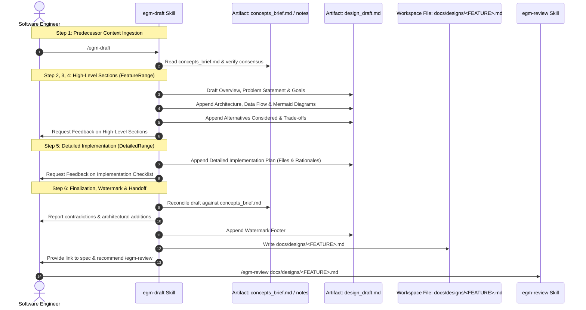

> **原文路径**：`docs/designs/draft.md` | 本文档为中文学习翻译版，保留英文原文件以便对照。

# EGM 设计起草：规格编写与语义边界

*   **作者：** Jim Quinn ([@quinnjim](https://github.com/quinnjim))、Elise Ewing ([@eewing314](https://github.com/eewing314))
*   **状态：** Current（现行）
*   **日期：** 2026-06-06

--------------------------------------------------------------------------------

## 概述

**EGM 设计起草技能**（`/egm-draft`）将构思产物（来自 `/egm-brainstorm` 的 `concepts_brief.md` 或讨论笔记）转化为 `docs/designs/` 目录下的正式活体设计文档。它采用逐节迭代的方式起草文档，在写入磁盘前于每个阶段收集反馈。

至关重要的是，它在文档中确立了**语义边界（semantic boundaries）**，从而使下游的多智能体评审（`/egm-review`）与自动化漂移审计（`/egm-drift-report`）得以高效运行。

## 问题背景

直接要求 AI 模型在单条提示词中编写完整的技术设计文档会引发严重的质量问题：

1.  **单体幻觉与文字墙输出**：模型会将庞大、无结构的 Markdown 文本块直接倾倒到聊天窗中，不仅难以评审，还会截断技术深度。
2.  **过早倾倒代码**：模型不会聚焦于架构不变量、数据流以及文件级设计理由，而是直接生成粗糙且难以维护的辅助代码。
3.  **缺乏供下游工具使用的语义结构**：如果没有严格标准化的章节边界（例如区分高层目标与具体实现计划），自动化评审员就无法拆分审计职责。

## 设计原则

*   **逐节迭代起草**：草稿按增量顺序编写（概述与目标 -> 架构与图表 -> 替代方案 -> 实现计划），并在各节之间请求用户反馈。
*   **产物优先交付**：所有起草状态都渲染至侧边栏产物（`design_draft.md`）或持久化工作区文件中。严禁将长篇草稿直接打印到聊天流中。
*   **按设计进行语义分割**：草稿被划分为高层概念区（`FeatureRange`）与具体执行区（`DetailedRange`），以支持下游金鱼进行有针对性的分区评审。
*   **详尽的文件与理由枚举**：实现计划必须列举每一个待创建、修改或删除的文件，并附上架构设计理由，但不生成原始源代码。
*   **来源水印标记**：定稿文档会在末尾附加标准化的来源水印页脚，以追踪 AI 编写状态。

## 系统架构与工作流



--------------------------------------------------------------------------------

## 起草协议（`/egm-draft`）

`/egm-draft` 工作流将构思产物转化为活体 Markdown 设计文档：

### 步骤 1：前序上下文摄取

从产物目录解析 `concepts_brief.md`（或 `discussion_summary.md` / 功能笔记；必要时回退至草稿目录或工作区根目录）并验证用户共识。

### 步骤 2：概述、问题与目标

在 `design_draft.md` 中起草面向用户的问题陈述、业务价值、目标（Goals）与非目标（Non-Goals）。

### 步骤 3：技术方案与架构

追加组件图（Mermaid）、API 签名与数据流叙述。

### 步骤 4：曾考虑的替代方案

记录被驳回的替代方案及其具体的权衡理由（延迟、复杂度、维护成本），这些内容源自概念简报中的 `Alternatives Weighed` 章节。

### 步骤 5：详细实现计划

起草执行章节：

*   统一清单，列出每个待创建、修改或删除的文件。
*   针对每项文件变更给出明确的架构理由。
*   **不含实现代码**：仅包含数据结构 Schema、类型定义与伪代码。

### 步骤 6：定稿、格式化与注册

*   将草稿与前序上下文进行对账，并要求用户对每一处矛盾做出裁决。此步骤不针对拉远视角标准进行自我打分；该工作由 `/egm-review` 阶段 5 在新鲜上下文中完成。
*   在末尾开放问题之后，附加由水平分隔线（`--------------------------------------------------------------------------------`）隔开的标准化来源水印页脚（`*Drafted with EGM*`）。
*   将文档写入 `docs/designs/<FEATURE>.md`。
*   若存在 `docs/designs/SITEMAP.md`，则向其注册该文档。本仓库使用 `docs/designs/README.md`；贡献者需按 [CONTRIBUTING.md](../../CONTRIBUTING.md) 的要求更新该文件。
*   使用标准 Markdown 格式化工具排版。
*   输出可点击链接，并指引用户运行 `/egm-review`。

--------------------------------------------------------------------------------

## 语义边界发现

EGM 设计文档经过刻意结构化，使下游金鱼评审引擎能够将文档解析为两个语义区域：

1.  **特性范围（`FeatureRange`）**：从第 1 行至分界标题之前。包含高层问题陈述、目标、架构与替代方案。由**设计批评家**（`egm-design`）和**理解力评审员**（`egm-comprehension`）负责审计。
2.  **详细范围（`DetailedRange`）**：从 `## Detailed Implementation Plan` 至文件末尾（EOF）。包含目标文件清单、Schema 与测试计划。由**实现就绪评审员**（`egm-implementation-readiness`）和**代码库细节审计员**（`egm-codebase-details`）负责审计。

以 `## Detailed Implementation Plan` 标题作为标准分界，可在无需人工配置行号范围的情况下实现自动化边界发现。位于文件末尾的终端页脚水印（`*Drafted with EGM*`）被视为惰性结构元数据，在评审与漂移分析期间会被排除在需求审计之外。

## 来源水印标记

为支持轻量级来源追踪与人工检视，所有由 `/egm-draft` 生成的设计规格文档均包含页脚水印：

```markdown
--------------------------------------------------------------------------------

*Drafted with EGM*
```

*   **分隔式 EOF 放置**：附加在文档的绝对末尾，通过一条水平线与尾部章节（`### Open Questions`）隔开。
*   **尽力而为且面向未来**：仅严格适用于今后新起草或更新的规格文档；不对历史遗留文档施加回溯性迁移扫描或阻塞性提交前检查。

--------------------------------------------------------------------------------

## 标准对齐

请参阅所链接的标准文档以了解其具体要求。

| 编写步骤 | 约束标准 |
| :------------- | :----------------- |
| 架构大纲 | [拉远视角标准（Zoom-out standard）](../../resources/document_standards/zoom-out-standard.md) |
| 文档结构 | [特性规格标准（Feature specification standard）](../../resources/document_standards/feature-spec-standard.md) |
| 详细计划 | [实现就绪标准（Implementation readiness standard）](../../resources/document_standards/implementation-readiness-standard.md) |

--------------------------------------------------------------------------------

## 实现文件

起草能力跨以下技能与参考文件实现：

| 文件路径 | 类型 | 用途与存在理由 |
| :-------- | :--- | :----------------------------- |
| `skills/egm-draft/SKILL.md` | 技能定义 | 实现 `/egm-draft` 的逐节 Markdown 编译、站点地图注册与格式化。 |
| `skills/egm-draft/TEST.md` | 单元测试 | 验证起草与定稿工作流的测试场景。 |
| `skills/egm-draft/test_scenarios.yaml` | 评估基准 | 同目录存放的行为评估套件，用于评测模型对起草协议的遵循度。 |
| `skills/egm-draft/references/design_doc.md` | 文档模板 | 权威 Markdown 设计文档模板，定义必需章节与布局。 |
| `resources/execution_instructions.md` | 执行指令 | 核心执行规则，强制执行无代码护栏、静默合规与一次一问的节奏控制。 |

--------------------------------------------------------------------------------

## 参考资料

*   Dave Rensin, [Elephants, Goldfish, and the New Golden Age of Software Engineering](https://medium.com/@drensin/elephants-goldfish-and-the-new-golden-age-of-software-engineering-c33641a48874) (Medium, 2026).
*   GitHub, [GitHub Flavored Markdown Spec](https://github.github.com/gfm/).
