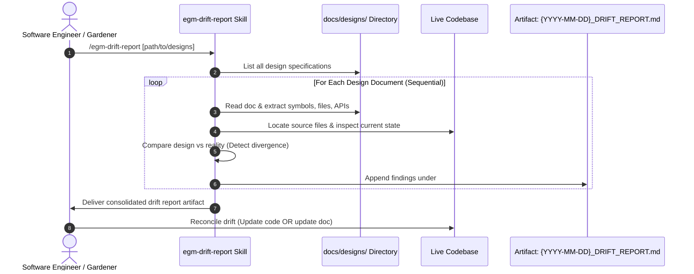

> **原文路径**：`docs/designs/drift_report.md` | 本文档为中文学习翻译版，保留英文原文件以便对照。

# EGM 漂移检测协议（活体规格与代码同步）

*   **作者：** Jim Quinn ([@quinnjim](https://github.com/quinnjim))
*   **状态：** Current（现行）
*   **日期：** 2026-06-07

--------------------------------------------------------------------------------

## 概述

**EGM 漂移检测技能**（`/egm-drift-report`）对照源代码审计签入在 `docs/designs/` 下的设计文档以及包级 `README.md` 层级结构，以识别并报告架构偏离（漂移）。

它旨在作为实践 EGM 团队的常规仪式纳入开发节奏，使设计文档始终与功能实现保持同步。

## 问题背景

文档漂移（尤其是在搭配 AI 工具使用时）会引发以下问题：

1.  **上下文陈旧**：缺乏保持文档同步的机制时，快速的临时修补或未追踪的重构会让设计文档迅速过时。当人类或 AI 智能体参考过时的规格来设计新功能时，会做出错误假设，进而导致有缺陷的实现。

2.  **静默的架构腐化**：没有自动化验证时，预期设计与实际代码之间的差异（例如用硬编码绕过逻辑替代了动态解析器）会悄无声息地累积，直到引发生产事故才被发现。

3.  **人工疲劳**：人工将长达数页的设计文档与数十个实现文件逐一交叉核对既枯燥又极难持续坚持。

## 系统架构与工作流



--------------------------------------------------------------------------------

### 漂移检测启发式分类

漂移检测技能按四类核心偏离审计代码：

| 偏离类别 | 描述 | 可报告漂移示例 |
| :------------------ | :---------- | :----------------------- |
| **功能缺失（Missing Features）** | 设计中描述的逻辑或组件在源代码中完全缺失。 | 设计文档指定的定时清理任务从未在服务二进制中实现。 |
| **模型不完整（Incomplete Models）** | 结构体、Schema、数据类或类缺少设计中规定的字段。 | 设计中的模型 Schema 定义了 5 个字段，但代码实现只有 3 个。 |
| **逻辑走捷径（Logic Shortcuts）** | 在设计为动态逻辑的地方使用了硬编码值、Mock 回退或绕过逻辑。 | 设计要求动态配额查询，但代码使用了硬编码常量 `DEFAULT_QUOTA = 100`。 |
| **架构偏离（Architectural Divergence）** | 代码采用了与计划不同的设计模式、框架或依赖来实现。 | 设计指定使用 gRPC 服务端点，但实际实现使用了自定义 HTTP 处理器。 |

--------------------------------------------------------------------------------

### 执行协议

1.  **接入与发现**：识别目标设计目录（`docs/designs/`）或包目录树（`README.md`）。
2.  **顺序处理**：逐一审计文档，防止工具缓冲区溢出和上下文退化。
3.  **源码落地核查**：通过代码搜索与文件查看工具解析引用的类、端点和文件。如果文档引用了未添加链接的符号，报告会提示工程师补充显式链接，以降低未来扫描的成本。
4.  **差异过滤**：**仅**报告具备可操作性的差异。如果实现与设计完全一致，则输出 `"No drift detected."`。
5.  **产物输出**：使用严格的 Markdown 标题将所有结果格式化写入 `{YYYY-MM-DD}_DRIFT_REPORT.md`：

    ```markdown
    ## <DESIGN_DOC_NAME>

    * [Divergence item 1 with file:line reference]
    * [Divergence item 2]
    <!-- Or "No drift detected." -->
    ```

--------------------------------------------------------------------------------

### 运维维护节奏

为保持文档处于活体且可信状态，我们建议（但不强制）采取以下实践：

*   **每周值班园丁轮值**：运行 EGM 的团队将 `/egm-drift-report` 纳入每周构建园丁（build gardener）或值班（oncall）检查清单。
*   **双向对账**：每一项检测到的漂移都是可操作的：
    *   *若代码变更是有意为之*：更新设计文档以反映现状。
    *   *若代码违背了设计*：提报 Issue 或提示智能体补全缺失的实现。

## 实现文件

漂移检测技能跨以下文件实现：

| 文件路径 | 类型 | 用途与存在理由 |
| :-------- | :--- | :----------------------------- |
| `skills/egm-drift-report/SKILL.md` | 技能定义 | 实现 `/egm-drift-report` 顺序文档扫描器、偏离启发式分析器及报告生成器。 |
| `skills/egm-drift-report/TEST.md` | 测试计划 | 指向 `pytest tests/unit` 与 `TESTING.md`（frontmatter 与链接检查）；无漂移专项测试。 |
| `skills/egm-drift-report/test_scenarios.yaml` | 评估场景 | 单个 `detect_all_drift` 场景，带有宽泛的 `required_pattern` 断言；`tests/unit/test_scenario_coverage.py` 校验其结构，但仓库内暂无执行该断言的运行器。 |

## 参考资料

*   Dave Rensin, [Elephants, Goldfish, and the New Golden Age of Software Engineering](https://medium.com/@drensin/elephants-goldfish-and-the-new-golden-age-of-software-engineering-c33641a48874) (Medium, 2026).
