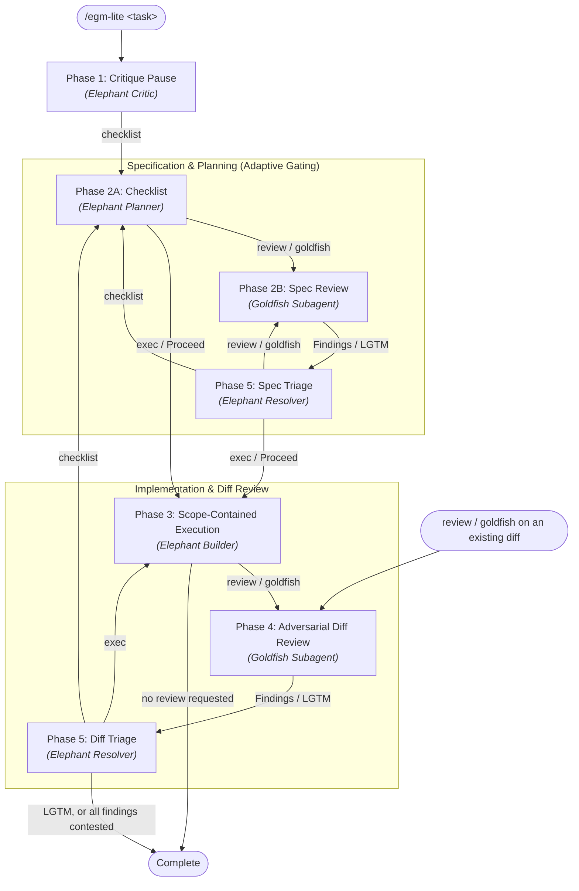

> **原文路径**：`docs/designs/lite.md` | 本文档为中文学习翻译版，保留英文原文件以便对照。

# EGM-Lite：快速临时工程协议

*   **作者：** Jonathan Njeunje ([@njeunje](https://github.com/njeunje))
*   **状态：** Current（现行）
*   **日期：** 2026-11-10

--------------------------------------------------------------------------------

## 概述

**EGM-Lite**（`/egm-lite`）将大象-金鱼模型 (EGM) 适配于小型快速迭代、规格修订、代码重构及缺陷修复场景，而无需走完完整的多文档生命周期。它强制执行一个解耦的 5 阶段状态机，并带有显式的**大象与金鱼智能体人格切换**：
**阶段 1：批评暂停（Critique Pause）**（大象·批评家）、**阶段 2：轻量级执行清单（Lightweight Execution Checklist）**（大象·规划师）及其后用户可跳过的**规格评审（Spec Review）**（金鱼·经由子智能体的规格评审员）、**阶段 3：范围受控执行（Scope-Contained Execution）**（大象·构建者）、**阶段 4：对抗性 Diff 评审（Adversarial Diff Review）**（金鱼·经由子智能体的评审员），以及**阶段 5：评审后裁决门禁（Post-Review Resolution Gate）**（大象·裁决者）。

## 问题背景

对小型变更运行完整的 EGM 生命周期（`/egm-brainstorm` -> `/egm-draft` -> `/egm-review`）会引入不必要的流程开销。反之，无约束的智能体执行则会默认滑向：

1.  未核查上游契约就进行无依据的代码编辑。
2.  推测性抽象与超出范围的重构（YAGNI）。
3.  自我验证掩盖了边界条件与回归缺陷。

EGM-Lite 提供了一个带护栏的中间方案，兼具隔离验证门禁与快速周转效率。

## 非目标

- 替代面向架构变更的完整 EGM 设计生命周期。
- 在隔离评审员不可用时执行同上下文自我评审。
- 将实现扩展到经批准的清单之外，或将评审设为强制步骤。

## 系统架构与解耦状态机

阶段之间的转换严格依赖显式用户命令触发以及异步子智能体完成：

*   **代码引用与 IDE 导航**：所有阶段都使用可点击链接关联被引用的本地文件、符号和行号范围，并通过符号或定义查询引用外部契约。
*   **直白语言 `> **BLUF:**` 引用块**：要求提供 `> **BLUF:**`（Bottom Line Up Front，结论先行）的阶段均以简洁的单段引用块开篇（其后紧跟 `---`），用直白语言陈述核心结论与推荐动作，不含原始 ID、代码字面量或行号链接。
*   **解耦阶段触发**：转换严格响应用户命令。阶段 1 仅通向清单（`checklist`）。在清单阶段，开发者可以跳过规格评审、走快速通道直达阶段 3（`exec`），待完成后再评审结果。阶段 2B 的规格评审与阶段 4 的 Diff 评审（`review` / `goldfish`）均是用户可跳过的金鱼评审，两者均非强制。
*   **自适应门禁（Adaptive Gating）**：阶段 2A 依据固定复杂度准则检查清单，针对非平凡变更推荐执行规格评审，针对常规变更推荐直接执行。最终由开发者决定；该推荐绝不强加必选步骤。
*   **命令路由与状态提示**：`review` 与 `goldfish` 是绑定到最近完成阶段的别名。在阶段 2A 或阶段 5 规格分诊之后，它们启动阶段 2B 规格评审。在阶段 3 或阶段 5 Diff 分诊之后，或在无进行中任务但存在既有 Diff 时，它们启动阶段 4 Diff 评审。失序命令（无物可审时调用 review，或清单尚未生成时调用规格评审）会返回一条 `> **BLUF:**` 状态提示，指明有效的下一步命令。
*   **子智能体完整性守卫**：阶段 2B 和阶段 4 要求具备隔离的新鲜上下文子智能体工具（`invoke_subagent`）。在不支持子智能体能力的单智能体环境中，协议会中止并告知开发者，而绝不执行有偏见的同上下文自我评审。
*   **禁止谄媚姿态（Non-Sycophantic Posture）**：所有阶段均以技术风险、权衡或缺陷开篇，严禁使用奉承性形容词或客套道歉。



### 阶段 1：批评暂停（`/egm-lite`）

*   **智能体人格**：大象（批评家 Critic）——对抗性、怀疑论。它工作在完整对话上下文中，因此属于大象；零上下文金鱼评审在阶段 2B 和阶段 4 运行。
*   **事实落地与 BLUF**：在提出解决方案之前，先探查目标文件、直接调用方或测试、任何现有目录 `README.md` 或用户引用的文档，以及仓库定义，并以 `> **BLUF:**` 开篇说明当前方案是否已准备好进入 `checklist` 或存在阻塞。
*   **契约追踪**：将假设标记为 `[⚠️ UNVERIFIED]`（未经测试的契约）或 `[⏳ ACK]`（已排期进行实证测试）。
*   **曾考虑的替代方案**：当存在多种可行方案时，将权衡记录在 `egm_lite_alternatives.md` 中（以 `> **BLUF:**` 开篇说明推荐选项与权衡），并在聊天中链接该产物而不展开行内长篇讨论（对简单或单路径任务则省略此文件）。
*   **完成门禁**：暂停执行，等待 `checklist` 命令。此时输入 `exec`、`review` 或 `goldfish` 命令将返回状态提示，引导用户先生成清单。

### 阶段 2：轻量级执行清单与规格评审

#### 阶段 2A：清单生成（`checklist`）

*   **智能体人格**：大象（规划师 Planner）——结构化、有条理。
*   **产物生成**：编写或更新 `egm_lite_checklist.md`，按三个标准章节组织：
    1.  *Targets & Tasks（目标与任务）*：使用 GFM 复选框（`- [ ]`）的有序清单项，链接精确文件路径与行号范围或工具命令，并附简要理由。
    2.  *Pre-Review Exclusions（预评审排除项）*：明确达成共识的范围边界，在评审中予以静默忽略。
    3.  *Accepted CONTEST Rationales（已接受的异议理由）*：在迭代循环间保留的已裁决误报发现，防止评审员重复标记。
*   **规格门禁（自适应门禁）**：依据固定复杂度准则（两个及以上生产代码文件、异步/并发、公共 API，或存在 `[⚠️ UNVERIFIED]` / `[⏳ ACK]` 标签）评估清单，并以 `> **BLUF:**` 开启门禁：对非平凡任务推荐运行规格评审（`goldfish` 或 `review`），对常规修复和纯文档编辑则说明直接执行（`exec`）是合理的。
*   **完成门禁**：在任何情况下均提供两个命令选项，并暂停执行直到用户输入 `goldfish` / `review` 或点击 **Proceed** / 输入 `exec`。

#### 阶段 2B：无状态规格评审（`goldfish` / `review`）

*   **智能体人格**：金鱼（经由子智能体的规格评审员）——隔离、零上下文审计员。
*   **子智能体隔离**：派生一个隔离的子智能体（角色为“Goldfish Specification Reviewer”），并将 `egm_lite_checklist.md` 的完整 Markdown 内容注入其提示词。若是从阶段 5 发起的复审，先将达成共识的修订更新至清单。若没有可用的新鲜上下文子智能体工具，则停止并在清单上提供 `exec` / **Proceed** 选项。
*   **规格评审准则**：跨四个维度强制执行严格的二元输出契约（零发现时输出 `[✅ LGTM]`），跳过预评审排除项与已接受的 `CONTEST` 理由，且禁止执行 AST 或代码 Diff 检查（因为此时尚未实现代码）：
    1.  *范围约束与 YAGNI*：目标严格限定在任务范围内，不增加未要求的抽象。
    2.  *契约与不变量标记*：外部依赖和未经测试的边界均标注了 `[⚠️ UNVERIFIED]` 或 `[⏳ ACK]`。
    3.  *边界条件与故障模式*：已映射错误处理、超时与边界条件。
    4.  *测试计划可执行性*：测试目标或实证验证步骤具体且可运行。
*   **完成门禁**：派生子智能体后暂停执行，等待其异步响应。

### 阶段 3：范围受控执行（`exec`）

*   **智能体人格**：大象（构建者 Builder）——专注的实现者。
*   **产物初始化**：在完成清单或经验证的规格（来自阶段 2A、阶段 2B 或阶段 5 规格 LGTM）之后，直接读取 `egm_lite_checklist.md` 而非重新创建。在从阶段 5 带有已同意修订或修复走快速通道时，先创建或更新 `egm_lite_checklist.md`，再修改任何文件或运行命令。
*   **边界强制执行**：应用留在 `egm_lite_checklist.md` 上的所有行内评论，并仅执行清单中经批准的条目与目标（涵盖代码、规格或设计文档）；零推测性逻辑。
*   **代码规范**：为非显而易见或复杂的逻辑块添加行内注释。
*   **测试验证与自我修复**：运行覆盖受影响目标的本地测试，具备自主单调收敛修复能力（对纯文档编辑则不适用，或仅运行 linter）。
*   **清单进度**：测试验证通过后，更新 `egm_lite_checklist.md` 将已完成任务标记为 `- [x]`；在上报中止、自主自我修复或多文件总结时以 `> **BLUF:**` 开篇，而在干净的单目标运行中省略。
*   **完成门禁**：提示可运行 `review` 或 `goldfish` 并暂停执行，附带严格负向约束禁止在触发前进入后续阶段。Diff 评审是用户可跳过的金鱼评审：只要阶段 3 编辑了文件，门禁就会推荐运行它，但用户也可以不经评审直接结束任务。

### 阶段 4：对抗性 Diff 评审（`review` / `goldfish`）

*   **智能体人格**：金鱼（经由子智能体的评审员）——隔离、零上下文审计员。
*   **入口**：在阶段 3 或阶段 5 Diff 分诊之后运行，或在无进行中任务时针对既有 Diff（工作区变更，或用户提供的 Diff / Pull Request）运行。无物可审时返回状态提示。
*   **子智能体隔离**：在新鲜子智能体上下文中对照清单评估干净的 VCS Diff，派生角色为“Goldfish Reviewer”（通过 `invoke_subagent`、`Agent` 或 `spawn_agent`，若无可用新鲜上下文子智能体工具则停止），保持零对话偏见，跳过清单中记录的预评审排除项与已接受的 `CONTEST` 理由，并抑制风格吹毛求疵。
*   **Diff 评审准则**：跨五个维度强制执行严格的二元输出契约（仅输出发现项，或在零发现时显式输出 `[✅ LGTM]`）。对于纯文档 Diff，前三个维度替换为对照经批准清单的事实一致性、清晰度、链接卫生和 Markdown 行宽检查：
    1.  *线程与状态安全*：竞态条件、死锁、异步变更。
    2.  *边界条件*：空值检查、差一错误（off-by-one）、未处理异常。
    3.  *测试覆盖与回归审计*：所有新增分支的单元测试覆盖。
    4.  *YAGNI 审计*：剪除不必要的抽象。
    5.  *契约与标签审计*：验证 `[⚠️ UNVERIFIED]` 与 `[⏳ ACK]` 标签均已测试并移除。
*   **完成门禁**：派生子智能体后暂停执行，等待其异步响应。

### 阶段 5：统一评审后裁决门禁（子智能体响应）

*   **智能体人格**：大象（裁决者 Resolver）——高上下文分诊员。
*   **响应路由**：根据派生评审的阶段（阶段 2B 或阶段 4，通过子智能体角色识别）决定当前处理的是规格评审响应还是 Diff 评审响应。
*   **严格非变更分诊**：大象裁决者严格以只读展示模式运行，严禁在分诊期间修改应用源文件。经批准的修复会暂存进 `egm_lite_checklist.md`，待后续 `exec` 或 `checklist` 回合执行。
*   **发现分诊（`PROPOSE FIX` vs. `CONTEST`）**：在不做代码编辑、不运行 VCS 变更操作的前提下，将子智能体发现与代码库或规格交叉核对；以 **`[🛠️ X FIX | 🛡️ Y CONTEST]`** 领衔的 `> **BLUF:**` 开篇，随后以结构化项目列表或紧凑对比表呈现编号及优先级标签条目（`[X] [PY]`，例如 `[1] [P0]`、`[2] [P0]`、`[3] [P3]`），各组内按严重程度降序排列（`P0` > `P1` > `P2` > `P3`，无论中间层级是否空缺），将 `PROPOSE FIX` 补丁排在有代码库证据支撑的 `CONTEST` 误报（默认跳过）之前。
*   **完成与同步门禁**：
    *   *实现前（规格评审）*：干净通过，或用户确认所有发现均被提出异议或驳回时，在清单上加盖 `Verified [✅ LGTM]` 印记并提示运行 `exec` / **Proceed**。它绝不会关闭任务。若仍有剩余发现，则提示运行 `checklist` 修订、`exec` 直接实现，或 `goldfish` / `review` 复审。
    *   *实现后（Diff 评审）*：干净通过，或用户确认所有发现均被提出异议或驳回时，以 **`[✅ LGTM]`** 领衔的 `> **BLUF:**` 开篇，并总结修改的文件与通过的测试；否则若仍存在缺陷，则提示运行 `checklist`（或快速通道 `exec`）。

## 实现文件

EGM-Lite 能力跨以下包文件实现：

| 文件路径 | 类型 | 用途与存在理由 |
| :-------- | :--- | :----------------------------- |
| `skills/egm-lite/SKILL.md` | 技能定义 | 实现带自适应门禁的解耦 5 阶段状态机（`/egm-lite` -> `checklist` -> 规格评审（用户可跳过） -> `exec` -> `review` -> 裁决）。 |
| `skills/egm-lite/agents/openai.yaml` | 宿主元数据 | 为 OpenAI/Codex 声明扩展接口、显示名称与品牌样式。 |
| `skills/egm-lite/assets/icon.svg` | 矢量图标 | 遵循 EGM 设计系统的自包含 24x24 双面图标（Spark）。 |
| `skills/egm-lite/TEST.md` | 单元测试 | 测试解耦阶段门禁与智能体人格切换的验证测试场景。 |
| `skills/egm-lite/test_scenarios.yaml` | 评估基准 | 评估模型对 5 阶段 EGM-Lite 协议遵循度的基准测试套件。 |

### 验证计划

EGM-Lite 协议通过确定性行为评估套件（`skills/egm-lite/test_scenarios.yaml`）、协议检查清单（`skills/egm-lite/TEST.md`）以及单元测试（`pytest tests/unit`）进行验证。

验证强制检查六项核心行为不变量：

1.  **状态机与暂停门禁（阶段 1 与阶段 2）**：断言变更操作必须暂停等待用户确认（先 `checklist`，再 `exec` 或 **Proceed**）、`egm_lite_checklist.md` 使用 GFM 复选框初始化，以及竞争架构记录于 `egm_lite_alternatives.md`。
2.  **范围受控执行与收敛（阶段 3）**：验证代码编辑严格限定在经批准的清单项内、本地测试以自主单调收敛方式执行，且已完成任务标记为 `- [x]`。
3.  **新鲜上下文子智能体隔离（阶段 4）**：通过新鲜上下文子智能体工具（`invoke_subagent`）强制真正的上下文隔离，拒绝同上下文金鱼评审，并跳过用户同意的预评审排除项。
4.  **二元评审契约（阶段 4）**：断言任何缺陷都会严格抑制 LGTM 并输出按优先级排序的发现（`P0`–`P3`），而干净通过时则以显式包含 `[✅ LGTM]` 的 `> **BLUF:**` 开篇。
5.  **评审后分诊与同步（阶段 5）**：验证纯展示型分诊（`[🛠️ X FIX | 🛡️ Y CONTEST]`）、`CONTEST` 理由在清单中的持久化，以及循环闭环。
6.  **自适应门禁与命令路由（阶段 2A、2B 与 5）**：断言阶段 2A 同时提供 `exec` 与 `goldfish` / `review` 并对非平凡变更给出推荐、规格评审子智能体接收到清单与规格评审准则、规格 LGTM 提示进入 `exec` 而不关闭任务，以及失序命令返回状态提示。

#### 测试执行

```bash
# 运行单元测试、打包校验与宿主发现检查
pytest tests/unit

# 校验 Markdown 链接完整性
pytest tests/unit/test_link_integrity.py
```

## 参考资料

*   [EGM 框架架构](architecture.md)
*   [EGM 金鱼评审协议与裁决引擎](review.md)
*   [EGM 设计起草](draft.md)
*   [共享技能图标](skill_icons.md)
*   [测试指南](../../TESTING.md)
