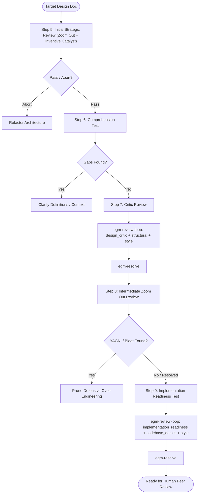

> **原文路径**：`docs/designs/review.md` | 本文档为中文学习翻译版，保留英文原文件以便对照。

> 💡 **第一性原理提示**：多阶段金鱼评审流水线本质上是一套**按海拔与职责正交解耦的漏斗型过滤器**。先用拉远视角（Zoom Out）与发明催化剂在最高海拔剔除伪需求与伪妥协，再检验零背景可读性，最后才逐层下沉到故障模式与文件路径审计，避免在注定会被推翻的方案上浪费细粒度审查成本；而 `egm-resolve` 的四分类裁决机制则将“盲从 AI 意见”转化为基于源码证据的工程辩论。

# EGM 金鱼评审协议与裁决引擎

*   **作者：** Brandon Tearse ([@tearseb](https://github.com/tearseb))、Brian Suchy ([@briansuchy](https://github.com/briansuchy))、Sean Stappas ([@seanstappas](https://github.com/seanstappas))
*   **状态：** Current（现行）
*   **日期：** 2026-06-10

--------------------------------------------------------------------------------

## 概述

**金鱼评审协议（Goldfish Review Protocol）**是大象-金鱼模型 (EGM) 的验证引擎。它通过使用隔离的、零上下文 AI 子智能体（“金鱼”）依据严格的定性评估准则对设计规格草稿进行压力测试。

本文档规定了以下内容：

1.  多阶段评审流水线（`/egm-review`）。
2.  评审编排驱动器（`egm-review-loop`）。
3.  专业评审智能体人格的完整目录。
4.  与文档标准及评估准则（`resources/document_standards/`）的映射关系。
5.  交互式裁决引擎（`egm-resolve`）。

## 问题背景

由起草文档的同一 LLM 进行自我评审会遭受严重的确认偏误。当同一个上下文窗口既起草计划又评审计划时：

1.  **盲区持续存在**：模型会误以为它记在内存中的上下文在正文里已经不言自明，从而忽略未声明的假设与未定义的术语。
2.  **幻觉掩盖**：讨论阶段做出的无效 API 假设未经实际源代码验证便蒙混过关。
3.  **过早批准实现**：缺乏具体文件路径或测试策略的实现计划未经严格审查就被草率放行。

金鱼模型通过派生新鲜的、无状态的子智能体来缓解这一问题——这些子智能体仅读取目标文档和明确引用的源文件。

## 评审流水线架构（`/egm-review`）

完整的评审流水线按顺序执行五个评估阶段：

### 阶段拆解

1.  **步骤 5：初始战略评审（海拔与矛盾检查）**：
    *   *目标*：完整文档。
    *   *智能体人格*：[`zoom_out`](../../agents/zoom_out.md)（怀疑论架构师 Skeptical Architect）、[`inventive_catalyst`](../../agents/inventive_catalyst.md)（发明催化剂 Inventive Catalyst）。
    *   *标准*：`zoom-out-standard.md`（用于 `zoom_out`）、内联模式目录（用于 `inventive_catalyst`）。
    *   *重点*：在投入细致评审轮次之前，验证问题界定、驳回推测性特性（YAGNI）、识别技术矛盾、提出基于模式的化解方案，并核查对现有基础设施的复用。
2.  **步骤 6：理解力测试（自洽性检查）**：
    *   *目标*：`FeatureRange` vs `DetailedRange`。
    *   *智能体人格*：[`comprehension`](../../agents/comprehension.md)（零背景读者 Naive Reader）。
    *   *标准*：基线自洽性（Baseline Self-Containment）。
    *   *重点*：以零先验上下文阅读文档。识别缺失的前置知识、未解释的缩略词与概念断层。
3.  **步骤 7：批评家评审（对抗性压力测试）**：
    *   *目标*：`FeatureRange`（高层架构）。
    *   *智能体人格*：[`design_critic`](../../agents/design_critic.md)、[`structural`](../../agents/structural.md)、[`style`](../../agents/style.md)。
    *   *标准*：`feature-spec-standard.md`（用于 `design_critic` 和 `structural`）。
    *   *重点*：探查单点故障（SPOF）、规模极限、故障模式与边界情况。
4.  **步骤 8：中间拉远视角评审（批评后剪枝）**：
    *   *目标*：完整文档。
    *   *智能体人格*：[`zoom_out`](../../agents/zoom_out.md)（怀疑论架构师）。
    *   *标准*：`zoom-out-standard.md`。
    *   *重点*：增量审计，聚焦于理解力测试与批评家评审阶段中引入的新增内容、修改项及防御性缓解措施。在进入任务规划前清除推测性复杂度与 YAGNI 元素，同时避免重复标记步骤 5 中已接受的决策。
5.  **步骤 9：实现就绪测试（可执行性检查）**：
    *   *目标*：`DetailedRange`（`## Detailed Implementation Plan`）。
    *   *智能体人格*：[`implementation_readiness`](../../agents/implementation_readiness.md)、[`codebase_details`](../../agents/codebase_details.md)、[`style`](../../agents/style.md)。
    *   *标准*：`implementation-readiness-standard.md`（用于 `implementation_readiness` 和 `codebase_details`）。
    *   *重点*：验证每一个被触及的文件均以明确的仓库相对路径写入边界列出并附有理由、API 签名与现行代码库事实一致，且存在分步骤测试计划。

--------------------------------------------------------------------------------

## 评审智能体人格目录

所有评审智能体人格提示词均位于 [`agents/`](../../agents/) 目录下：

| 智能体人格文件 | 角色头衔 | 核心职责 |
| :----------- | :--------- | :-------------------- |
| [`agents/zoom_out.md`](../../agents/zoom_out.md) | 怀疑论架构师（Skeptical Architect） | 审计过度工程、YAGNI 与非必要复杂度。搜索代码库以寻找现有工具组件，防止重复造轮子。 |
| [`agents/comprehension.md`](../../agents/comprehension.md) | 零背景读者（Naive Reader） | 假设没有任何先验知识。识别未定义的术语、隐含的系统上下文与缺失的架构图。 |
| [`agents/design_critic.md`](../../agents/design_critic.md) | 分析型设计批评家（Analytical Design Critic） | 评估系统可靠性、规模极限、运维风险、故障恢复及权衡理由。 |
| [`agents/implementation_readiness.md`](../../agents/implementation_readiness.md) | 技术主管审计员（Tech Lead Auditor） | 确保实现计划包含无歧义、确定性的指令、完整的文件清单与验证步骤。 |
| [`agents/codebase_details.md`](../../agents/codebase_details.md) | 代码库细节审计员（Codebase Auditor） | 将文档中引用的路径、类与函数签名与现行源码交叉核对，防止漂移与幻觉 API。 |
| [`agents/structural.md`](../../agents/structural.md) | 布局校验员（Layout Validator） | 强制执行标准标题层级、表格格式及文档模板一致性。 |
| [`agents/style.md`](../../agents/style.md) | 技术文字编辑（Technical Copy Editor） | 清除对话式赘语，强制客观事实语气，校准防御性免责声明（`DROP` / `CALIBRATE` / `RELOCATE` / `KEEP`），并确保遵循简洁的技术写作标准。 |
| [`agents/inventive_catalyst.md`](../../agents/inventive_catalyst.md) | 发明催化剂（Inventive Catalyst） | 应用 TRIZ 原则识别技术矛盾、伪妥协以及基于模式的解决方案。 |
| [`agents/synthesizer.md`](../../agents/synthesizer.md) | 评审合成器（Review Synthesizer） | 并发派生评审员、去重评审发现、规范化文件链接并写入整合报告产物。 |

--------------------------------------------------------------------------------

## 文档标准与评估准则（`resources/document_standards/`）

评审员依据[共享运行时资源](../../resources/README.md)中列出的版本化标准来评估草稿。请阅读实际标准文件以了解具体要求。上述阶段拆解仅说明每次评审与对应标准的映射关系，并不替代这些评估准则本身。

--------------------------------------------------------------------------------

## 交互式裁决引擎（`egm-resolve`）

当金鱼评审员完成审计后，**大象裁决引擎（Elephant Resolution Engine）**会摄取扁平化的评审发现列表并管理交互式分诊。

### 1. 评估与分类

针对每一条评审发现，大象会判定其归属类别：

*   **`PROPOSE FIX`（建议修复）**：批评意见成立。生成精确的替换文本或结构化编辑方案。
*   **`CONTEST`（提出异议）**：批评意见不成立或基于误解。引用具体的代码库证据来为当前文本辩护。
*   **`ESCALATE`（上报裁决）**：批评意见不成立，但唯有被审文件之外的知识才能反驳它。交由用户裁决。大象不会为了迎合零上下文评审员而强行往文档里塞入冗余背景。
*   **`DECLINE`（婉拒忽略）**：该发现仅为微瑕（Nit）。记录在案，不作修改。

提出异议（`CONTEST`）必须引用评审员本可读取到的证据。理解力断层（Comprehension gaps）不可提出异议，且未提出异议时不得更改严重程度级别。

### 2. 用户分诊模式

工程师可通过四种交互模式审阅 `goldfish_review_report.md`：

*   **自动接受（Auto Accept）**：批量应用所有 `PROPOSE FIX` 建议，并跳过 `CONTEST` 条目。
*   **交互式逐条拆解（Interactive Breakdown）**：在聊天中按顺序逐条走查，提供详细解释并支持人工推翻裁决。
*   **产物评论（Artifact Comments）**：直接在产物文件上添加行内评论，由大象解析并应用。（推荐）
*   **通配请求（Wildcard Requests）**：暂停评审以回答临时问题或执行探索性命令，随后再恢复分诊流程。

### 3. 迭代与检查点门禁

应用修复后，循环会呈现一个强制检查点，询问用户是再运行一轮评审还是结束工作流。被提出异议（`CONTEST`）或记录为不修复（`DECLINE`）的发现会在跨轮次间保持已裁决（Settled）状态。已修复的发现若在后续评审中再次被提出，则会重新打开。当某轮评审结果不包含任何未裁决的 Blocker（阻塞级）或 Major（重要级）发现时，该轮即为净轮次（Clean Round）。当连续出现两个净轮次，或工程师主动中止循环时，流程结束。达到 5 轮时，或当某项新发现需要通过回滚先前修复来解决（即发生修复振荡 Churn）时，循环会询问工程师选择接受、继续，还是退回起草阶段。

## 实现文件

| 文件路径 | 类型 | 用途与存在理由 |
| :-------- | :--- | :----------------------------- |
| `skills/egm-review/SKILL.md` | 技能定义 | 编排多阶段评审流水线的入口（拉远视角 $\rightarrow$ 理解力 $\rightarrow$ 批评家 $\rightarrow$ 中间拉远视角 $\rightarrow$ 实现就绪）。 |
| `skills/egm-review/TEST.md` | 单元测试 | 测试 `/egm-review` 多阶段流程与检查点门禁的验证测试场景。 |
| `skills/egm-review/test_scenarios.yaml` | 评估基准 | 评估模型评审精确率与召回率的基准测试套件。 |
| `skills/egm-review-loop/SKILL.md` | 技能定义 | 核心评审驱动器，管理异步子智能体派生与评审发现收集。 |
| `skills/egm-review-loop/TEST.md` | 单元测试 | 测试金鱼评审循环分发的验证测试场景。 |
| `skills/egm-review-loop/test_scenarios.yaml` | 评估基准 | 评估金鱼评审循环分发的基准测试套件。 |
| `skills/egm-resolve/SKILL.md` | 技能定义 | 大象裁决引擎，管理 `CONTEST` vs `PROPOSE FIX` 分诊与自动化修复。 |
| `skills/egm-resolve/TEST.md` | 单元测试 | 验证评审发现分类与裁决循环的测试场景。 |
| `skills/egm-resolve/test_scenarios.yaml` | 评估基准 | 评估模型裁决与修复建议准确度的基准测试套件。 |
| `agents/*.md` | 智能体人格提示词 | 全部 8 位金鱼评审员与合成器的系统提示词指令。 |
| `resources/document_standards/*.md` | 文档标准 | 特性规格、实现就绪与简洁性的评估准则与标准。 |

## 参考资料

*   Dave Rensin, [Elephants, Goldfish, and the New Golden Age of Software Engineering](https://medium.com/@drensin/elephants-goldfish-and-the-new-golden-age-of-software-engineering-c33641a48874) (Medium, 2026).
*   DARPA, [The Heilmeier Catechism](https://www.darpa.mil/about/heilmeier-catechism).
