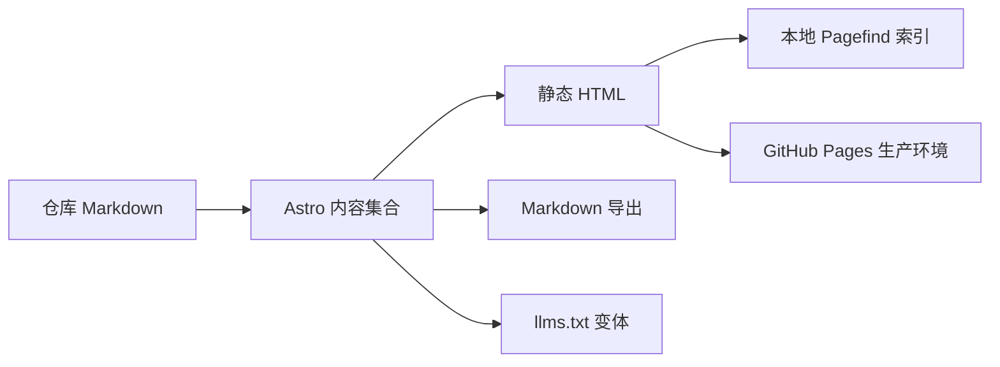

> **原文路径**：`docs/designs/site_documentation.md` | 本文档为中文学习翻译版，保留英文原文件以便对照。

# EGM 官网与文档站

- **作者：** @n3wth
- **状态：** 提案（Proposed）。维护者范围审批待定。
- **日期：** 2026-11-04
- **范围 Issue：** #303。关联工作：#7、#58、#301 与 #302。

## 概述

使用 Astro Starlight 从 `docs/site/` 中的官网 Markdown 发布指南与技能页面。在全站范围内保持统一的页眉、页脚、字阶（type scale）与色彩体系。在不引入服务端运行时的前提下提供 Markdown 导出与本地搜索。

现有原型仅作为评审佐证，不能替代设计批准，也不授权生产发布。

## 问题背景

当前官网仅对 EGM 做了简要介绍，大部分说明仍把读者导向 GitHub。读者需要清晰的安装步骤以及直达每个技能的入口。学生、架构师、项目经理和软件工程师都需要一套不以编码工作流为前提的说明文档。

默认的起草与设计评审技能面向软件设计；自定义评审技能则通过显式选择评审员与评估标准来支持其他类型文档。官网必须在不在首页堆砌冗长免责声明的情况下阐明这一区别。

Issue #7 提议建设单页指南并排除搜索与多页文档。本提案范围独立。Issue #7 与实操示例 Issue #58 仍需独立推进。

## 目标

- 发布 `/guide`、`/install`、`/getting-started`、`/workflow` 与 `/skills` 页面。
- 为现有的七个技能分别发布 `/skills/<skill-name>` 页面。
- 在 `docs/site/skills/` 中为每个技能保留一个独立页面，面向使用插件的人类读者解释该技能。
- 将每个技能页面链接至其权威 `SKILL.md`。
- 将官网指南正文保留在 `docs/site/` 中，与展示组件解耦。
- 在首页与文档页之间共享页眉与页脚。
- 复用现有的 Material Web gBreeze 样式、字体、品牌标志与技能图标。
- 在浅色与深色双主题中为正文文本分配统一的颜色角色。
- 提供键盘无障碍的本地搜索以及“复制为 Markdown”操作。
- 将每个文档页面导出为 Markdown，并生成三个 `llms.txt` 变体文件。
- 保留现有的 GitHub Pages 生产部署流程。

## 非目标

- 更改技能执行方式、评审权限或宿主环境支持。
- 更改插件清单、分类、政策链接或技能描述。
- 替换现有的生产隐私同意（consent）与统计分析规则。
- 新增用户账号、数据库、远程搜索或 AI 聊天服务。
- 制作录制的评审示例，或将虚构示例宣称为真实评审。
- 用原型审批替代仓库既有的贡献流程。
- 新增对其他 AI 应用的支持。

## 待决问题

- 维护者必须批准该新范围并为其 Issue 加上 `design-ready` 标签。
- 本设计必须先合并，对应 Issue 才能获得 `pr-ready` 以进入实现。
- PR #302 仍保留其独立的元数据范围决策，本提案不授予该豁免。

## 关键用户旅程 (CUJs)

### 理解 EGM

- **前置条件（Given）：** 读者在毫无 EGM 先验知识的情况下访问首页。
- **操作（When）：** 读者浏览说明与流程图。
- **预期结果（Then）：** 读者能够区分高上下文的作者（大象）与独立的评审员（金鱼）。
- **预期结果（Then）：** 读者能够看出由人类核查发现项并拍板决定如何修改。

### 安装插件

- **前置条件（Given）：** 读者使用受支持的桌面应用或命令行应用。
- **操作（When）：** 读者打开 `/install`。
- **预期结果（Then）：** 已发布的 ChatGPT 与 Codex 桌面端链接显示在首位，并标明其仅限桌面端的限制。
- **预期结果（Then）：** 独立章节说明 Claude Cowork 与既有命令行安装路径。
- **预期结果（Then）：** 读者可继续阅读首个项目指南并查看宿主支持限制。

### 选择并阅读技能

- **前置条件（Given）：** 读者知道下一步任务，但不知道对应的命令。
- **操作（When）：** 读者打开 `/skills` 并选择一个任务分组。
- **预期结果（Then）：** 页面展示每个技能的权威图标、名称、命令与简短用途。
- **预期结果（Then）：** 点击技能链接会打开独立页面，解释该技能并链接至其仓库指令文件。

| 任务分组 | 技能与命令 |
| --- | --- |
| 构思与起草（Develop an idea） | Brainstorm（`/egm-brainstorm`）、Draft（`/egm-draft`） |
| 评审文档（Review a document） | Review（`/egm-review`）、Resolve findings（`/egm-resolve`）、Custom review（`/egm-review-loop`） |
| 代码协作（Work with code） | Document a codebase（`/egm-bootstrap`）、Check for drift（`/egm-drift-report`） |

### 搜索与复制文档

- **前置条件（Given）：** 读者在支持 JavaScript 的环境中打开文档页。
- **操作（When）：** 读者打开搜索框、输入关键词并选择一个结果。
- **预期结果（Then）：** Pagefind 搜索本地索引并跳转到对应页面或章节。
- **操作（When）：** 读者点击“Copy page（复制页面）”。
- **预期结果（Then）：** 站点复制该页面的 Markdown 内容并提示成功。
- **预期结果（Then）：** 若复制失败，则暴露直达 Markdown 的链接以及错误提示。

### 无 JavaScript 或窄屏阅读

- **前置条件（Given）：** JavaScript 不可用，或读者使用窄屏设备。
- **操作（When）：** 读者打开某个文档 URL。
- **预期结果（Then）：** 静态页面文本与普通链接保持可用。
- **预期结果（Then）：** 在 JavaScript 可用时，移动端导航与布局适配视口。
- **预期结果（Then）：** 宽代码块与表格在其内容区域内可横向滚动。

## 技术方案

### 静态内容流水线

Astro 保持静态输出。Starlight 提供文档布局、导航、目录、搜索集成与代码渲染。Astro 内容加载器读取 `docs/site/**/*.md`。每个集合条目 ID 为 `docs/site/` 之下不含 `.md` 后缀的文件路径，对应路由为 `/` 加上该 ID。例如，`docs/site/skills/egm-review.md` 的路由为 `/skills/egm-review`。`SKILL.md` 文件是写给 AI 助手的指令，官网不直接渲染这些文件。权威技能指令保持不变。

Markdown 转换器将相对仓库引用解析为权威 GitHub URL，同时保留绝对 URL、站内路由、锚点以及代码示例。

### 依赖与加载器选型

使用 Node.js 22.23.4 或更高版本。候选锁文件解析出的包版本如下：

| 包名 | 版本 |
| --- | --- |
| `astro` | `7.4.5` |
| `@astrojs/starlight` | `0.42.9` |
| `starlight-llms-txt` | `0.12.0` |
| `@astrojs/markdown-remark` | `7.3.5` |
| `unified` | `11.0.5` |
| `remark-parse` | `11.0.0` |
| `remark-gfm` | `4.0.1` |
| `remark-stringify` | `11.0.0` |

在 `package-lock.json` 中固定这些解析版本，验证与部署均使用 `npm ci`。候选方案在这些版本下通过了 Astro 检查、静态构建与文档检查。

使用 `defineCollection` 与来自 `astro/loaders` 的 Astro `glob` 加载器定义 `docs` 集合。以仓库根目录作为基础路径（从 `site/` 出发为 `..`），匹配模式为 `docs/site/**/*.md`。使用 `generateId` 生成集合条目 ID。对照 Starlight 的 `docsSchema()` 校验 frontmatter，通过 Schema 校验拒绝缺少标题或无效的 Starlight 元数据。

### 技能页面

每个技能页面文件名为 `docs/site/skills/<skill-name>.md`，其中 `<skill-name>` 与技能目录名一致。图标查找、侧边栏与重定向均依赖该命名。每个页面按以下顺序包含五个章节：What it does、When to use it、What you get、Example、Full instructions。frontmatter 标题采用上方任务分组表中的显示名称；frontmatter 描述为官网文案，不改变权威技能描述。新增技能时须同步新增页面、侧边栏条目与重定向。如果技能页面与其 `SKILL.md` 存在出入，以 `SKILL.md` 为准，视为技能页面存在缺陷。

对于 Markdown 导出，使用 `unified`、`remark-parse` 和 `remark-gfm` 解析 `entry.body`，应用共享的仓库链接转换器，再用 `remark-stringify` 序列化，并在开头添加页面标题与描述。渲染页面时在 Astro 的 remark 流水线中复用同一转换器。

### 仓库 URL 规则

仓库引用统一指向 `main` 分支，这些链接刻意跟踪当前仓库内容而非固定构建版本。相对路径相对于源 Markdown 文件解析，而非其官网路由。保留查询字符串与片段锚点；原样保留绝对 URL、根相对站内路径与纯锚点引用。在文档检查中拒绝超出仓库范围的路径以及缺失的相对目标。

- 仓库文件链接至 `https://github.com/google/elephant-goldfish-model/blob/main/<path>`。
- 仓库目录链接至 `https://github.com/google/elephant-goldfish-model/tree/main/<path>`。
- 图像节点解析至 `https://raw.githubusercontent.com/google/elephant-goldfish-model/main/<path>`。
- 被图像使用的引用定义（reference definitions）指向 raw 资产地址；其他定义遵循文件或目录规则。

图像与普通链接可能共享同一个引用定义，此时对该定义使用 raw 地址以确保图像有效。在渲染后的 HTML 与 Markdown 导出中同时测试内联图像、图像引用定义、目录链接以及带锚点的文档链接。保持代码示例原样不变。

旧版 HTML 路由重定向如下：

- `/docs` 重定向至 `/guide`。
- `/docs/getting-started` 重定向至 `/getting-started`。
- `/docs/workflow` 重定向至 `/workflow`。
- `/docs/skills` 重定向至 `/skills`。
- 上述七条命令对应的 `/docs/skills/<skill-name>` 重定向至 `/skills/<skill-name>`。

本契约不包含其他旧版路径。

### 共享界面

`Nav.astro` 负责文字商标（wordmark）、站点链接、当前激活分区以及 GitHub 链接。Starlight 页眉包装器额外挂载搜索功能并为移动端菜单预留空间。两套布局共用 68 像素页眉高度与统一页面边距（gutters）。

Material Web 通过已安装的 `@material/web` 包提供，其 `labs/gb` 样式通过原生元素类与 CSS 自定义属性实现 gBreeze 风格。站点包装组件直接复用这些类，不引入 Lit 自定义元素运行时。共享设计令牌（token）源位于 `site/src/styles/tokens.css`。

共享页脚负责法律链接与主题切换控件。主题菜单在页脚上方展开并支持键盘导航。主题选择持久化存储在本地，当用户选择 System 时跟随系统设置。

正文文本、标题文本与既有的次要文本各使用单一颜色角色。将 Starlight 中性色映射到这些共享令牌，而不是硬编码十六进制色值。深色模式下文字商标保持白色，浅色模式下保持深色。品牌标志色与代码语法高亮色与正文颜色保持分离。

文档正文使用 18 像素字号、1.7 行高与最大 42 rem 宽度。外层桌面网格最大宽度为 1160 像素。空间允许时左右导航栏各占 200 像素；较窄屏幕下折叠为 Starlight 移动端导航。

原样使用权威技能 SVG，不改变其几何结构。界面图标在本地打包 Google Material Symbols Rounded。搜索对话框采用紧凑排版与扁平结果行，并提供清晰的焦点状态。Expressive Code 保留语法高亮与复制功能，不添加装饰性终端窗口控件。

### 机器可读内容

每个文档 URL 均配有对应的 `.md` URL 以及 HTML `<link rel="alternate">` 标签。Markdown 端点与 HTML 页面复用相同的内容集合与引用转换器。`starlight-llms-txt` 生成 `/llms.txt`、`/llms-full.txt` 和 `/llms-small.txt`。这些文件旨在改善内容可访问性，不承诺模型兼容性或回答质量。

### 外部数据与隐私

构建过程可获取一次公开的 GitHub Star 数，超时时间设为 5 秒。无效数据或网络失败仅移除该数字而不导致构建失败。浏览器端不请求 GitHub 计数，也不加载远程字体。

保留当前 `main` 上的生产主机名与隐私同意门禁。在 localhost 或非权威域名上不加载任何 Google Analytics 资源。本特性不更改隐私同意逻辑。在生产上线前，文档布局必须具备与首页一致的生产隐私同意行为。

将现有的内联隐私同意脚本原样提取至 `site/src/components/Analytics.astro`，不改动其逻辑。该组件接收 `pageTitle: string` 并在构建期读取 `PUBLIC_GA_MEASUREMENT_ID`。`Base.astro` 与 Starlight 的 `Head.astro` 覆盖组件均渲染此组件。当衡量 ID 为空时，组件不输出任何脚本。其脚本仍校验 `window.location.hostname === 'egm.dev'` 后才加载外部资源。共享页脚保留隐私同意管理控件。

更新 `site/tests/analytics.test.mjs` 以测试提取后的脚本。更新 `site/scripts/verify-analytics.mjs`，在相同的隐私同意用例下同时测试首页与文档页 HTML，覆盖两套布局下的待定、拒绝、接受、撤销、初始化失败以及非权威域名状态。

### 部署

GitHub Pages 仍是 `egm.dev` 的生产托管目标。其构建响应站点文件、官网 Markdown 以及技能图标的变更。每日定时构建刷新公开 Star 数据。

## 备选方案考量

### 维持单一自定义指南页

该选项依赖更少，但需要自行编写导航、搜索与内容导出代码，无法满足选定的多页指南与技能参考需求。

### 迁移至第三方托管文档服务

该选项提供现成的文档界面，但会引入另一套部署与内容系统。选定设计保留仓库 Markdown、现有 Astro 站点与既有生产托管。

### 直接渲染每个 `SKILL.md` 文件

本设计的第一版曾将每个 `skills/*/SKILL.md` 直接渲染为技能页面。该选项为每个技能保留唯一文本，不会产生漂移。但 `SKILL.md` 是写给 AI 助手的指令，充斥参数、工具调用和循环规则，不符合“不以编码工作流为前提的说明”要求。

### 在渲染的 `SKILL.md` 上方添加一段人类导读

该选项在页面上保留了权威文本，但页面主体仍是给助手看的指令，且本地搜索返回的也是这些指令。选定设计改为直接链接至权威文件。

## 风险

| 风险 | 缓解措施或风险接受说明 |
| --- | --- |
| 技能页面与其 `SKILL.md` 发生漂移。 | `npm run check:docs` 强制要求每个技能目录对应一个页面，且每个页面链接到自身的 `SKILL.md`。内容一致性检查在 [#391](https://github.com/google/elephant-goldfish-model/issues/391) 中独立跟进。 |
| 修改 `SKILL.md` 不会触发站点构建。 | 接受。页面正文并非源自该文件；每日构建会发现被删除或重命名的链接目标。 |
| Markdown 导出与 `llms.txt` 包含的是人类可读页面文案，而非助手指令。 | 接受。每份导出均链接至权威指令文件。 |
| 本地搜索无法检索仅出现在 `SKILL.md` 中的术语。 | 接受。 |
| “Full instructions” 链接指向 `main`，可能与用户已安装的插件版本有差异。 | 接受。 |

## 非功能性需求

### 无障碍访问（Accessibility）

保持语义化标题、描述性链接、清晰的键盘焦点，并在装饰性图标旁配以文字标签。正文文本在双主题下必须达到 4.5:1 对比度；选定正文色相对主背景已超过 9:1。无 JavaScript 时静态内容必须保持可读。

### 性能

保持静态 HTML 与本地资产。通过既有 Starlight 集成加载本地搜索实现。不引入服务端运行时或远程搜索请求。保留自托管字体并尊重系统减少动态效果（reduced-motion）偏好。

### 发布与回滚

先评审设计再实施；生产发布前核查精确的实现分支。使用本地浏览器截图进行视觉评审。原型不代表生产审批。若路由、资产或隐私同意行为出现故障，直接回滚生产实现提交。

## 详细实现

### 范围边界与 PR 依赖

实现仍作为单一特性，通过四个串行依赖的阶段 2 PR 进行评审，分别对应：依赖与基础原语、文档引擎、共享界面以及首页。每个单元均受本设计、Issue #303 以及完整特性审批要求的约束。此拆分旨在降低单次评审体量，并非利用小补丁豁免。插件元数据变更保留在 PR #302，已发布安装文档保留在 PR #301；两者均非站点特性的代码依赖。

草稿实现 PR 可在审批前提前展示 PR 栈供评审。在本设计合并且 Issue 获得 `pr-ready` 之前，任何实现 PR 均不得合并。

### 实现阶段

1. 添加内容集合、路由映射、引用转换器、Markdown 导出及其构建检查。要求所有文档 URL、Markdown 导出与生成资产全部可解析。
2. 添加共享界面与隐私同意组件，连接首页与 Starlight 布局。要求 Astro 检查、隐私同意测试以及桌面端与移动端浏览器检查全部通过。
3. 补齐最终内容、权威图标、代码样式与生产构建触发器。在实现评审前要求全站与仓库检查全部通过。

逐一验证每个中间栈状态。在文档引擎与共享界面之后评审首页。在前期 PR 合并前，后续上游 Diff 会包含前置提交，其 PR 描述必须附上增量对比链接。

### 接口契约

| 接口 | 契约 |
| --- | --- |
| 内容加载器 | 每个集合条目 ID 等于 `docs/site/` 之下不含 `.md` 的文件路径。 |
| 内容元数据 | 每个页面在 frontmatter 中定义标题与描述；Schema 强制要求标题存在。 |
| `repositoryLink(url, file)` | 返回解析后的 URL 字符串。原样保留带协议 URL、根相对 URL 与纯锚点；其他路径相对于源仓库文件解析。 |
| `transformRepositoryMarkdown(tree, file)` | 就地修改语法树，重写 `link`、`image` 与 `definition` 的 URL；保持代码节点不变。 |
| Markdown 端点 | 为每个集合条目返回一个静态路径并将条目作为 props 传入。序列化页面标题、描述与转换后的正文，响应类型为 `text/markdown; charset=utf-8`。 |
| `githubStars` | 导出 `Promise<number \| null>`。仅接受安全非负整数；使用可选构建令牌与 5 秒超时；任意失败均返回 `null`。 |
| `Nav` | 接受可选的 `embedded: boolean` 与具名搜索插槽。嵌入态复用既有 Starlight 页眉容器。 |
| `PageActions` | 接受 `title`、`rail` 或 `standalone` 位置参数。反馈与回退状态限定于每个可见操作实例。 |
| 按钮包装器 | 保留既有变体与无障碍标签；透传原生 popover 属性与 `data-*` 属性；保持链接安全属性。 |
| `Symbol` | 接受本地符号名与可选类名；缺失符号时抛出异常；将渲染的符号标记为装饰性元素。 |
| 主题控件 | 在 `starlight-theme` 下存储 `light`、`dark` 或空值（表示 System）。存储失败仅影响持久化；System 模式跟随媒体查询。 |
| 跨标签页主题同步 | 不添加跨标签页同步契约。每个页面在加载时读取已存储偏好。 |
| 文档检查 | 校验可选 Star 数据失败用例、URL 保留、相对引用、未改动代码示例、路由导出以及本地资产文件存在性。 |

### 文件操作

新建下文列出的官网 Markdown 文件、集合加载器、`Home.astro`、文档适配器、符号资产、内容辅助模块、Markdown 端点、网格样式表与文档样式表。修改下文列出的既有配置、依赖文件、工作流、README、页眉、页脚、基础布局、首页路由、令牌与全局样式。新建 `site/src/components/gb/Symbol.astro`；修改 `Button.astro`、`IconButton.astro` 和 `site/src/components/Install.astro`。新建 `Analytics.astro`；修改 `site/tests/analytics.test.mjs` 和 `site/scripts/verify-analytics.mjs` 以实现共享隐私同意验证。新建 `site/scripts/check-docs.mjs` 并修改 `tests/unit/test_link_integrity.py`。在移除所有调用方后，删除被替换的旧首页组件 `Hero.astro`、`Install.astro`、`Model.astro`、`Loop.astro` 和 `Skills.astro`。保留 `SkillIcon.astro` 供文档页使用。不要添加未使用的符号，也不要为未改动的 Starlight 页脚添加多余包装器。不要提交构建生成物。

### 文档与配置文件

| 文件 | 变更与原因 |
| --- | --- |
| `docs/site/guide.md`、`docs/site/install.md`、`docs/site/getting-started.md`、`docs/site/workflow.md`、`docs/site/skills.md` | 新增仓库托管的官网正文与页面路由。 |
| 七个技能对应的 `docs/site/skills/<skill-name>.md` | 为每个技能新增面向人类读者的独立说明页。 |
| `site/src/content.config.ts` | 加载 `docs/site/` 中的官网 Markdown。 |
| `site/astro.config.mjs` | 配置 Starlight、组件覆盖、代码设置、导出、重定向与显式侧边栏。 |
| `site/package.json`、`site/package-lock.json` | 声明并锁定文档依赖与验证命令。 |
| `.github/workflows/deploy-site.yml` | 监听源 Markdown 与图标变更、运行文档检查并刷新 Star 数据。 |
| `site/README.md` | 说明本地开发、内容归属、验证与部署方式。 |

### 共享界面文件

| 文件 | 变更与原因 |
| --- | --- |
| `site/src/pages/index.astro`、`site/src/components/Home.astro` | 发布简洁的首页、流程图、安装入口与任务链接。 |
| `site/src/components/Nav.astro`、`site/src/components/Footer.astro` | 共享导航、激活状态、法律链接与主题选择。 |
| `site/src/layouts/Base.astro` | 加载共享令牌与网格样式，同时保留生产隐私同意门禁。 |
| `site/src/components/Analytics.astro`、`site/tests/analytics.test.mjs`、`site/scripts/verify-analytics.mjs` | 共享现有隐私同意脚本并在两套页面布局下进行测试。 |
| `site/src/styles/tokens.css`、`site/src/styles/grid.css`、`site/src/styles/global.css`、`site/src/styles/docs.css` | 共享文本角色、边距、可读宽度、主题色与文档样式。 |
| `site/src/components/Install.astro` | 在界面阶段更新其指南链接目标，随后随旧首页一并移除。 |
| `site/src/components/gb/Button.astro`、`site/src/components/gb/IconButton.astro`、`site/src/components/gb/Symbol.astro` | 复用原生 Material Web 类与本地圆角符号。 |

### Starlight 适配器文件

本表所有路径均位于 `site/src/components/docs/` 之下。

| 文件 | 变更与原因 |
| --- | --- |
| `Header.astro`、`PageFrame.astro` | 将共享站点页眉与页脚嵌入 Starlight。 |
| `Head.astro` | 发布自托管字体与机器可读替代链接。 |
| `Sidebar.astro`、`MobileMenuToggle.astro` | 提供扁平化任务导航与无障碍移动端菜单控件。 |
| `PageTitle.astro`、`PageSidebar.astro` | 展示页面元数据、权威技能图标、目录与页面操作。 |
| `PageActions.astro` | 复制 Markdown，提供实时反馈与可见失败回退。 |
| `Search.astro` | 通过共享圆角图标按钮打开原生 Starlight 搜索。 |
| `ThemeSelect.astro` | 通过原生 popover 应用并持久化共享主题选择。 |
| `Pagination.astro` | 保持上一页/下一页操作紧凑。直接使用 Starlight 默认页脚，不额外包一层适配器。 |

### 资产与内容辅助模块

| 文件 | 变更与原因 |
| --- | --- |
| `site/src/assets/symbols/README.md` | 记录图标来源与许可证。 |
| `site/src/assets/symbols/arrow_back.svg`、`arrow_forward.svg`、`check.svg`、`close.svg`、`content_copy.svg`、`dark_mode.svg` | 本地打包圆角界面图标。 |
| `site/src/assets/symbols/description.svg`、`menu.svg`、`search.svg` | 补齐本地打包的界面图标集。 |
| `site/src/lib/github-stars.ts` | 在构建期获取并校验可选的公开 Star 数据。 |
| `site/src/lib/repository-markdown.mjs` | 保留代码示例并重写相对仓库链接。 |
| `site/src/pages/[...slug].md.ts` | 从内容集合导出页面 Markdown。 |
| `site/scripts/check-docs.mjs` | 检查路由、导出、引用转换、本地资产、搜索输出以及 Star 拉取失败处理。 |
| `tests/unit/test_link_integrity.py` | 将官网路由解析至源 Markdown 并排除构建生成目录。 |

直接复用当前 `main` 中的 `site/src/components/SkillIcon.astro` 与 `skills/*/assets/icon.svg`。站点实现中不得新增或编辑权威技能指令、插件清单或生成的运行时文件。

## 必需测试

- 在 `site/` 中运行 `npm ci`、`npm run check`、`npm run build`、`npm run check:docs` 与 `npm test`。
- 运行仓库单元测试套件与产物包一致性测试。
- 检查每一条文档路由、Markdown 导出、生成资产引用以及旧版重定向。
- 检查每个技能目录均有一个对应技能页、每个页面都链接至自身的 `SKILL.md`，且每个页面都使用权威图标。
- 检查搜索框打开、查询、清空、结果导航、Escape 关闭以及焦点返回。
- 检查复制成功、权限被拒以及直达 Markdown 回退机制。
- 检查主题菜单、系统偏好变更以及持久化选择。
- 在桌面端浅色与深色主题下对比首页、指南页、安装页与技能页。
- 检查移动端导航、内容溢出、表格滚动与代码块滚动。
- 在生产发布前检查两套布局均具备生产隐私同意行为。
- 检查 localhost 与非权威域名不会请求 Google Analytics 资源。

原型已通过站点构建、文档检查、9 项站点单元测试以及 336 项仓库单元测试（跳过两项可选原生宿主探针）。这些结果不能替代最终实现分支上的测试。完整 EGM 评审、剪贴板权限被拒检查以及生产隐私同意一致性仍是明确的评审要求。

## 设计评审记录

新鲜上下文评审员应用了 EGM 拉远视角（Zoom Out）、理解力（Comprehension）、实现就绪（Implementation Readiness）与代码库细节（Codebase Details）评估准则。草稿现已明确技能分组、重定向、文件操作、接口契约、实现阶段以及必需的隐私同意提取。拉远视角评审未发现重大问题；理解力发现项已通过裁决解决核查；实现就绪评审指出了两处文件分类，草稿现已明确说明两项操作。精确的界面尺寸保留在本文档中，以使选定的视觉目标可度量。

2026-11-09，技能页面从“直接渲染 `SKILL.md`”调整为“面向人类读者编写的独立说明页”。新鲜上下文评审员使用结构校验员（Structural）、风格编辑（Style）与设计批评家（Design Critic）智能体人格并对照特性规格标准对该变更进行了评审。草稿现已补充被拒备选方案、风险与技能页面契约。上述原型测试结果早于本次变更。

这些局部准则评审不代表完成完整 `egm-review` 或已收敛（converged）。完整协议与维护者批准仍待完成。
