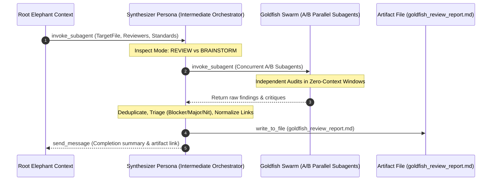

> **原文路径**：`docs/designs/synthesizer.md` | 本文档为中文学习翻译版，保留英文原文件以便对照。

> 💡 **第一性原理提示**：`synthesizer` 的核心价值是**上下文防火墙（Context Firewall）**与**去噪聚合器**。在支持嵌套子智能体的宿主环境中，如果主会话直接扇出 6 到 12 个金鱼评审员，海量原始工具日志会瞬间冲垮大象的上下文窗口；将扇出/扇入封装进中间合成器，既保留了 A/B 双采样带来的高召回率，又确保大象只接收经过去重、分级与链接规范化的精炼产物。

# EGM 合成器智能体人格（蜂群编排与输出聚合）

*   **作者：** Brian Suchy ([@briansuchy](https://github.com/briansuchy))
*   **状态：** Current（现行）
*   **日期：** 2026-07-31

--------------------------------------------------------------------------------

## 概述

**EGM 合成器智能体人格**（`synthesizer`）是一个中间编排层，负责启动多个子智能体并对它们之间的反馈进行去重。它用于整合由 EGM 技能启动的各类子智能体反馈，并在支持嵌套子智能体的运行时（如 Antigravity）中防止主上下文窗口膨胀。

## 问题背景

直接从主用户对话中管理多智能体评审蜂群存在以下挑战：

1.  **上下文污染与 Token 膨胀**：在根会话中直接并发派生 6 到 12 个评审员，会使主上下文窗口充斥着数千 Token 的原始冗长工具输出与中间子智能体通信噪音，从而降低模型的推理能力。
2.  **冗余与重叠的批评意见**：评审同一份文档的多名评审员经常从略微不同的视角（如结构视角 vs. 设计视角）发现同一个底层问题。未经筛选的输出会让人类工程师淹没在重复的评审发现中。
3.  **链接格式不一致**：无状态子智能体经常构造出格式不统一或已损坏的相对文件链接。
4.  **打断聊天流**：将原始评审追踪日志倾倒到用户聊天中违反了产物优先交互协议 (Artifact-First) 原则。

## 系统架构与数据流

## 运行模式

根据调用上下文的不同，合成器以两种截然不同的模式运行：

### 1. `Mode: REVIEW`（文档审计）

*   **冗余子智能体派生（A/B 采样）**：针对请求的每位评审员启动两个独立实例（例如 `Hostile Design Critic A` 和 `Hostile Design Critic B`），以最大化评审发现的召回率，并消除非确定性评估导致的漏检。
*   **角色头衔强制规范**：子智能体角色名必须严格以 `Auditor`、`Reviewer` 或 `Critic` 结尾，以便在执行仪表盘中获得清晰的可观测性。
*   **严重程度分诊**：将所有聚合后的发现划分为三个等级：
    *   🔴 **Blocker（阻塞级）**：架构缺陷、未处理的单点故障（SPOF）、缺失目标文件，或无法解决的依赖冲突。
    *   🟡 **Major（重要级）**：不完整的错误处理、未声明的规模扩展假设，或缺失验证计划。
    *   🟢 **Nit（微瑕级）**：轻微的清晰度问题、术语不一致，或格式偏差。
*   **链接规范化**：为所有引用的行号构造规范的 Markdown 链接：`[path:Lstart-end](path#Lstart-Lend)`。
*   **产物输出**：将整合后的报告写入 `goldfish_review_report.md`（或 `zoom_out_report.md` / `comprehension_report.md`）。

--------------------------------------------------------------------------------

### 2. `Mode: BRAINSTORM`（概念构思）

*   **7 视角蜂群**：跨七个视角并发派生头脑风暴智能体：`Skeptical Architect`（怀疑论架构师）、`Codebase Grounding Auditor`（代码库落地审计员）、`UX & Ergonomics`（UX 与人体工程学）、`Naive Comprehension`（零背景理解）、`Implementation Feasibility`（实现可行性）、`Structural Design`（结构设计），以及 `Inventive Catalyst (Contradiction Resolution)`（发明催化剂：矛盾化解）。
*   **概念合成**：聚合发散想法、突出隐藏风险、识别现有基础设施复用机会，并编译生成统一的 `concepts_brief.md` 产物。

--------------------------------------------------------------------------------

## 智能体间通信契约

1.  **输入参数**：
    *   `TargetFile`：目标文档的绝对路径。
    *   `LineRange`：目标行号范围（或 `full file`）。
    *   `Reviewers`：评审智能体人格简称数组。
    *   `Standards`：评审员到标准 Markdown 文件的键值映射。
    *   `GoldfishContext`：供评审员建立基线的补充阅读清单。
2.  **输出契约**：
    *   合成器严禁在聊天中或通过 `send_message` 输出完整报告正文。
    *   它必须使用文件写入工具将报告写入磁盘。
    *   它仅通过 `send_message` 返回一条消息，内容包含：
        *   按严重程度统计的发现总数。
        *   指向所生成产物的清晰链接。

## 实现文件

| 文件路径 | 类型 | 用途与存在理由 |
| :-------- | :--- | :----------------------------- |
| `agents/synthesizer.md` | 智能体人格提示词 | `synthesizer` 编排智能体人格的系统提示词与运行逻辑。 |
| `.claude-plugin/agents/synthesizer.md` | Claude Code 适配器 | 向 Claude Code 注册合成器、加载智能体人格并配置其工具权限。 |

## 参考资料

*   Dave Rensin, [Elephants, Goldfish, and the New Golden Age of Software Engineering](https://medium.com/@drensin/elephants-goldfish-and-the-new-golden-age-of-software-engineering-c33641a48874) (Medium, 2026).
