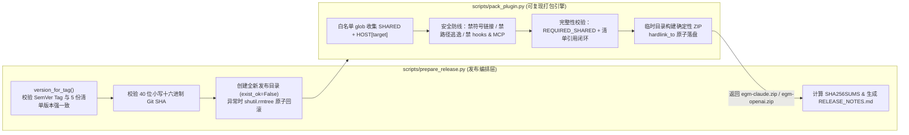

# 构建与发布脚本（`scripts/`）架构导读与源码精解

> **原文路径**：`scripts/pack_plugin.py` & `scripts/prepare_release.py` | 本文档为中文架构导读与代码精解，保留英文原文件以便对照。
>
> 💡 **第一性原理提示**：AI 代理插件（Plugin）本质上是会被注入高权限宿主环境的提示词与配置包。如果打包脚本使用“黑名单排除法”，测试文件、本地密钥或恶意符号链接极易泄漏进发行包；如果 ZIP 构建不可复现，则无法用校验和与供应链证明（Attestation）验真。`scripts/` 下的两个脚本以**白名单打包 + 零信任校验 + 比特级可复现构建 + 跨宿主版本强一致**构建了 EGM 的软件供应链底座。

---

## 1. 整体协作架构

`scripts/` 包含两个职责单一、层层递进的 Python 脚本（均仅依赖标准库）：



---

## 2. `scripts/pack_plugin.py` 深度解析

### 2.1 核心设计哲学：白名单打包（Allowlist Packaging）

与 `.gitignore` 式的黑名单不同，`pack_plugin.py` 严格采用**两级白名单 + 强制必选清单**：

1. **`SHARED`（L12–21）**：所有宿主共享的运行时文件白名单模式，仅涵盖 `plugin.json`、`LICENSE`、`README.md`、技能定义与参考资产、智能体人格、文档标准、核心用户文档及图标资源。仓库里的 `tests/`、`site/`、`.github/`、`docs/designs/` 等开发态文件天然被排除在外。
2. **`HOST`（L22–26）**：按宿主环境隔离的专属资产白名单：
   - `claude`：`.claude-plugin/plugin.json`、`.claude-plugin/icon.png`、`.claude-plugin/agents/*.md`
   - `openai`：`.codex-plugin/plugin.json`
3. **`REQUIRED_SHARED`（L31–54）**：硬性完备性断言。即使 glob 模式匹配到了部分文件，如果 8 个核心技能（`SKILLS`）、10 个智能体人格（含 `bootstrap_orchestrator` 与 `synthesizer`）、5 份文档标准或关键参考 Schema 有任意一份缺失，打包都会立即失败（Fail-Closed）。

### 2.2 纵深安全防线：符号链接、路径逃逸、竞态条件与能力收缩

`build()` 函数在真正写盘前构筑了五道安全防线：

| 防线 | 源码位置 | 校验逻辑 | 防范风险 |
| :--- | :--- | :--- | :--- |
| **拒绝覆盖与源码树自包含** | L62–65 | 检查 `folder` 和 `archive` 均不存在且非符号链接；检查 `folder != root` 且 `not root.is_relative_to(folder)` | 防止覆写已有产物，或输出目录包裹源码目录导致无限递归 |
| **逐段符号链接检查** | L70–72 | 对相对路径的每一个前缀 `relative.parts[:i]` 调用 `.is_symlink()` | 防止通过中间目录的符号链接把仓库外的敏感文件偷渡进 ZIP 包 |
| **真实路径逃逸检查** | L73–74 | `not path.resolve().is_relative_to(root)` | 二次兜底确认解析后的物理路径严格位于仓库根目录内 |
| **禁用 hooks 与 MCP/App 依赖** | L83–87 | 同时检查宿主清单、可移植 `plugin.json` 及 `extensions["com.openai"]`，禁止 `hooks`、`mcpServers`、`mcp`、`apps` | 目录型静态插件包不应隐式注入可执行钩子或外部 MCP 服务依赖，保持纯声明式安全边界 |
| **清单引用闭环校验** | L88–109 | 校验 `agents` 字段以及 OpenAI 的 `composerIcon`/`logo`、Claude 的 `icon`，禁止绝对路径、禁止 `..`，且目标必须存在于本次打包的 `files` 集合中 | 防止清单指向未打包的“悬空资源”或通过 `../` 越界引用 |

### 2.3 比特级可复现 ZIP 与防竞态原子落盘（Lines 112–129）

为什么要把 ZIP 做成**比特级可复现（Bit-for-Bit Reproducible）**？因为只要源码内容相同，无论在哪台机器、什么时间构建，生成的 `.zip` 都拥有完全一致的 SHA-256 哈希值。`pack_plugin.py` 通过 5 个细节实现了这一点：

1. **确定性排序**：`for relative in sorted(files):` 消除文件系统遍历顺序差异。
2. **统一 POSIX 路径分隔符**：`relative.as_posix()` 消除 Windows `\` 与 Linux `/` 的差异。
3. **冻结时间戳**：`zipfile.ZipInfo(relative.as_posix(), (1980, 1, 1, 0, 0, 0))` 锁定为 ZIP 纪元起点，消除构建时间差异。
4. **规范化文件权限与系统标识**：
   - 落地文件夹：`destination.chmod(0o644)`
   - ZIP 条目：`info.create_system = 3`（Unix）、`info.external_attr = 0o100644 << 16`（普通文件 `0644`）、固定压缩算法 `ZIP_DEFLATED`。
5. **防悬空符号链接竞态（TOCTOU）的原子落盘（L112–128）**：
   - 先在同目录下的私密临时目录（`tempfile.TemporaryDirectory(prefix=".egm-", dir=output)`）内以独占模式 `"x"` 完整写入 `staged` ZIP。
   - 最后通过 `archive.hardlink_to(staged)` 将已完成的归档原子链接到最终路径。
   - **关键注释（L126–127）**：在 Windows 上，独占创建文件仍可能跟随一个悬空符号链接；而对已完成文件执行 `hardlink_to` 会直接原子声明最终目录项，**绝不跟随符号链接**，若目标在检查后被并发抢占则直接失败。临时目录退出 `with` 块时自动清理。

### 2.4 函数与 CLI 入口速览

- `build(root: Path, target: str, output: Path) -> tuple[Path, Path]`（L57–129）：核心构建函数，返回 `(runtime_folder, zip_archive)` 二元组。
- CLI 入口（L132–139）：接受 `--target {claude,openai}` 与 `--output <dir>`，自动以脚本上两级目录作为 `root` 执行构建并打印产物路径。

---

## 3. `scripts/prepare_release.py` 深度解析

### 3.1 跨宿主版本强同步（`HOST_MANIFESTS` & `version_for_tag`）

EGM 同时维护多份宿主清单，版本号漂移是发布阶段最常见的人为失误。`prepare_release.py` 定义了 5 份权威发行清单列表（L13–15）：

```python
HOST_MANIFESTS = (
    "plugin.json",
    ".claude-plugin/plugin.json",
    ".codex-plugin/plugin.json",
    ".cursor-plugin/plugin.json",
    ".plugin/plugin.json",
)
```

`version_for_tag(root: Path, tag: str) -> str`（L18–38）执行两道严格门禁：
1. **严格 SemVer Tag 正则**：`r"v(0|[1-9][0-9]*)\.(0|[1-9][0-9]*)\.(0|[1-9][0-9]*)"`——必须以 `v` 开头，三段非负整数，**严禁前导零**（如拒绝 `v01.2.3`）。
2. **五清单逐一核对**：去掉前导 `v` 得到 `version`，逐个读取 `HOST_MANIFESTS` 并断言 `manifest.get("version") == version`，任意一份不一致即抛出 `ValueError`。

### 3.2 `prepare(root: Path, tag: str, output: Path, commit: str) -> None`（Lines 41–90）

该函数负责端到端产出可供人类维护者核验的**草稿发布候选目录（Draft Release Candidate）**：

1. **前置身份核验（L56–58）**：
   - 调用 `version_for_tag(root, tag)` 确认版本一致。
   - 严格校验 `commit` 为 **40 位全小写十六进制字符**（完整的 Git SHA）。注意 Docstring 中极其诚实的边界声明：*脚本不会去查 Git 仓库核实该 commit 是否真的对应当前检出代码（`Local source identity is caller-supplied`），因此最终发布必须依赖 CI 工作流产物与供应链证明（Attestation）。*
2. **不可覆盖与异常全量回滚（L59, L88–90）**：
   - `output.mkdir(parents=True, exist_ok=False)` 确保绝不覆写已有的发布候选目录。
   - 整个构建过程包裹在 `try ... except Exception:` 中；一旦中途任意一步报错，立即执行 `shutil.rmtree(output, ignore_errors=True)` 清理半成品并重新抛出异常，防止残留残缺的发布包。
3. **调用 `pack_plugin.build` 构建双端归档并生成校验和（L61–68）**：
   - 依次对 `"claude"` 和 `"openai"` 调用 `build(root, target, output / "build")`。
   - 将产物重命名为带版本号的 `egm-{target}-{version}.zip`，计算 SHA-256 摘要并按标准 `sha256sum` 格式（双空格分隔：`{digest}  {filename}\n`）写入 `SHA256SUMS`。
4. **生成带审计指引的 `RELEASE_NOTES.md`（L69–87）**：
   - 记录声明的 `commit` 与 `tag`。
   - 给出两层验证命令：
     - 离线哈希校验：`sha256sum -c SHA256SUMS`
     - CI 供应链溯源证明校验：`gh attestation verify FILE --repo google/elephant-goldfish-model --signer-workflow google/elephant-goldfish-model/.github/workflows/release.yml --source-ref refs/heads/main`
   - 明确划定 **Verification** 边界：CI 仅验证了离线单元测试与运行时打包；实机安装、工作流运行、评审员隔离、目录授权与云端宿主支持**并未**由本次构建证明，需由人类维护者在正式发布前补充精确包体（exact-bundle）的宿主实测证据。

### 3.3 CLI 入口（Lines 93–99）

```bash
python3 scripts/prepare_release.py \
  --tag v0.1.0 \
  --commit <40-char-git-sha> \
  --output /tmp/egm-release-candidate
```

该命令将产出完整的草稿发布目录，供维护者审查或 GitHub Actions 发布流水线上传草稿 Release。
