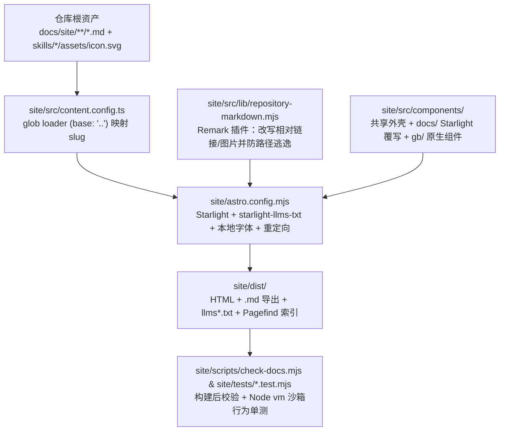

# egm.dev

> **原文路径**：`site/README.md` | 本文档包含 `site/README.md` 的完整忠实中文翻译，以及文末附加的 `site/` 工程架构精解，保留英文原文件以便对照。
>
> 💡 **第一性原理提示**：`site/`（https://egm.dev）不仅是一个静态文档站，更体现了 EGM 的**单一事实来源（Single Source of Truth, SSOT）**与**零隐私侵入（Zero-Telemetry by Default）**原则：文档直接从仓库 `docs/site/` 加载、技能图标直接复用 `skills/*/assets/icon.svg`、仓库内相对链接在构建期自动安全改写为 GitHub URL，并通过 Node 原生 `vm` 沙箱测试严格守卫 Cookie 同意门禁与无障碍交互。

大象-金鱼模型（Elephant-Goldfish Model, EGM）的官方网站与文档站，通过 GitHub Pages 部署于 https://egm.dev 。

| 浅色模式 (Light) | 深色模式 (Dark) |
| --- | --- |
|  |  |

<details>
<summary>整页与移动端预览（Full page and mobile）</summary>


</details>

## 技术栈（Stack）

- [Astro](https://astro.build) 静态站点输出，包含自定义首页与 [Starlight](https://starlight.astro.build) 文档系统。Starlight 提供本地 Pagefind 搜索、响应式侧边栏以及页面目录面板。
- 原生元素形态的 [gBreeze](https://www.npmjs.com/package/@material/web)（`@material/web` `labs/gb`）：页面直接输出该包自有的类名（`btn`、`icon-btn`、`list-item`、`badge`、`divider`）并导入包内样式表。gBreeze 控件使用原生 HTML，不依赖 Lit 运行时。
- Google Sans Flex 与 Google Sans Code 字体，自托管于 `src/assets/fonts/` 目录下（OFL 协议）。

## 规范与约束（Rules）

- 仅通过 gBreeze 令牌（`src/styles/tokens.css`）及组件文档化的自定义属性（Custom Properties）定制主题。请勿直接重写组件盒模型样式。
- 保持技能名称和命令与仓库根目录 README 完全一致。
- **介绍视频（Explainer video）**：`src/components/Explainer.astro` 在按钮内部渲染自托管的海报缩略图，仅在访客点击播放后才创建 `youtube-nocookie.com` iframe。
- **Cookie 与分析统计（仅限 `egm.dev`）**：EGM 插件本身收集**零遥测数据（zero telemetry）**。仅在规范域名 `https://egm.dev` 上（当构建时设置了 `PUBLIC_GA_MEASUREMENT_ID` 且 `window.location.hostname === 'egm.dev'`），页面才会加载 Google Cookie 通知栏（`cookienotificationbar.min.js`）。仅当通知栏报告明确的同意选择且 `loaded.detail.required === true` 后，才会加载 Google Analytics 4（`gtag.js`）。待定（Pending）、拒绝（Rejected）、缺失（Absent）或初始化失败的同意状态绝不会加载 GA。CNB 的非必需回退（non-required fallback）不属于明确同意。文档化的实例 `statuschange` 监听器会更新 Consent Mode v2。撤回同意（Revocation）会在排队发送拒绝状态之前先设置 GA 的测量禁用标志，并阻止后续的 event/config 调用。CNB 使用独立的数据层（data layer），确保其默认行为无法启用分析或广告。Google Signals 与广告存储/个性化保持禁用。脚本在配置前会对 URL 和 Referrer 进行脱敏清理。外部 Fork、预览域名、本地构建以及未设置 Measurement ID 的构建对 Google 主机发起**零请求**。

### 同意机制集成契约（Consent integration contract）

本集成遵循于 2026-10-30 审查的公开 [CNB 脚本](https://www.gstatic.com/glue/cookienotificationbar/cookienotificationbar.min.js)（SHA-256 为 `e99eda4f401f141e55dcf8ccc1baa988e5165c99e89372d126841b8e7d26cd26`）。其构造函数在 `loaded` 上注册全局回调；在拉取配置与存储状态后，触发 `detail: { required, status }`。自动加载的实例可通过 `glue.CookieNotificationBar.instance` 访问。其 `listen('statuschange', callback)` 方法接收 `detail: { status }`。其支持的 `customDataLayerName` 选项用于为自身的同意命令指定独立数据层。浏览器测试夹具（Fixtures）对这些源码契约进行了建模。

Google 的[编程式 Analytics 退出文档](https://developers.google.com/tag-platform/security/guides/privacy#turn_off_google_analytics)指出，标签在设置 Cookie 或发送数据前会检查 `ga-disable-MEASUREMENT_ID`。该检查为库加载后的撤回操作提供了底层依据（包括不经过页面 `gtag` 包装器的自动事件）。撤回操作会在排队发送拒绝同意状态之前先设置该标志。

浏览器检查会拦截每一条网络响应，覆盖待定与拒绝同意、授予同意、脚本执行前后的撤回、重新授予以及禁用状态的构建。其 GA 测试夹具实现了文档化的禁用标志。这些属于集成回归检查，而非对线上 Google 库的实时审计。

## 技能图标（Skill icons）

`src/components/SkillIcon.astro` 通过 `?url` 直接导入规范的 `../skills/egm-*/assets/icon.svg` 文件。网站与插件包共用同一套资产。请勿将它们复制到 `public/` 或在组件中重绘。每个装饰性图标在 40px 圆形表面（使用现有 Surface Token）内呈 28px 显示，并由相邻的技能名称或命令提供无障碍名称（accessible label）。文档页面标题会在每个技能名称旁复用该组件。

## 本地开发（Develop）

```sh
npm install
npm run dev        # http://localhost:4321
npm run check      # astro check
npm run build      # 输出至 dist/
npm run check:docs # 校验已构建的文档路由与 Markdown 导出
npm run capture    # 重新构建，并重新生成 public/og.png 与 screenshots/*.png
```

`npm run capture` 需要本地安装 Chrome（若 Chrome 不在 `PATH` 中，请设置 `CHROME_PATH`）。社交分享预览图来源于 `scripts/og.html`，请编辑该文件而非直接修改 PNG。任何可见改动后都应运行 `npm run capture`，以保持提交的截图同步。

## 搜索元数据（Search metadata）

首页通过 JSON-LD 声明站点名称，并同时链接自适应 SVG Favicon 与 96px PNG 回退图标。PNG 使用 SVG 的浅色主题配色；当 `public/favicon.svg` 变更时须重新生成。构建过程会为首页和每一篇文档页生成 `sitemap-index.xml`。

## 文档系统（Documentation）

`docs` 内容集合从仓库加载 `docs/site/**/*.md`。加载器将这些文件映射为 `/guide`、`/install`、`/getting-started`、`/workflow`、`/skills` 以及 `/skills/<command>`。`docs/site/skills/` 下的每个技能页面面向读者介绍一项技能，并链接回其规范的 `SKILL.md`。

每篇文档页面都有对应的 `.md` URL 并在 HTML 中提供 `<link rel="alternate" type="text/markdown">` 链接。`starlight-llms-txt` 插件负责生成 `/llms.txt`、`/llms-full.txt` 和 `/llms-small.txt`。这些均为纯静态文件，不依赖任何 AI 服务或 API Key。

“Copy page（复制页面）”按钮位于桌面端目录列表下方及移动端标题附近。首页与文档页共用页头、页脚、网格与 gBreeze 控件。构建过程仅拉取一次 GitHub Star 数量，若 GitHub 不可用则省略显示；页头会将超过 1,000 的 Star 数四舍五入到最近的千位。

## 部署（Deploy）

`.github/workflows/deploy-site.yml` 会在每次推送到 `main` 且触及 `site/`、`docs/site/` 或任意技能图标时构建并发布 `dist/`。每日定时构建负责刷新 Star 数量，工作流也支持手动触发（manual dispatch）。`public/CNAME` 用于固定自定义域名。

---

## 附：`site/` 核心工程架构精解

为了帮助学习者看懂 `site/` 如何将 Astro/Starlight 与 EGM 仓库无缝集成，以下按核心模块拆解其架构设计与源码实现：



### 1. `site/astro.config.mjs`（站点总装配置）

- **静态输出与路径规范**：`output: 'static'`、`trailingSlash: 'never'`，确保部署到 GitHub Pages 时 URL 干净一致。
- **Starlight 深度定制**：
  - 通过 `components` 字段覆写了 9 个 Starlight 内部插槽（`Header`、`Head`、`PageTitle`、`PageSidebar`、`ThemeSelect`、`PageFrame`、`Sidebar`、`Pagination`、`MobileMenuToggle`），从而让文档页与自定义首页共享同一套 gBreeze 设计语言与页头页脚。
  - 配置 `starlightLlmsTxt` 插件，自动生成面向 LLM 消费的 `/llms.txt`、`/llms-full.txt` 和 `/llms-small.txt`。
- **Markdown 管线挂载**：`markdown: { processor: unified({ remarkPlugins: [remarkRepositoryLinks] }) }`，在构建期自动把仓库内相对路径转为 GitHub 链接。
- **历史路由重定向（`redirects`）**：把旧版 `/docs/*` 路径统一 301/meta-refresh 重定向到扁平化的 `/guide`、`/getting-started`、`/workflow`、`/skills/*`。
- **零外部字体请求**：使用 `fontProviders.local()` 加载本地 `.woff2` 字体，绝不请求 `fonts.googleapis.com`。
- **现代 CSS 透传与 Worktree 隔离**：Vite 配置 `cssTarget: 'esnext'` 以原样保留 `light-dark()`、`@layer`、`@property` 供 gBreeze 主题切换使用；设置独立 `cacheDir: './.astro/vite'` 避免多 Git Worktree 并行开发时 Vite 缓存冲突。

### 2. `site/src/content.config.ts`（跨目录内容集合加载器）

仅 15 行代码，却实现了“文档不冗余拷贝”的关键设计：
- 使用 Astro 5 Content Layer 的 `glob({ base: '..', pattern: 'docs/site/**/*.md' })`，直接跨出 `site/` 目录读取仓库根目录下的 `docs/site/`。
- `generateId` 去掉前缀 `docs/site/` 和后缀 `.md`，自动将 `docs/site/skills/egm-draft.md` 映射为路由 `/skills/egm-draft`，并由 `docsSchema()` 校验 Frontmatter。

### 3. `site/src/lib/repository-markdown.mjs`（仓库相对链接安全改写器）

这是连接“Git 仓库可读 Markdown”与“静态网站可访问页面”的桥梁，包含三个核心函数：
- **`repositoryLink(url, file, image = false)`**：
  - 放行协议链接（`https:`、`mailto:`）、根相对路径（`/`）、锚点（`#`）以及包含方括号的占位符（如 `[RelativePath]#L1`）。
  - 将相对路径解析为仓库内的绝对物理路径 `local`，并用 `relative(root, local)` 检查是否以 `..` 开头——**一旦试图逃逸出仓库根目录，立即抛出异常**；同时调用 `statSync(local)` 验证目标文件/目录真实存在（断链即 `ENOENT` 报错）。
  - 按目标类型精准改写：图片转为 `https://raw.githubusercontent.com/...`；目录转为 `/tree/main/...`；普通文件转为 `/blob/main/...`。
- **`transformRepositoryMarkdown(tree, file)`**：
  - 若处理的是 `SKILL.md` 且首个 AST 节点为一级标题（`h1`），自动移除该标题以避免与页面主标题重复（保证单页唯一 `<h1>`）。
  - 两遍遍历 AST：先收集所有 `imageReference` 标识符，再改写 `link`、`image` 和 `definition` 节点的 `url`（确保引用式图片 `[mark]: path` 也能正确改写为 `raw.githubusercontent.com`）。
- **`remarkRepositoryLinks()`**：标准 Remark 插件包装器，供 `astro.config.mjs` 挂载。

### 4. `site/src/components/`（三层组件体系）

- **顶层共享组件**：
  - `Home.astro`、`Nav.astro`、`Footer.astro`、`Mark.astro`：站点品牌与首页骨架。
  - `Analytics.astro`：严格执行域名检查、CNB 同意门禁、Consent Mode v2 与 URL/Referrer 脱敏。
  - `Explainer.astro`：点击前仅渲染静态海报与按钮，点击后才动态替换为 `youtube-nocookie.com` iframe 并自动聚焦。
  - `SkillIcon.astro`：通过 `?url` 引用仓库根 `skills/*/assets/icon.svg`，实现图标单一事实来源。
- **`docs/`（11 个 Starlight 覆写组件）**：包括 `Head.astro`（注入 `Analytics` 与 Markdown alternate link）、`PageActions.astro`（Copy page 按钮）、`PageTitle.astro`（技能页自动拼接 `SkillIcon`）、`Search.astro`（Pagefind 集成）等。
- **`gb/`（3 个 gBreeze 原生控件包装）**：`Button.astro`、`IconButton.astro`、`Symbol.astro`，直接输出轻量原生 HTML 类名而零 Lit 运行时开销。

### 5. `site/scripts/check-docs.mjs`（构建后端到端不变量检查）

`npm run check:docs` 运行该脚本，一口气验证五类关键不变量：
1. **GitHub Star 优雅降级**：Mock `globalThis.fetch` 测试正常数字、负数、字符串类型异常、HTTP 失败和网络抛错 5 种场景。
2. **`repository-markdown.mjs` 单元测试**：验证文件链接、锚点、目录链接、内联/引用图片、占位符放行、路径逃逸报错与断链 `ENOENT` 报错，并同时验证 HTML 渲染与 Markdown 导出两条管线。
3. **技能文档全覆盖**：动态扫描仓库 `skills/` 目录，断言每个技能都在 `pages` 路由清单中，且其 `docs/site/skills/<name>.md` 包含指向规范 `SKILL.md` 的链接。
4. **构建产物完整性**：遍历所有 13 个核心页面，校验 `dist/<page>/index.html` 与 `dist/<page>.md` 均存在、每页恰好只有 1 个 `<h1>`、HTML 含 `type="text/markdown"`、Markdown 以 `# ` 开头且无 `<nav` 杂项、所有 `/_astro/*` 静态资产文件真实落盘。
5. **LLM 索引、搜索与重定向**：验证 `llms.txt`、`llms-full.txt`、`llms-small.txt`、`pagefind/pagefind.js` 均已生成，且全部 `/docs/*` 重定向页指向正确目标。

### 6. `site/tests/`（零浏览器依赖的 Node `vm` 沙箱单测）

`site/tests/` 利用 Node 内置 `node:test` + `node:vm`（配合 `typescript.transpile`）直接从 `.astro` 文件提取 `<script>` 代码块并在隔离上下文中执行，做到毫秒级回归测试：
- **`analytics.test.mjs`**：校验 `Base.astro` 与 `docs/Head.astro` 共用 `<Analytics>`；模拟 CNB 实例与自定义数据层，验证 Pending/Rejected/初始化失败绝不加载 GA、仅在明确 `ACCEPTED` 后按顺序更新 Consent Mode v2 再触发 `config`、脱敏 URL 查询参数（仅保留 `utm_source` 等白名单参数，剥离 `private=secret` 与 hash）、禁用 Google Signals 与广告个性化，以及撤回同意时立即置位 `ga-disable-*`。
- **`copy-accessibility.test.mjs`**：测试首页复制命令按钮在剪贴板允许与拒绝两种场景下的 `aria-label` 无障碍名称保持与恢复逻辑。
- **`explainer.test.mjs`**：静态断言点击前 DOM 中绝无 `<iframe>` 或 `youtube.com/embed`，并动态模拟点击按钮验证其替换为带 `autoplay=1&rel=0` 与 `strict-origin-when-cross-origin` 的 `youtube-nocookie.com` iframe 且自动获得焦点。
