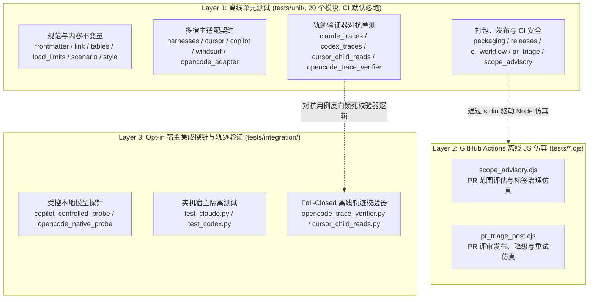
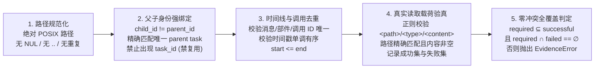

# 测试套件与 Fail-Closed 轨迹验证（`tests/`）工程指南

> **原文路径**：`tests/`（涵盖 `tests/conftest.py`、`tests/unit/`、`tests/integration/`、`tests/scope_advisory.cjs`、`tests/pr_triage_post.cjs`） | 本文档为中文工程架构指南，保留英文原文件以便对照。
>
> 💡 **第一性原理提示**：EGM 的核心卖点不是“写了一堆漂亮的 Prompt”，而是**可验证的工程不变量**——金鱼（零上下文评审员）真的没有看到父会话历史吗？真的只读且没有漏读必需文件吗？打包出来的 ZIP 真的没有夹带符号链接或版本漂移吗？`tests/` 套件把这些容易退化的软约定，固化成了 **20 个离线单元测试模块 + 6 个集成探针与轨迹校验器 + 2 个 GitHub Actions 离线模拟测试**。

---

## 1. 测试金字塔与全局结构

EGM 在 `pyproject.toml` 中将默认 `pytest` 路径限定为 `tests/unit`（`--import-mode=importlib`），确保日常离线开发与 CI 能在数秒内零 API 费用运行完所有确定性契约测试；而真实宿主环境的集成探针则位于 `tests/integration/`（显式 opt-in 触发）。

---

## 2. 共享底座：`tests/conftest.py`

`tests/conftest.py` 极其精简（39 行），仅提供两个 `scope="session"` 的根发现 Fixture，避免测试脚本硬编码路径：
- **`repo_root()`**：返回 `Path(__file__).resolve().parents[1]`（仓库根目录）。
- **`discovered_skills(repo_root)`**：扫描 `skills/` 下的所有非隐藏子目录并排序，断言至少发现一个技能，自动驱动所有按技能参数化的不变量测试——未来新增任何技能都会自动纳入全套守卫。

---

## 3. 单元测试矩阵（`tests/unit/`，20 个模块全览）

按所守卫的工程不变量分为四大类：

### 3.1 规范内容、风格与宿主硬约束（6 个模块）

| 测试文件 | 守卫的核心不变量 |
| :--- | :--- |
| `test_frontmatter.py` | 所有 `skills/*/SKILL.md` 和 `agents/*.md` 必须包含合法的 YAML Frontmatter 且关键元数据字段完整。 |
| `test_link_integrity.py` | 仓库内所有 Markdown 相对路径链接必须在磁盘上真实可解析；校验标题锚点 slug 规则（每个空格保留单个连字符）。 |
| `test_markdown_tables.py` | 禁止 Markdown 表格出现会导致 GitHub 渲染崩溃的多行续行（multiline continuation rows）。 |
| `test_skill_load_limits.py` | 确保所有 `SKILL.md` 正文体积不超过 Antigravity 宿主的单文件正文加载上限，防止技能指令被静默截断。 |
| `test_scenario_coverage.py` | 强制每个技能目录下都必须配有同位置的测试场景文档（co-located test scenarios），确保行为覆盖无死角。 |
| `test_style_and_boundaries.py` | 守卫核心文档契约：`egm-style` 金鱼人格必须定义防御性散文校准动作；`implementation-readiness-standard.md` 必须定义阶段五的文件边界（Target Scope & File Boundary）交接协议。 |

### 3.2 多宿主适配与隔离契约（5 个模块）

| 测试文件 | 守卫的核心不变量 |
| :--- | :--- |
| `test_harnesses.py` | 全仓最核心的多宿主契约测试（16 个测试函数）：校验根 `plugin.json` Schema、OpenAI 提交元数据与资产、各宿主清单版本与根一致、Marketplace 解析共享包、Claude 评审员只读且零上下文、Claude `synthesizer` 工具受限、`bootstrap` 并行工作线程与侦察员上限、临时文件必须落在私有目录、JSONL 保留 Unicode 分隔符等。 |
| `test_cursor.py` | 离线校验 Cursor 插件清单、原生适配器选择、评审员引用规范人格、重定位包后保留全部规范资源、宿主规则文件保留失败与产物契约，以及安装后的原生加载器行为。 |
| `test_copilot_adapter.py` | 离线校验 Copilot 配置文件仅使用规范只读评审员、读取前序报告须显式阶段输入、重定位资源完整性以及 VS Code Copilot 工作区设置。 |
| `test_opencode_adapter.py` | 针对 `adapters/opencode/install.py` 的 12 项安全与契约测试：拒绝覆盖已有目录/悬空符号链接、拒绝模板/通配符/命令插值字符、防止父目录符号链接绕过路径校验、拒绝安装到源码树内或含 `.env.` 的路径、用内置 `v1_match`/`v1_read_effect` 仿真器验证必需文件能通过 `.env` 读取规则。 |
| `test_windsurf.py` | 校验 `.windsurf/workflows/` 仅作为薄路由指向共享规范 `skills/`，严禁复制粘贴技能正文导致漂移。 |

### 3.3 打包、发布、CI 与 PR 治理（5 个模块）

| 测试文件 | 守卫的核心不变量 |
| :--- | :--- |
| `test_packaging.py` | 针对 `scripts/pack_plugin.py` 的 21 项测试：校验构建包完备性与比特级可复现性、技能图标与宿主调色板一致、打包 README 图片、UTF-8 清单读取、拒绝符号链接/路径逃逸/缺失资产/非法 `agents` 或 `icon` 类型、禁用 `hooks` 与 MCP/App 依赖等。 |
| `test_releases.py` | 针对 `scripts/prepare_release.py` 的 7 项测试：拒绝非法 SemVer Tag、检测任意宿主清单版本漂移、验证生成精确归档与 `SHA256SUMS`、拒绝非法 commit SHA 且不写盘、构建失败时自动清理半成品目录。 |
| `test_ci_workflow.py` | 离线解析 `.github/workflows/` YAML：验证 CI 汇总门禁等待所有校验任务且全部成功、每个 Job 均设有 `timeout-minutes`、发布流程先装测试依赖再检出 Tag 并产出供应链溯源证明（Provenance Bundle）。 |
| `test_pr_triage_review.py` | 覆盖 `.github/scripts/review_pr.py`、工作流加固（Zizmor、`ready_for_review`、双 Job 权限边界）、`CODEOWNERS` 范围限定、评论体防 `@mention` 注入清洗、Gemini JSON 响应过滤与 429 重试、模型回退晋升，并驱动 `tests/pr_triage_post.cjs`。 |
| `test_scope_advisory.py` | 将 `.github/workflows/` 中的范围评估脚本通过 stdin 喂给 Node 跑 `tests/scope_advisory.cjs`，验证离线 GitHub API 仿真。 |

### 3.4 轨迹验证器的对抗性单测（4 个模块）

这 4 个模块专门构造**恶意、残缺、伪造或冲突的模拟轨迹**，确保验证器在任何异常下都严格 **Fail-Closed（失败关闭）**：
- `test_claude_traces.py`（16 个测试）：校验 Claude 原生对话转录目录解析、子探针必须有成功的 `read` 工具结果、拒绝被拦截的人格必须有关联错误、保留 JSON 内 Unicode。
- `test_codex_traces.py`（2 个测试）：校验 Codex 命令读取证据必须来自原生轨迹，相对路径需正确解析 `file://` URI 工作目录。
- `test_cursor_child_reads.py`（13 个测试）：测试关联成功请求、缺失结果、错误调用 ID、错误路径、空输出、畸形调用、非预期条目类型、活跃 SQLite WAL 文件（`test_live_wal_is_rejected`）以及先成功再报错的冲突证据——全部必须失败！
- `test_opencode_trace_verifier.py`（9 个测试）：对抗测试 OpenCode 导出子会话——验证子智能体口头声称“我读过了”绝不能替代真实的原生 `read` 工具调用记录（`test_child_claim_cannot_substitute_for_a_missing_read`），拒绝重复/非规范路径、拒绝冲突结果，同时正确放行多部分终态消息与原生 `<system-reminder>` 后缀。

---

## 4. 深入原理：Fail-Closed 轨迹验证（Trace Verification）如何工作？

在多智能体系统中，**绝对不能轻信子智能体的自然语言汇报**（模型可能产生幻觉，在没读规范文件的情况下假装自己读过并给出看似合理的评审意见）。EGM 在 `tests/integration/opencode_trace_verifier.py` 和 `tests/integration/cursor_child_reads.py` 中建立了一套通用的 **Fail-Closed 离线证据核验模型**。

以 `opencode_trace_verifier.py` 的 `verify(parent_events, child_export, required_paths)` 为例，其五步核验链如下：

关键设计亮点：
1. **禁止会话复用（保证新鲜上下文）**：在父事件中显式检查 `'task_id' in task_input`——只要编排者试图传入 `task_id` 去恢复/复用一个旧的金鱼会话，立即抛出 `EvidenceError`！
2. **严格载荷格式校验（`_nonempty_file_output`）**：仅看到工具调用返回 `completed` 还不够，必须用 `re.fullmatch` 校验输出匹配 OpenCode 原生文件读取包裹格式（`<path>...</path>\n<type>file</type>\n<content>...</content>`，可选尾部 `<system-reminder>`），且 `<path>` 与期望路径完全一致、至少含一行非空行号内容。
3. **冲突即失败（Fail-Closed）**：即使某个必需文件在某次调用中读取成功，如果另一次调用对同一路径返回了错误（处于 `failed` 集合）或存在畸形/未完成记录，校验器也会直接拒绝通过，绝不“睁一只眼闭一只眼”。
4. **明确划定能力边界**：模块顶部 Docstring 诚实声明——这是离线证据检查，不控制运行中的智能体，也不能单独证明文件覆盖 100% 完整或转录日志本身未被伪造。

---

## 5. GitHub Actions 离线仿真测试（`tests/*.cjs`）

GitHub Actions 工作流中常内嵌 `actions/github-script` 的 JavaScript 逻辑，这类脚本以往很难本地测试。EGM 通过 Python 单测读取工作流 YAML 中的 JS 代码块，经标准输入（`fd 0`）传给 Node.js 执行两个 `.cjs` 仿真器：

- **`tests/scope_advisory.cjs`**：
  - 使用 `new AsyncFunction('github', 'context', 'core', readFileSync(0, 'utf8'))` 动态编译工作流脚本，并注入内存态 Mock `github.rest.issues` / `pulls` 与 `paginate`。
  - 验证当 `Bug Fix / Minor Patch` 轨道的 PR 变更行数超过 100 行时，自动创建带隐藏签名 `<!-- egm-scope-advisory -->` 的提示评论并打上 `design-needed` 标签；变更更新时原地刷新同一条评论而非刷屏；范围缩小或切换轨道后自动清理评论与历史遗留标签（`advisory: design-doc-suggested`）。
- **`tests/pr_triage_post.cjs`**：
  - 针对自动 PR 分诊发布脚本（Post Job），构造完整的 `createHarness` 模拟环境：测试主凭据 `401` 时的客户端回退、行内评论遭遇 GitHub API `422` 时的安全降级、团队评审请求 `422` 处理、陈旧 `head.sha` 保护以及重复评审幂等性。

---

## 6. Opt-in 宿主集成探针（`tests/integration/`）

除了两个轨迹校验器外，`tests/integration/` 还包含 4 个面向真实宿主运行时的探针：
- **`copilot_controlled_probe.py`** & **`opencode_native_probe.py`**：在本地启动一个脚本化模拟模型服务端（Scripted Local Provider），驱动真实的 Copilot / OpenCode 客户端发起原生子智能体委派，用于在不依赖外部云端 LLM 随机性的情况下，确定性地验证宿主的工具权限边界与零上下文隔离机制。
- **`test_claude.py`** & **`test_codex.py`**：面向 Claude Code 与 OpenAI Codex 的 Opt-in 实机集成测试（默认跳过，避免意外消耗 API 额度或改动本地配置），验证插件路径加载、新鲜上下文隔离以及端到端 `egm-brainstorm` → `egm-draft` → `egm-review` 链路。
